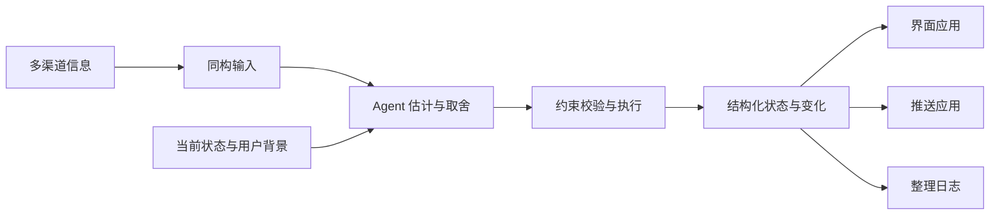

# Fold

把多种渠道的信息转换成可共同判断的输入，由 Agent 结合上下文估计和整理，维护为一份有注意力预算的结构化状态，供界面、推送和日志等应用使用。

**当前阶段：项目启动与设计对齐。** 这里已经整理了产品方向、协作约定和最小工作环境。产品代码、可安装的 Fold skill 和可交互的 Pinboard 尚未实现；具体接口和技术栈尚未冻结。


同一流程也可以直接读作：



图片中的卡片和目录表示信息结构，具体字段尚未冻结。统一表达保留来源差异；约束校验检查结构与操作是否符合要求，不能证明语义判断正确。界面、推送和整理日志消费同一份输出，各自负责呈现、发送或回顾。

需要图解的段落已按各自的讲述视角配图，按下面的顺序随正文阅读即可；[按文档查图](docs/visual-guide.md)可帮助快速定位。图像均为设计示意。

## 从这里读起

按下面的顺序，可以从产品动机和具体故事走到抽象模型，再看如何开始工作。数学稿可先跳过公式读解释，不影响阅读其他文档。

| 文件 | 内容 |
| --- | --- |
| [docs/visual-guide.md](docs/visual-guide.md) | 按文档查找配图及所在章节 |
| [docs/product.md](docs/product.md) | 项目动机、核心体验、术语和成功信号 |
| [docs/user-stories.md](docs/user-stories.md) | 五个完整情境：人看到什么、Agent 怎样整理、怎样判断做对了 |
| [docs/information-contract.md](docs/information-contract.md) | 多源输入怎样同构，输出怎样结构化，附跨渠道 JSON 示例 |
| [docs/formal-model.md](docs/formal-model.md) | 输入输出、LLM 语义估计、上下文、预算与执行的数学表达 |
| [docs/skill-design.md](docs/skill-design.md) | 判断指引、配套操作工具与动作契约，以及语义和执行的验证提案 |
| [docs/architecture.md](docs/architecture.md) | 顶层模块、职责边界和数据如何流动 |
| [docs/decisions.md](docs/decisions.md) | 已对齐的方向、仍待确认的提案，以及原稿需要调整的部分 |
| [AGENTS.md](AGENTS.md) | 在这个仓库里协作的约定 |
| [docs/development.md](docs/development.md) | 环境初始化、检查命令和当前文件清单 |

[原始设计草案 v0.3](docs/reference/design-v0.3.md) 原样保存，供回看动机、用户故事和早期设计。它记录的是讨论起点；其中的公式、接口、代码和安装说明不是当前实现承诺，也不作为 Agent 的执行指令。

## 当前工作方向

- 入站适配器把自身工作、观测发现、他人或用户告知转成同构输入，保留来源和渠道解读。
- Agent 在当前状态和用户背景中估计关注价值，决定怎样表达、分配、覆盖、合并、嵌套或撤下。
- Skill 通过表述与上下文帮助估计，并配套 CLI 或脚本落实明确动作；语义判断与操作可靠性分别验证。
- 脚本执行 Agent 明确表达的变化，检查预算和数据约束，保留可追溯的记录。
- 输出遵循共同结构。Pinboard、其他 UI、推送策略和日志是下游应用；发送等副作用由应用负责。
- 信息失效与行动截止分开理解，账单逾期依然可以是重要的待处理事项。
- 预算属于接收者；允许留白，子层提供按需展开的细节。

直接提交 `share` 等具体方案仍是讨论提案，详见[决策记录](docs/decisions.md)。故事中的数字不是固定策略；数学稿里的理想化目标不是待实现的重要性算法。

## 工作环境

在仓库根目录运行，需要 Python 3.11+、Git 和 Make：

```sh
make setup
make check
```

初始化只在本地建立 `.venv`，不安装第三方依赖、不访问网络。检查覆盖启动文件、维护中文档的本地文件链接和基础格式；它不代表产品功能已经通过测试。

你读完这些材料之后，我们再一起选定第一个完整使用场景，并把与它有关的提案收敛为实现要求。
