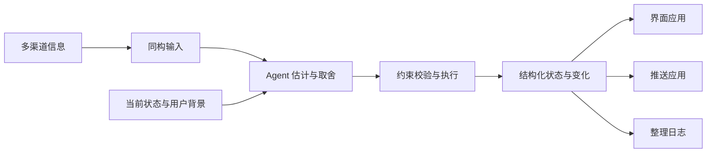

# Fold

把多种渠道的信息转换成可共同判断的输入，由 Agent 结合上下文估计和整理，维护为一份有注意力预算的结构化状态，供界面、推送和日志等应用使用。

**当前阶段：首切片设计基线已完成，产品待实现。** 首切片是 US-01 单 Agent 本地闭环：Agent 声明、注意力分配、文字简报与批注往返，并提供可选的静态状态概览，辅助 Agent 理解 JSON。文档与验收用例已经就位，产品 CLI、概览渲染器和可安装 skill 尚未实现。

另有可独立体验的[交互原型](prototype/README.md)：回放同一段两周情境，比较空间排布、时间展开和流动形态三种表达。演示中的输入与判断预先编排，不代表真实 Agent 已达到相同判断质量。

人离开后再回来，是首个验收场景；Fold 同样适用于人在场时的持续整理。需要立即告知的事情先走即时渠道，再按持续关注价值纳入状态。


同一流程也可以直接读作：



统一表达保留来源差异；约束校验检查结构与操作是否符合要求，不能证明语义判断正确。界面、推送和整理日志消费同一份输出，各自负责呈现、发送或回顾。

## 从这里读起

先理解产品与人的使用过程，再读 Agent 怎样判断和操作，最后查看精确契约与实现边界。

| 文件 | 内容 |
| --- | --- |
| [docs/product.md](docs/product.md) | 项目动机、核心体验、术语和成功信号 |
| [docs/user-stories.md](docs/user-stories.md) | 五个完整情境：人看到什么、Agent 怎样整理、怎样判断做对了 |
| [docs/skill-design.md](docs/skill-design.md) | 何时调用、上下文视图、判断指引、CLI 动作与验证计划 |
| [docs/information-contract.md](docs/information-contract.md) | 外部行为规范：输入输出、操作、版本、回执与呈现 |
| [docs/architecture.md](docs/architecture.md) | 模块边界与持久化规范：保存、恢复和调用如何衔接 |
| [docs/formal-model.md](docs/formal-model.md) | 用数学检查输入输出、语义估计、预算与执行的关系；可先读公式旁的解释 |

准备实现时，接着读 [decisions.md](docs/decisions.md) 的范围、实施顺序和后续问题，再按 [AGENTS.md](AGENTS.md) 与[工作环境说明](docs/development.md)开始工作。[六组一致性用例](conformance/cases)提供验收材料，[配图索引](docs/visual-guide.md)帮助定位图示。

[原始设计草案 v0.3](docs/reference/design-v0.3.md) 原样保存，供回看动机与早期设计，不是现行实现规范。故事、配图与形式模型用于解释；精确外部行为以信息契约为准，持久化以架构为准，范围及实施次序以决策记录为准。

## 工作环境

在仓库根目录运行，需要 Python 3.11+、Git 和 Make：

```sh
make setup
make check
```

初始化只在本地建立 `.venv`，不安装第三方依赖、不访问网络。检查覆盖启动文件、用例文件、维护中文档的本地文件链接和基础格式；它不代表产品功能已经通过测试。

设计中的 `fold state` 可选导出概览与差异 PNG，由 Agent 选择关注范围，工具负责 HTML 布局与真实浏览器截图。普通 JSON 查询不依赖浏览器；可视模块的可选运行环境及验收要求见[工作环境说明](docs/development.md)，参数与产物约定见[信息契约](docs/information-contract.md)。

## 文档与原型体验站

在线体验：[fold.vibecoding.icu](https://fold.vibecoding.icu/)。首页提供三个真实原型预览，点击图片进入同一时刻的对应视图；顶部菜单可直接选择 A、B、C 或原版。

体验站使用 VitePress 构建文档导航、中文搜索、公式和流程图，并在 `/prototype/` 提供完整原型。原始 Markdown 和原型代码仍是内容源；构建时生成站点文件。

使用 Node.js 22+，在仓库根目录执行：

```sh
npm ci
npm run site:dev      # 本地文档与原型，http://127.0.0.1:4174
npm run site:build    # 生成 dist/
npm run site:preview  # 预览构建结果
```

本机 Wrangler 登录后，运行 `npm run deploy` 构建并发布到 Cloudflare Workers Static Assets。部署配置为 `wrangler.jsonc`，只上传 `dist/`；依赖、缓存和本地试验资料不发布。构建目录和依赖均不提交版本库。
