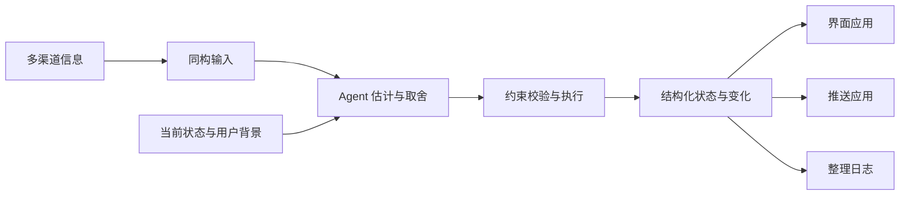

# Fold

把多种渠道的信息转换成可共同判断的输入，由 Agent 结合上下文估计和整理，维护为一份有注意力预算的结构化状态，供界面、推送和日志等应用使用。

**当前阶段：首切片阶段 1 已实现；本地存储、产品 CLI 与概览渲染器尚未实现。** 首切片是 US-01 单 Agent 本地闭环：Agent 声明、注意力分配、文字简报与批注往返，并提供可选的静态状态概览，辅助 Agent 理解 JSON。内存内核、文字简报与用例运行器已就位。

阶段之外，到 2026-10-15 有三条并行工作：

- **判断与评测。** [skill/SKILL.md](skill/SKILL.md) 已改到第二版，做过五次真实模型评测：手写情境上两次逐帧对比作者编排（换过模型与 Harness），混合语料上三次从空状态自由运行两周；第二次语料里加入了作者编写的家庭流，默认演示数据就依据这一次，第三次用第一次的背景重跑含家庭流的语料，用来区分家庭流与背景的影响。结论与局限见[评测索引](docs/evaluations/README.md)。
- **真实语料。** 从公开渠道收集带噪音的真实输入，拼成化名人物 Jonas 的两周，再加上作者编写的家庭往来，共 3217 条（家庭流 388 条）；前四条流用当事人后来的行为推出弱标注，家庭流的标注由作者写定，见[真实语料](corpus/README.md)。
- **原型与形式。** 第二次自由运行的结果经人工打磨（修正逐条记录）成原型的默认演示数据；同一份状态有十二种表达形式，共用一套回应组件，见[交互原型](prototype/README.md)。另一套手写情境的输入与判断预先编排，可切换。演示不代表真实 Agent 已经稳定达到其中的判断质量。

想先快速看懂这项工作，读 16 页的[小册子](docs/brief/index.html)；精确规则以下面的规范为准。各处撞到、还没决定的问题集中在[决策记录的未决问题](docs/decisions.md#未决问题)。

人离开后再回来，是首个验收场景；Fold 同样适用于人在场时的持续整理。需要立即告知的事情先走即时渠道，再按持续关注价值纳入状态。


同一流程也可以直接读作：



统一表达保留来源差异；约束校验检查结构与操作是否符合要求，不能证明语义判断正确。界面、推送和整理日志消费同一份输出，各自负责呈现、发送或回顾。

## 从这里读起

| 想了解什么 | 入口 |
| --- | --- |
| 这项工作在做什么、做到了哪里 | [小册子](docs/brief/index.html)：问题、假设、真实数据、评测、十二种形式与还缺什么，16 页 |
| 产品为什么做、人怎样使用 | [产品方向](docs/product.md)、[用户故事](docs/user-stories.md) |
| 现在的范围、实施顺序与未决问题 | [决策记录](docs/decisions.md) |

### 设计规范

先理解产品与人的使用过程，再读 Agent 怎样判断和操作，最后查看精确契约与实现边界。

| 文件 | 内容 |
| --- | --- |
| [docs/product.md](docs/product.md) | 项目动机、核心体验、术语和成功信号 |
| [docs/domain-model.md](docs/domain-model.md) | 事件、反馈与时间信号的基础形式，以及业务策略怎样影响处理决定 |
| [docs/user-stories.md](docs/user-stories.md) | 五个完整情境：人看到什么、Agent 怎样整理、怎样判断做对了 |
| [docs/skill-design.md](docs/skill-design.md) | 何时调用、上下文视图、判断指引、CLI 动作与验证计划 |
| [docs/information-contract.md](docs/information-contract.md) | 外部行为规范：输入输出、操作、版本、回执与呈现 |
| [docs/architecture.md](docs/architecture.md) | 模块边界与持久化规范：保存、恢复和调用如何衔接 |
| [docs/formal-model.md](docs/formal-model.md) | 用数学检查输入输出、语义估计、预算与执行的关系；可先读公式旁的解释 |
| [docs/decisions.md](docs/decisions.md) | 首切片范围、实施顺序、并行工作的进展与未决问题 |

准备实现时，接着读 [AGENTS.md](AGENTS.md) 与[工作环境说明](docs/development.md)。[六组一致性用例](conformance/cases)提供验收材料，[配图索引](docs/visual-guide.md)帮助定位图示。[原始设计草案 v0.3](docs/reference/design-v0.3.md) 原样保存，供回看动机与早期设计，不是现行实现规范。故事、配图、形式模型与小册子用于解释；精确外部行为以信息契约为准，持久化以架构为准，范围及实施次序以决策记录为准。

### 判断与评测

| 文件 | 内容 |
| --- | --- |
| [skill/SKILL.md](skill/SKILL.md) | 给使用 Fold 的 Agent 的判断指引，第二版 |
| [docs/evaluations/README.md](docs/evaluations/README.md) | 五份评测报告的索引：各是什么设置、一句话结论与费用 |

### 真实语料

| 文件 | 内容 |
| --- | --- |
| [corpus/README.md](corpus/README.md) | 来源调查、许可与入库范围、重建方法、弱标注 |
| [corpus/composite/MIX.md](corpus/composite/MIX.md) | 化名人物 Jonas 的设定、五条流的来源与改写规则（家庭流见 [family/README.md](corpus/composite/family/README.md)） |
| [corpus/composite/NOISE.md](corpus/composite/NOISE.md) | 噪音画像，与工作单流和手写情境并排 |
| [corpus/composite/LABELS.md](corpus/composite/LABELS.md) | 从后续行为推出的弱标注：规则、覆盖与局限 |

### 原型与形式

| 文件 | 内容 |
| --- | --- |
| [prototype/README.md](prototype/README.md) | 运行方式、演示数据、十二种形式的场景与入口 |
| [prototype/forms/CONCEPTS.md](prototype/forms/CONCEPTS.md) | 两轮形式的概念卡与结论、状态里缺的信息、打磨记录索引 |
| [prototype/data/composite/POLISH.md](prototype/data/composite/POLISH.md) | 第二次自由运行怎样打磨成演示数据：与第一次的差别、9 处修正与几类常见错误 |
| [prototype/data/composite/SOURCES.md](prototype/data/composite/SOURCES.md) | 演示数据各流的来源、许可与公开之前要决定的事 |

## 工作环境

在仓库根目录运行，需要 Python 3.11+、Git 和 Make：

```sh
make setup            # 系统 python3 低于 3.11 时：make setup PYTHON=python3.12
make check
make test             # 用内存内核运行一致性用例
make prototype        # 本地原型，http://127.0.0.1:4173
```

初始化只在本地建立 `.venv`，不安装第三方依赖、不访问网络。检查覆盖启动文件、用例文件、维护中文档的本地文件链接和基础格式；它不代表产品功能已经通过测试。

设计中的 `fold state` 可选导出概览与差异 PNG，由 Agent 选择关注范围，工具负责 HTML 布局与真实浏览器截图。普通 JSON 查询不依赖浏览器；可视模块的可选运行环境及验收要求见[工作环境说明](docs/development.md)，参数与产物约定见[信息契约](docs/information-contract.md)。

## 文档与原型体验站

在线体验：[fold.vibecoding.icu](https://fold.vibecoding.icu/)。首页与顶部菜单的“原型体验”都是全部 21 个原型的画册网格（顺序与[合页](prototype/all.html)相同），每张卡片是该原型默认时刻的真实截图；点卡片在当前页的弹框里载入那个原型，可直接逐帧回放与就地回应，也可另开新标签页。默认演示数据与小册子截图含化名改写的真实公开文本，2026-10-15 用户决定照现状公开，来源、许可与已知的署名缺口见 [SOURCES.md](prototype/data/composite/SOURCES.md#公开与许可)。

体验站使用 VitePress 构建文档导航、中文搜索、公式和流程图，在 `/prototype/` 提供完整原型，在 `/docs/brief/` 提供小册子。原始 Markdown 和原型代码仍是内容源；构建时生成站点文件。

使用 Node.js 22+，在仓库根目录执行：

```sh
npm ci
npm run site:dev      # 本地文档与原型，http://127.0.0.1:4174
npm run site:build    # 生成 dist/
npm run site:preview  # 预览构建结果
```

本机 Wrangler 登录后，`npm run deploy` 构建并发布到 Cloudflare Workers Static Assets；只在用户指示时运行。部署配置为 `wrangler.jsonc`，只上传 `dist/`；依赖、缓存和本地试验资料不发布。构建目录和依赖均不提交版本库。
