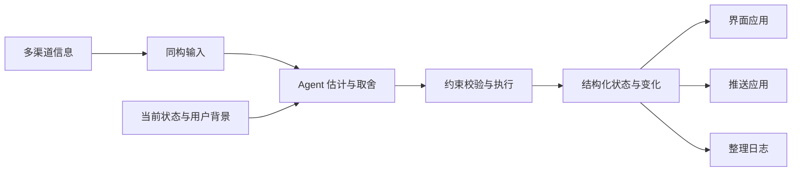

# Fold

把多种渠道的信息转换成可共同判断的输入，由 Agent 结合上下文估计和整理，维护为一份有注意力预算的结构化状态，供界面、推送和日志等应用使用。

**当前阶段：首切片阶段 1 已实现；本地存储、产品 CLI 与概览渲染器尚未实现。** 首切片是 US-01 单 Agent 本地闭环：Agent 声明、注意力分配、文字简报与批注往返，并提供可选的静态状态概览，辅助 Agent 理解 JSON。内存内核、文字简报与用例运行器已就位。

阶段之外，到 2026-11-04 有三条并行工作：

- **判断与评测。** [skill/SKILL.md](skill/SKILL.md) 已改到第二版，做过六次真实模型评测：手写情境上两次逐帧对比作者编排（换过模型与 Harness），混合语料 composite 上三次从空状态自由运行两周（第二、三次含作者编写的家庭流，用来区分家庭流与背景的影响），作者编写的 founder 语料上一次自由运行（2026-11-03），现在的默认演示数据依据这一次。结论与局限见[评测索引](docs/evaluations/README.md)。
- **语料。** 默认的 [founder](corpus/founder/README.md) 是作者编写的创业者陆晨的两周：一家 7 人 AI 小公司的产品技术负责人，主线是第一个大客户九家店上线，工作与生活约 3 : 1，共 2532 条，人物与每一条消息都不来自真实的人，噪音的量照真实数据定，标注由作者写定。旧语料 [composite](corpus/composite/MIX.md) 是化名人物 Jonas 的两周，从公开渠道收集的真实输入化名改写后拼成，加上作者编写的家庭往来，共 3217 条，前四条流用当事人后来的行为推出弱标注。两份的来源与许可见[语料说明](corpus/README.md)。
- **原型与形式。** founder 上那次自由运行的结果经人工打磨（修正逐条记录）成原型的默认演示数据；composite 的演示数据与一套预先编排的手写情境仍可切换（`?data=composite`、`?data=story`）。同一份状态有十二种表达形式，共用一套回应组件，见[交互原型](prototype/README.md)。演示不代表真实 Agent 已经稳定达到其中的判断质量。

想先弄清为什么做这件事，从头读[为什么要做 Fold](docs/why.md)；精确规则以下面的规范为准。各处撞到、还没决定的问题集中在[决策记录的未决问题](docs/decisions.md#未决问题)。

人离开后再回来，是首个验收场景；Fold 同样适用于人在场时的持续整理。需要立即告知的事情先走即时渠道，再按持续关注价值纳入状态。


同一流程也可以直接读作：



统一表达保留来源差异；约束校验检查结构与操作是否符合要求，不能证明语义判断正确。界面、推送和整理日志消费同一份输出，各自负责呈现、发送或回顾。

## 从这里读起

| 想了解什么 | 入口 |
| --- | --- |
| 为什么做这件事、做到了哪里 | [为什么要做 Fold](docs/why.md)：问题从哪来、为什么难、Fold 的两个判断、模型会错在哪、现在做到了哪 |
| 产品为什么做、人怎样使用 | [产品方向](docs/product.md)、[用户故事](docs/user-stories.md) |
| 现在的范围、实施顺序与未决问题 | [决策记录](docs/decisions.md) |

### 设计规范

先理解产品与人的使用过程，再读 Agent 怎样判断和操作，最后查看精确契约与实现边界。

| 文件 | 内容 |
| --- | --- |
| [docs/product.md](docs/product.md) | 项目动机、核心体验、术语和成功信号 |
| [docs/domain-model.md](docs/domain-model.md) | 事件、反馈与时间信号的基础形式，以及业务策略怎样影响处理决定 |
| [docs/user-stories.md](docs/user-stories.md) | 五个完整情境：人看到什么、Agent 怎样整理、怎样判断做对了 |
| [docs/skill-design.md](docs/skill-design.md) | 何时调用、上下文视图、判断指引、CLI 动作与验证计划 |
| [docs/information-contract.md](docs/information-contract.md) | 外部行为规范：输入输出、操作、版本、回执与呈现 |
| [docs/architecture.md](docs/architecture.md) | 模块边界与持久化规范：保存、恢复和调用如何衔接 |
| [docs/formal-model.md](docs/formal-model.md) | 用数学检查输入输出、语义估计、预算与执行的关系；可先读公式旁的解释 |
| [docs/decisions.md](docs/decisions.md) | 首切片范围、实施顺序、并行工作的进展与未决问题 |

准备实现时，接着读 [AGENTS.md](AGENTS.md) 与[工作环境说明](docs/development.md)。[六组一致性用例](conformance/cases)提供验收材料，[配图索引](docs/visual-guide.md)帮助定位图示。[原始设计草案 v0.3](docs/reference/design-v0.3.md) 原样保存，供回看动机与早期设计，不是现行实现规范。故事、配图、形式模型与“为什么要做 Fold”一篇用于解释；精确外部行为以信息契约为准，持久化以架构为准，范围及实施次序以决策记录为准。

### 判断与评测

| 文件 | 内容 |
| --- | --- |
| [skill/SKILL.md](skill/SKILL.md) | 给使用 Fold 的 Agent 的判断指引，第二版 |
| [docs/evaluations/README.md](docs/evaluations/README.md) | 六份评测报告的索引：各是什么设置、一句话结论与费用 |

### 语料

| 文件 | 内容 |
| --- | --- |
| [corpus/README.md](corpus/README.md) | 各份语料的来源、许可与入库范围、重建方法、标注 |
| [corpus/founder/README.md](corpus/founder/README.md) | 默认语料：作者编写的陆晨两周，规模、渠道、写法与检查（设计见 [OUTLINE.md](corpus/founder/OUTLINE.md)） |
| [corpus/founder/NOISE.md](corpus/founder/NOISE.md)、[LABELS.md](corpus/founder/LABELS.md) | founder 的噪音画像（与真实语料实测并排）与作者标注 |
| [corpus/composite/MIX.md](corpus/composite/MIX.md) | 旧语料：化名人物 Jonas 的设定、五条流的来源与改写规则（家庭流见 [family/README.md](corpus/composite/family/README.md)） |
| [corpus/composite/NOISE.md](corpus/composite/NOISE.md) | composite 的噪音画像，与工作单流和手写情境并排 |
| [corpus/composite/LABELS.md](corpus/composite/LABELS.md) | composite 从后续行为推出的弱标注：规则、覆盖与局限 |

### 原型与形式

| 文件 | 内容 |
| --- | --- |
| [prototype/README.md](prototype/README.md) | 运行方式、演示数据、十二种形式的场景与入口 |
| [prototype/forms/CONCEPTS.md](prototype/forms/CONCEPTS.md) | 两轮形式的概念卡与结论、状态里缺的信息、打磨记录索引 |
| [prototype/data/founder/POLISH.md](prototype/data/founder/POLISH.md) | 默认演示数据：founder 上的自由运行怎样打磨成演示，38 处修正（f02 空帧的连带修正与措辞）与没有改的判断分歧 |
| [prototype/data/founder/SOURCES.md](prototype/data/founder/SOURCES.md) | founder 演示数据的来源：全部由作者编写，没有第三方内容 |
| [prototype/data/composite/POLISH.md](prototype/data/composite/POLISH.md) | 旧演示数据：composite 第二次自由运行怎样打磨成演示，9 处修正与几类常见错误 |
| [prototype/data/composite/SOURCES.md](prototype/data/composite/SOURCES.md) | composite 演示数据各流的来源、许可与已知的署名缺口 |

## 工作环境

在仓库根目录运行，需要 Python 3.11+、Git 和 Make：

```sh
make setup            # 系统 python3 低于 3.11 时：make setup PYTHON=python3.12
make check
make test             # 用内存内核运行一致性用例，并自测 founder 语料流水线
make prototype        # 本地原型，http://127.0.0.1:4173
```

初始化只在本地建立 `.venv`，不安装第三方依赖、不访问网络。检查覆盖启动文件、用例文件、维护中文档的本地文件链接和基础格式；它不代表产品功能已经通过测试。

设计中的 `fold state` 可选导出概览与差异 PNG，由 Agent 选择关注范围，工具负责 HTML 布局与真实浏览器截图。普通 JSON 查询不依赖浏览器；可视模块的可选运行环境及验收要求见[工作环境说明](docs/development.md)，参数与产物约定见[信息契约](docs/information-contract.md)。

## 文档与原型体验站

在线体验：[fold.vibecoding.icu](https://fold.vibecoding.icu/)。首页是一页入口：首屏把同一刻 Agent 读过的全部输入铺成一片点，一扇窗随处境改形（骑车、桌前、复盘），窗里重新编码、没用到的原地暗下；往下是为什么这是新问题（一个软件的通知有尽头，Agent 看见的没有）、六种处境按带宽从窄到宽、一种编码的例子（把注意力切成固定的份数：一轮整理的三拍与一张能按的演示卡）、六种处境的原型（各一段循环录像）与其余原型的轮播，演示部分的数字来自默认演示回放的同一刻（f22）；第三轮入口页曾用 `npm run deploy:v2` 先发到 fold-v2.vibecoding.icu，2026-11-03 换到主域；规格、选型与验收见 [site/landing/spec.md](site/landing/spec.md)。顶部菜单的“全部原型”是全部原型（含第三轮的概念动画）的画册网格（顺序与[合页](prototype/all.html)相同），点卡片在当前页的弹框里载入那个原型，可直接逐帧回放与就地回应，也可另开新标签页。默认演示数据 founder 的人物与消息都由作者编写，没有第三方内容，见 [SOURCES.md](prototype/data/founder/SOURCES.md)；旧演示数据 composite 含化名改写的真实公开文本，仍随站点发布、可切换，2026-10-15 用户决定照现状公开，来源、许可与已知的署名缺口见 [composite 的 SOURCES.md](prototype/data/composite/SOURCES.md#公开与许可)。

体验站使用 VitePress 构建文档导航、中文搜索、公式和流程图，在 `/prototype/` 提供完整原型，在 `/docs/why` 提供从头读起的一篇（旧小册子的地址 `/docs/brief/` 跳到这里）。原始 Markdown 和原型代码仍是内容源；构建时生成站点文件。

使用 Node.js 22+，在仓库根目录执行：

```sh
npm ci
npm run site:dev      # 本地文档与原型，http://127.0.0.1:4174
npm run site:build    # 生成 dist/
npm run site:preview  # 预览构建结果
node scripts/check-landing.mjs  # 入口页自动检查（读 dist/）：数字对得上 data.json、七个尺寸无报错无横向滚动、减弱动态给终态、画廊块数等
node scripts/check-why.mjs      # /docs/why 的检查（读 dist/）：七个尺寸无报错无横向滚动、图片都加载、旧地址 /docs/brief/ 能跳过来
```

本机 Wrangler 登录后，`npm run deploy` 构建并发布到 Cloudflare Workers Static Assets；只在用户指示时运行。部署配置为 `wrangler.jsonc`，只上传 `dist/`；依赖、缓存和本地试验资料不发布。构建目录和依赖均不提交版本库。
