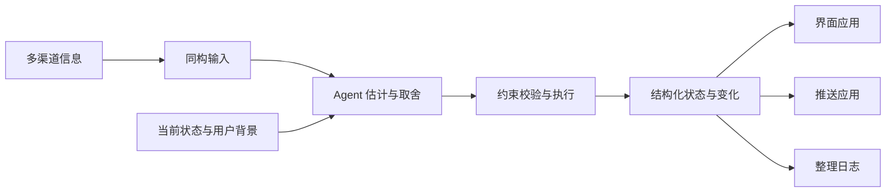

# Fold

把多种渠道的信息转换成可共同判断的输入，由 Agent 结合上下文估计和整理，维护为一份有注意力预算的结构化状态，供界面、推送和日志等应用使用。

**当前阶段：首切片实现要求已冻结，产品代码尚未开始。** 首切片是 US-01 单 Agent 本地闭环：Agent 自己的进度声明、五档档位派生份额、一个 Python CLI、文字简报输出、批注往返。范围与决定见 [docs/decisions.md](docs/decisions.md)。


同一流程也可以直接读作：



统一表达保留来源差异；约束校验检查结构与操作是否符合要求，不能证明语义判断正确。界面、推送和整理日志消费同一份输出，各自负责呈现、发送或回顾。

## 从这里读起

按下面的顺序，可以从产品动机和具体故事走到抽象模型，再看如何开始工作。数学稿可先跳过公式读解释。

| 文件 | 内容 |
| --- | --- |
| [docs/decisions.md](docs/decisions.md) | 已对齐方向、首切片决定、推迟清单 |
| [docs/product.md](docs/product.md) | 项目动机、核心体验、术语和成功信号 |
| [docs/user-stories.md](docs/user-stories.md) | 五个完整情境：人看到什么、Agent 怎样整理、怎样判断做对了 |
| [docs/information-contract.md](docs/information-contract.md) | 声明字段、份额与排序规则、快照与事件结构、消费者 |
| [docs/skill-design.md](docs/skill-design.md) | 何时调用、上下文视图、判断指引、CLI 动作与验证计划 |
| [docs/formal-model.md](docs/formal-model.md) | 输入输出、语义估计、预算与执行的数学表达 |
| [docs/architecture.md](docs/architecture.md) | 顶层模块、职责边界和数据如何流动 |
| [conformance/cases](conformance/cases) | US-01 与 US-03 的一致性用例，先于代码 |
| [docs/visual-guide.md](docs/visual-guide.md) | 按文档查找配图及所在章节 |
| [AGENTS.md](AGENTS.md) | 在这个仓库里协作的约定 |
| [docs/development.md](docs/development.md) | 环境初始化、检查命令和当前文件清单 |

[原始设计草案 v0.3](docs/reference/design-v0.3.md) 原样保存，供回看动机、用户故事和早期设计。其中的公式、接口、代码和安装说明不是当前实现承诺。

## 当前工作方向

- Agent 在当前状态和用户背景中估计关注价值，用五档档位表达比较结果，决定覆盖、合并、嵌套或撤下。
- 脚本按固定映射派生份额，整批校验预算与引用，原子写入，保留 actor 与 reason。超额只报错，不自行让位。
- 存储用时刻，读取用时长；行动截止与信息失效分开，到期不自动撤下。
- 批注保存与已读分开；已读只在 Agent 带 `acknowledges` 的一次实际提交里产生。
- 输出遵循共同结构。文字简报是首个消费者；Pinboard、推送和日志是后续应用。
- 多 Agent 并发、Observation 接入、推送阈值等推迟到后续切片，规则已先写明。

## 工作环境

在仓库根目录运行，需要 Python 3.11+、Git 和 Make：

```sh
make setup
make check
```

初始化只在本地建立 `.venv`，不安装第三方依赖、不访问网络。检查覆盖启动文件、用例文件、维护中文档的本地文件链接和基础格式；它不代表产品功能已经通过测试。

当前切片：US-01，见 [docs/decisions.md](docs/decisions.md)。
