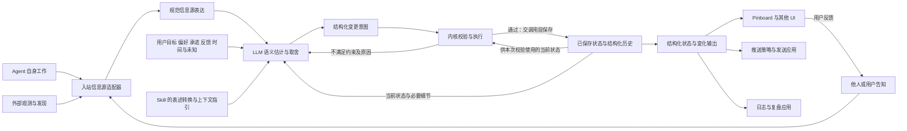

# Fold：顶层架构

状态：启动阶段的设计建议。本文划清职责，不冻结接口、数据格式或技术栈；未决机制集中记录在[决策与开放问题](decisions.md)。产品目标见[产品方向](product.md)，具体往返见[用户故事](user-stories.md)，形式化探索见[数学模型](formal-model.md)。

## 职责边界

**入站适配器统一信息表达，Agent 结合上下文估计和取舍，内核检查和执行，下游应用消费结构化结果。**

*来源一侧也包括 Agent 自身工作产生的进展。内核返回接受结果，调用与存储层负责保存；下游负责展示和发送。分工不意味着现在就拆成多个包。*

| 逻辑部分 | 负责什么 | 边界 |
| --- | --- | --- |
| 入站信息源适配器 | 把 Agent 工作结果、外部观测或发现、他人或用户告知，转换为共同的信息源表达。 | 保留原信息与渠道已有解读及其来源；不按渠道替 Agent 裁定全局重要性，不把格式转换冒充事实核验。 |
| Agent 与 Skill 的判断指引 | 在当前状态、用户目标、反馈、时间和证据的上下文中，进行 LLM 语义估计并决定怎样表达、怎样取舍。 | 指引改善问题表述与上下文供给；估计质量需要验证，不由预算算术保证。 |
| 内核 | 检查声明与结构约束，执行通过校验的变更，产生新状态及变化记录。 | 不自行决定谁不重要，不因超额自动降档、合并或挤出条目。 |
| 存储与运行调用层 | 提供状态与反馈上下文，保存接受的状态、结构化历史与必要来源引用，处理 I/O。 | 不另设整理策略；反馈已保存不等于已读，执行失败不报告为成功。 |
| Skill 配套 CLI、脚本及宿主调用适配器 | 按统一动作契约提供读取、结构操作、校验、提交和查询能力，衔接内核与存储调用。 | 固定动作含义与返回语义，不另写一套取舍策略；这是调用适配，不等于入站信息源适配，也不承担下游发送。MCP 等其他包装按宿主需要选择。 |
| 下游消费者 | UI、Pinboard、文字简报、推送策略与日志应用，按用途排序、过滤、呈现或采取后续动作。 | 不因自身排版或过滤回写、篡改共同状态；推送策略与发送不进入通用内核。 |

这些是逻辑边界，不代表现在就建立各个包或运行服务。最初可以选一种输入、一种宿主入口与一种输出用途，用少量文件验证完整路径。

Skill 的交付包括判断指引和成套可执行操作能力。配套工具可以把内核与调用层封装成连贯入口，让使用 Fold 的 Agent 按概念动作工作，无需临时实现状态读写、预算计算或关联维护；打包在一起不改变各层职责。具体能力、动作契约与失败恢复见[Skill 设计](skill-design.md)。

## 预期数据流

图中是数据依赖，不限定调用次数或进程数量。CLI、MCP 或宿主工具可承载这些读取与提交，不改变入站、估计、执行、出站的职责。

已保存状态有两条用途不同的读取路径：Agent 用它比较新旧信息、重新估计关注价值，调用层也把当前状态交给内核，检查变更引用、预算与关系约束。内核返回接受结果后仍需由调用层完成保存，才成为可继续读取的已保存状态；校验通过不能替代保存成功，保存失败不能报告为更新完成。

Agent 需要看见同层摘要、预算与份额、新变化及来源、用户目标与未处理反馈，并按需补充细节历史。已有份额很小，不能成为屏蔽重估证据的理由。具体提案见[skill 设计](skill-design.md)。

预算不足时，内核返回具体错误，Agent 重新估计与整理。记录批注只说明反馈已保存；何时读取、怎样标记处理结果及如何触发下一轮，仍需设计，图中不隐含调度服务。

## 共享的数据契约边界

不同输入渠道应共享一种规范信息源表达，不同消费者应共享预定义的状态与变化结构；输入、变更声明和输出不必采用同一个 schema。[信息契约](information-contract.md)给出邮件、用户留言到同一结构化状态的完整例子。下面列的是概念，不冻结准确字段名、必填性、序列化方式或运行时。

| 概念 | 可能需要表达的内容 | 尚未确定的部分 |
| --- | --- | --- |
| 规范信息源 | 身份或去重标识（id）、来源（source）、原内容或引用（payload）、渠道已有解读（interpretation）、事件与观测时间（time）、出处与转换沿革（provenance）、未知或可靠性说明。 | 原文与引用怎样保存，来源解读如何标注，冲突与重复怎样处理。统一结构不证明事实真实。 |
| 条目 | 稳定身份、标题与摘要、份额或分配意图、事项性质、来源、可选子层。 | 份额是否直接申报，排序怎样表达，字段和文本长度限制。 |
| 层 | 所属上下文、预算、当前条目。 | 预算单位、整数要求、上下限，以及跨媒介的对应关系。 |
| 变更声明 | 目标条目、新内容、关系调整、估计依据、整理原因与声明者。 | 提交目标状态还是操作列表；直接申报份额仍是提案。 |
| 状态与变化输出 | 可供程序处理的身份、结构、顺序或关注信号、状态及来源关联；可包含自然语言摘要、理由与未知。 | 重要性与紧迫性等信号的表达、校准尺度、各消费者需要的投影。 |
| 时间信息 | 创建与更新时间，以及经明确区分的行动截止或信息失效语义。 | 是否需要专用字段、是否自动撤下、由谁触发时间变化。 |
| 反馈 | 原始批注、作者、关联条目与记录时间。 | 已读和已处理的含义，合并或撤下后如何保持可达。 |
| 历史 | 结构化的变化、操作者、原因、时间及必要来源引用。 | 事件与快照如何组合，输入资料保留范围与回放方式。 |

结构化输出不排斥自然语言。程序依赖约定的字段进行排序、过滤和状态管理，人和模型通过摘要、解释与来源理解其含义。

## 下游复用与副作用

用户消息“那篇文章明天讨论要用”和外部观测“机票报价已失效”经各自适配器进入共同输入。Agent 结合当前状态估计后，输出讨论材料的关注变化与机票状态变化。这份结果可以同时供 UI 展示、推送策略筛选和日志应用记录，不要求为每个消费者重新裁定一套事实。

Pinboard 自己处理坐标、阅读方向、稳定布局与展开。其他 UI 可选择不同呈现；若媒介装不下，需要定义适配或请求重新表达的机制，不能静默改变源状态里的份额与内容。

推送应用可以用结构化的重要性、紧迫性等信号和可配置阈值判断是否通知。其含义与尺度需要校准，策略还可考虑用户偏好与渠道约束；不能直接把 `share` 或面积等同于是否发送。选渠道、实际发送和发送结果均属于下游，核心状态变化不等于通知已送达。

详尽日志需要获得并保存结构化变更历史及必要来源引用。当前快照或有损摘要不足以恢复全部输入；如果要求回看原文，引用对象也必须留存可读。保存粒度、期限与范围仍待确定，不能将“支持追溯”描述成已具备完整原始档案。

## 建议采用的实现方向

- **内核保持纯函数。** 将“当前状态、变更声明、配置、时间”作为显式输入，返回结果或可操作的错误。文件、网络与时钟读取放在调用层，方便重复验证同一个场景。
- **先验证，再写入。** 不合法的引用、预算或层级应在改变持久化状态之前被发现。一次整理是否必须原子提交，仍需确认。
- **把失败交回判断者。** 错误指出具体约束与当前值，例如“总份额超过预算”，让 Agent 自己决定删减什么。
- **为多 Agent 留出并发边界。** 共享预算需要读写一致性；版本检查并要求冲突方重读，是候选方案之一。
- **反馈与历史跟随内容变化。** 覆盖、合并或撤下不能让用户的反馈无从查找；具体关联与继承规则需要样例验证。
- **用一份源说明教 Agent。** 如果将来同时交付 skill 和 SDK 指引，优先由同一份内容生成，避免两种用法教出不同规则。

纯函数、原子提交、版本检查与生成方式均为当前建议；技术选型和第一版交付边界尚未决定。

## 实现前先验证什么

用[五个用户故事](user-stories.md)对齐预期：同一事项有新进展、几个事项合并、预算已满却出现更重要的事项、账单逾期、临时报价失效、用户反馈，以及两个 Agent 基于同一旧状态整理。

再加入不同来源表达同一事实，以及同一输出供 UI、推送和日志复用的样例，检查出处、渠道解读与未知是否在适配中丢失。

语义估计是可执行且需要评估的环节：[skill 设计](skill-design.md)提出等义改写、相关背景变化、上下文缺失与旧版本等对照。内核测试检查结构与执行；不能用脚本确定性证明模型估计正确，也不应把某一次合理选择写成唯一的重要性算法。

数学模型帮助描述信息适配、语义估计、受约束状态变化与下游消费；具体数据契约、原子提交、存储和调用方式仍处于设计探索，尚未实现。

下一步应先审阅这些边界与[开放问题](decisions.md)，选定一条完整使用路径，再决定数据契约、运行时和最小实现。
