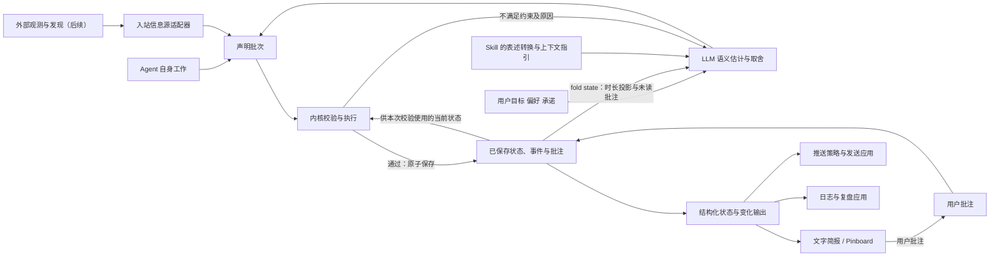

# Fold：顶层架构

状态：设计稿。本文划清职责；首切片的实现范围与未决问题见[决策记录](decisions.md)。产品目标见[产品方向](product.md)，具体往返见[用户故事](user-stories.md)，形式化探索见[数学模型](formal-model.md)。

## 职责边界

**入站适配器统一信息表达，Agent 结合上下文估计和取舍，内核检查和执行，下游应用消费结构化结果。**

*来源一侧也包括 Agent 自身工作产生的进展。内核返回接受结果，调用与存储层负责保存；下游负责展示和发送。*

| 逻辑部分 | 负责什么 | 边界 |
| --- | --- | --- |
| 入站信息源适配器（后续切片） | 把外部观测或发现、他人或用户告知，转换为共同的信息源表达。 | 保留原信息与渠道解读及其来源；不按渠道替 Agent 裁定全局重要性。 |
| Agent 与 Skill 的判断指引 | 在当前状态、用户目标、反馈、时长和证据的上下文中，进行语义估计并决定怎样表达、怎样取舍。 | 指引改善问题表述与上下文供给；估计质量需要验证，不由预算算术保证。 |
| 内核 | 检查声明批次与结构约束，派生份额与 rank，执行通过校验的变更，产生新状态及事件。 | 不自行决定谁不重要，不因超额自动降档、合并或挤出条目。 |
| 存储与调用层 | 提供状态与批注，保存接受的状态、事件和来源附件，处理 I/O 与原子写入。 | 不另设整理策略；批注已保存不等于已读。 |
| Skill 配套 CLI | 按统一动作契约提供 `state`、`commit`、`annotate`、`history`。 | 固定动作含义与返回语义；这是调用适配，不等于入站信息源适配。 |
| 下游消费者 | 文字简报、Pinboard、推送策略与日志应用，按用途排序、过滤、呈现或采取后续动作。 | 不因自身排版或过滤回写共同状态；推送发送不进入通用内核。 |

这些是逻辑边界，首切片用一个 Python 脚本和一个本地目录实现全部路径。

## 预期数据流

图中是数据依赖，不限定调用次数或进程数量。

已保存状态有两条读取路径：Agent 用时长投影比较新旧信息、重新估计关注价值；调用层把当前状态交给内核，检查引用、预算与关系约束。校验通过且原子写入成功，才返回新 revision。

预算不足时，内核返回具体错误，Agent 重新估计与整理。批注事件只说明反馈已保存；只有 Agent 在 commit 中 `acknowledges` 才记为已读。Fold 不自带调度服务，Agent 何时再次运行由宿主决定。

## 共享的数据契约边界

不同输入渠道共享一种规范信息源表达，不同消费者共享预定义的状态与变化结构；输入、声明和输出不必采用同一个 schema。字段定义见[信息契约](information-contract.md)。

| 概念 | 表达的内容 | 后续切片 |
| --- | --- | --- |
| 规范信息源 | 身份、来源、原内容或引用、渠道解读、事件与观测时间、出处。 | 原文保存、冲突与重复处理。 |
| 条目 | 稳定身份、标题与摘要、档位与派生份额、kind、status、时间字段、批注、来源附件、可选子层。 | 字段长度是否需要按媒介调整。 |
| 层 | 预算、已用份额、当前条目。 | 跨媒介是否重算预算。 |
| 声明批次 | 若干声明、acknowledges、actor、读取时的 revision。 | 多 Agent 的改写权与 yield_request。 |
| 状态与变化输出 | 快照与事件流，含 revision、actor、reason。 | 推送阈值的字段语义。 |
| 时间 | 存时刻，读时长；`due_at` 与 `stale_after` 分开。 | 自动失效的触发点。 |
| 批注 | 原文、作者、关联条目、保存时间、已读绑定的 revision。 | 合并或撤下后的可达性规则。 |
| 历史 | 已接受事件、actor、reason、时间及来源引用。 | 快照与事件的组合、保存期限。 |

## 下游复用与副作用

同一份结果可以同时供文字简报展示、推送策略筛选和日志应用记录，不要求为每个消费者重新裁定一套事实。

Pinboard 自己处理坐标、阅读方向、稳定布局与展开。若媒介装不下，渲染器用显式折叠规则适配，不改变源状态里的份额与内容。

推送应用用 `kind` 与 `weight` 和可配置阈值判断是否通知；选渠道、实际发送和发送结果均属于下游。

详尽日志保存结构化变更历史及来源附件。当前快照或有损摘要不足以恢复全部输入；需要回看原文时，引用对象必须留存可读。

## 实现方向

- **内核保持纯函数。** 将“当前状态、声明批次、配置、now”作为显式输入，返回结果或可操作的错误。文件读写和时钟放在调用层。
- **先验证，再写入。** 不合法的引用、预算或层级在改变持久化状态之前被发现；一次整理整批原子提交。
- **把失败交回判断者。** 错误指出具体约束与当前值，例如“预算 64，声明 88，超出 24”，让 Agent 自己决定删减什么。
- **为多 Agent 留出并发边界。** 事件带 actor；revision 检查与条目改写权在接入第二个 Agent 时启用。
- **反馈与历史跟随内容变化。** supersede 和 merge 继承批注，withdraw 保留批注与原因。
- **用一份源说明教 Agent。** 将来同时交付 skill 和 SDK 指引时，由同一份内容生成。

## 实现前先验证什么

[conformance/cases](../conformance/cases) 用 US-01 和 US-03 覆盖：同一事项有新进展、几个事项合并、子层保留、批注继承与 acknowledge、预算已满时整批拒绝、Agent 自行让位、撤下可查原因。先写用例再写代码。

语义估计是需要单独评估的环节：[skill 设计](skill-design.md)提出等义改写、相关背景变化、上下文缺失与旧版本等对照。内核测试检查结构与执行，不能用脚本确定性证明模型估计正确。
