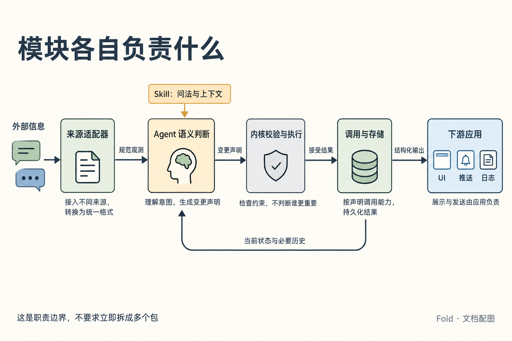

# Fold：顶层架构

状态：设计基线。本文定义模块职责与本地持久化方法；外部操作与回执以[信息契约](information-contract.md)为准，实现顺序与后续范围见[决策记录](decisions.md)。产品目标见[产品方向](product.md)，具体往返见[用户故事](user-stories.md)，形式化解释见[数学模型](formal-model.md)。

## 职责边界

**入站适配器统一信息表达，Agent 结合上下文估计和取舍，内核检查和执行，下游应用消费结构化结果。**

*来源一侧也包括 Agent 自身工作产生的进展。内核返回接受结果，调用与存储层负责保存；下游负责展示和发送。*

| 逻辑部分 | 负责什么 | 边界 |
| --- | --- | --- |
| 入站信息源适配器（后续切片） | 把外部观测或发现、他人或用户告知，转换为共同的信息源表达。 | 保留原信息与渠道解读及其来源；不按渠道替 Agent 裁定全局重要性。 |
| Agent 与 Skill 的判断指引 | 在当前状态、用户目标、反馈、时长和证据的上下文中，进行语义估计并决定怎样表达、怎样取舍。 | 指引改善问题表述与上下文供给；估计质量需要验证，不由预算算术保证。 |
| 内核 | 检查声明批次与结构约束，派生份额与 rank，执行通过校验的变更，产生新状态及事件。 | 不自行决定谁不重要，不因超额自动降档、合并或挤出条目。 |
| 存储与调用层 | 提供状态与批注，保存完整批次记录，维护快照缓存，处理互斥、重复请求与中断恢复。 | 不另设整理策略；写入成功与回执送达分别处理。 |
| Skill 配套 CLI | 按统一动作契约提供 `state`、`commit`、`annotate`、`history`。 | 固定动作含义与返回语义；这是调用适配，不等于入站信息源适配。 |
| 下游消费者 | 文字简报、Agent 静态概览、Pinboard、推送策略与日志应用，按用途呈现或采取后续动作。 | 不因自身排版或过滤回写共同状态；推送发送不进入通用内核。 |

这些是逻辑边界，首切片用一个 Python CLI 和一个本地目录交付。内核、存储与渲染保留可独立调用的函数边界，便于先在内存中验证用户体验，再接入文件存储。

## 预期数据流

图中是数据依赖，不限定调用次数或进程数量。

已保存状态有两条读取路径：Agent 用时长投影比较新旧信息、重新估计关注价值；调用层把恢复后的当前状态交给内核，检查引用、预算与关系约束。接受写入后返回批次回执；有业务变化或新增批注确认才增加 revision，无变化检查仍可保存记录。

预算不足时，内核返回具体错误，Agent 重新估计与整理。批注保存后为 `saved`，只有 Agent 在成功的 commit 中 `acknowledges` 才成为 `acknowledged`；两者分别表达尚未收到处理确认与已确认，不推断实际阅读或行动结果。Fold 不自带调度服务，Agent 何时再次运行由宿主决定。

## 共享的数据契约边界

不同输入渠道共享一种规范信息源表达，不同消费者共享预定义的状态与变化结构；输入、声明和输出不必采用同一个 schema。字段定义见[信息契约](information-contract.md)。

| 概念 | 表达的内容 | 后续切片 |
| --- | --- | --- |
| 规范信息源 | 身份、来源、原内容或引用、渠道解读、事件与观测时间、出处。 | 原文保存、冲突与重复处理。 |
| 条目 | 稳定身份、标题与摘要、档位与派生份额、kind、status、时间字段、批注、来源附件、可选子层。 | 字段长度是否需要按媒介调整。 |
| 层 | 预算、已用份额、当前条目。 | 跨媒介是否重算预算。 |
| 声明批次 | JSON 对象含 batch_id、declarations、acknowledges；actor 与 now 为显式命令参数。 | 多 Agent 的基准 revision、改写权与 yield_request。 |
| 状态与变化输出 | 快照与完整批次记录，含 event_seq、batch_id、revision、actor 与变化依据。 | 推送阈值的字段语义。 |
| 时间 | 存时刻，读时长；`due_at` 与 `stale_after` 分开。 | 自动失效的触发点。 |
| 批注 | 原文、作者、关联条目、保存时间、saved / acknowledged 与首次确认 revision；合并或撤下后保持可达。 | 跨渠道反馈的身份关联。 |
| 历史 | 以事件为事实源，快照为可重建缓存；按批次或条目查询操作与来源。 | 保存期限及远程恢复。 |

首切片没有采集用户查看的入口，`last_seen_at` 和 `since_seen` 一律为 null；Agent 读状态、用户批注和处理确认都不产生阅读证据。`last_checked_at` 来自最近的 checked 记录，只表示 Agent 的无变化检查。

## 本地提交与恢复

一个本地目录保存 `events.jsonl` 与 `snapshot.json`。前者是事实来源，后者记录已经应用的 `last_event_seq`，用于加速读取；两份文件不依赖跨文件原子替换来维持一致。

每个接受的写请求只追加一条 JSONL 批次记录，包含完整 changes、确认信息和恢复所需的确定结果。type 为 commit、acknowledge、checked 或 annotation。每条记录都递增 event_seq；revision 仅随业务变化或新增确认递增，不能用 revision 定位事件流。

所有写入在同一个本地互斥范围内执行下列步骤，用户保存批注也走这条路径：

1. **恢复当前状态。** 检查事件流并将快照推进到最后一条完整记录。末尾未写完、没有换行终止的残片不算接受记录，在互斥保护下移除后才允许继续追加；完整行若无法解析或破坏事件顺序，报告存储损坏，不能静默跳过。
2. **核对请求身份。** 查询已保存的 batch_id，按[批次与回执](information-contract.md#批次与回执)的比较规则处理重复与冲突；这一步先于候选计算，不因重试重新使用调用时间更新状态。仅尚未接受的请求继续执行。
3. **构造并校验候选。** 应用补丁、继承和份额派生，检查最终预算、引用与层级。再区分业务变化、新确认和无变化，确定记录类型及 revision。校验拒绝不写事件、不占用已提交 ID。
4. **保存完整批次。** 追加以换行终止的完整 JSON 记录并同步文件；首次创建日志时也同步所在目录。同步成功后已经提交；此后不能因快照写入或回执输出失败宣称“没有写入”。中断后能否找到完整记录，由恢复流程确认。
5. **更新缓存并返回。** 用临时文件写出并同步新快照，再原子替换 snapshot.json，完成所需目录同步后返回回执。若缓存未更新完，下次读取从事件恢复；事件不因缓存失败而撤销。

`state` 和 `history` 返回结果前也要在同一互斥保护下检查恢复，避免暴露半条批次或过期缓存。重放直接应用记录中已确定的变化、时刻和确认绑定，不重新运行 Agent、不用新的 now 重新判定旧声明。对完整记录的同步也要在恢复后完成，才能将它作为已确认保存的结果返回。

互斥范围内的重复检查保证历史查询与重试之间即使原调用落地，也不会被执行两次。无法取得互斥或完成恢复时，查询仍是未知，不能回答“未找到”。对外的重试指引和冲突回执集中在[信息契约](information-contract.md#批次与回执)，不以本地原子写入假定回执必达。

内核保持纯函数，存储层围绕它完成上述协议，CLI 将同一套结果翻译成契约定义的回执。批次中保存首次接受的输入时间、确定变化与回执，后续重复调用的时间不覆盖它们。

## 下游复用与副作用

同一份结果可以同时供文字简报展示、推送策略筛选和日志应用记录，不要求为每个消费者重新裁定一套事实。

Pinboard 自己处理坐标、阅读方向、稳定布局与展开。若媒介装不下，渲染器用显式折叠规则适配，不改变源状态里的份额与内容。

推送应用用 `kind` 与 `weight` 和可配置阈值判断是否通知；选渠道、实际发送和发送结果均属于下游。

详尽日志保存结构化变更历史及来源附件。当前快照或有损摘要不足以恢复全部输入；需要回看原文时，引用对象必须留存可读。

## state 的可视渲染

overview 是现有读取路径上的可选消费者，接口与等价范围见[视觉概览规范](information-contract.md#state-的视觉概览与-diff)。不改状态树、事件协议或四个 CLI 子命令，也不为静态图片建立新的业务状态。

调用层在恢复并捕获状态时固定 source_event_seq、revision 与调用方的 now；需要 diff 时同时恢复指定基线。释放存储锁后，向 JSON 输出和渲染器传递同一份不可变读取结果。截图期间的新提交不会混入本次图片，图上版本足以说明它对应哪次状态。

渲染路径为：**已捕获状态与基线 → 确定性 diff 与内容选择 → 布局用的数据 → HTML/CSS → 浏览器完成排版 → PNG 与渲染说明**。完整 diff 先于选择计算，以便说明未展示的变化；布局只改变呈现，不重新分配预算或改写事实。相同 ID 在对比中对应同一条目，移位不能被当作内容变化。

首切片采用工具维护的 HTML 模板与浏览器截图。文本按数据转义，不执行条目内容中的 HTML/脚本、不自动访问 sources 链接；字体、样式和渲染资源由工具控制。等字体与布局就绪再截图，检查选定文字是否溢出，必要时分图并保留版本、层级与续页标记。

Python 标准库继续承担内核、存储和普通 CLI。图像生成额外需要可选的浏览器运行环境，隔离在渲染适配层；普通 JSON 读取不加载它，缺失时按契约报告图像失败。输出放在与状态存储分离的专用产物目录，成功产物与失败说明明确区分，重复使用目录也不返回旧图片充当新结果。

验收分别检查语义投影与实际截图：前者核对 JSON、选择范围、diff 和只读行为；后者必须打开真实 PNG、核对 DOM 文本与状态、验证字体和长内容可读。只测试渲染数据或检查“文件存在”，不能声称视觉工具已完成。

## 实现方向

- **内核保持纯函数。** 将“当前状态、声明批次、配置、now”作为显式输入，返回结果或可操作的错误。文件读写和时钟放在调用层。
- **先验证，再写入。** 不合法的引用、预算或层级在改变持久化状态之前被发现；一次整理以完整批次记录提交，快照从事件恢复。
- **把失败交回判断者。** 错误指出具体约束与当前值，例如“预算 64，声明 88，超出 24”，让 Agent 自己决定删减什么。
- **为多 Agent 留出并发边界。** 事件带 actor；revision 检查与条目改写权在接入第二个 Agent 时启用。
- **反馈与历史跟随内容变化。** supersede 和 merge 继承批注，withdraw 保留批注与原因。
- **用一份源说明教 Agent。** 将来同时交付 skill 和 SDK 指引时，由同一份内容生成。

## 实现前先验证什么

[conformance/cases](../conformance/cases) 覆盖用户往返、预算取舍、批次恢复、补丁与子树、首切片操作边界。实现按[阶段顺序](decisions.md#实现顺序与完成标准)推进，不要求先写完文件恢复才看到文字简报；最终仍需通过完整行为验收。内核直接调用与真实子进程中断各验证不同层面，测试组织见[工作环境](development.md)。

语义估计是需要单独评估的环节：[skill 设计](skill-design.md)提出等义改写、相关背景变化、上下文缺失与旧版本等对照。内核测试检查结构与执行，不能用脚本确定性证明模型估计正确。
