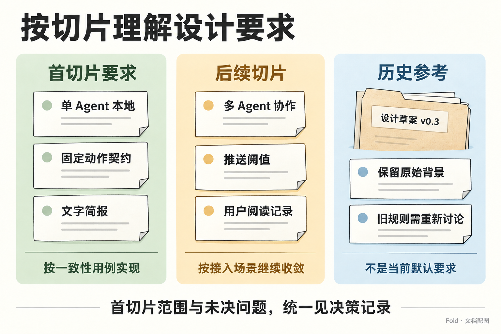

# 决策记录

状态：首切片设计基线已完成；阶段 1（内存中的完整往返）已实现，阶段 2、3 待实现。阶段之外，判断评测、真实语料、演示数据与表达形式四条并行工作到 2026-10-15 的进展列在实施顺序表末尾，各处撞到的问题集中在[未决问题](#未决问题)。本文记录范围、取舍理由、实现顺序与后续问题；外部行为唯一定义在[信息契约](information-contract.md)，本地持久化方法唯一定义在[架构](architecture.md#本地提交与恢复)。故事、Skill 和数学说明可从各自视角重复解释，但不另立协议。

背景见[原始设计 v0.3](reference/design-v0.3.md)。产品意图见 [product.md](product.md)，职责边界见 [architecture.md](architecture.md)，工作方式见 [development.md](development.md)。

## 已对齐的方向

*首切片、后续切片与历史参考的效力不同；具体范围与未决问题以本记录为准。*

- **泛化输入与结构化输出构成产品边界。** 输入可以来自 Agent 自身工作、外部观测或用户告知；输出是预定义结构，供 UI、推送与日志消费。Pinboard 和推送发送都是下游应用。
- **LLM 让语境估计成为可调用的环节。** Agent 结合当前状态和用户背景估计关注价值；Skill 通过表述转换与上下文供给帮助估计。估计质量需要用场景验证。
- **Agent 做判断，脚本守边界。** 重要性、让位和合并由 Agent 决定；脚本执行明确操作、检查约束、保留记录，不自行降档或驱逐。
- **信息失效与行动截止是不同概念。** 账单逾期后仍然重要；到期不推出撤下。
- **Skill 同时交付判断指引与操作工具。** Agent 通过固定语义的命令读取、提交、批注和查询，不临时实现存储与预算逻辑。
- **通知与持续整理可以同时发生。** 紧急事项先走即时渠道，是否纳入后续整理按持续关注价值判断；用户是否在场不是 Fold 的使用门槛。

## 首个切片：US-01 单 Agent 本地闭环

首切片以[信息契约](information-contract.md)为规范，[conformance/cases](../conformance/cases) 提供对应的验收断言，[Skill 设计](skill-design.md)指导 Agent 如何使用。用例目前是待实现的验收材料，不表示产品已通过测试；发现用例与规范不一致时修正两者，不让实现暗中选择一种解释。

| 决定 | 内容 | 理由 |
| --- | --- | --- |
| 范围 | 单用户、单 Agent、本地目录存储、Agent 自己的进度声明、文字简报、批注往返，以及 state 的可选静态 overview / diff 图。不在场是 US-01 的验证场景。 | 先验证完整往返，并帮助 Agent 从大状态中定位全局与变化。 |
| 份额协议 | Agent 默认提交五档 `weight`，脚本派生 `share`：critical 3B/8、high 3B/16、normal 3B/32、low 3B/64、trace 1，向下取整、最小 1。B = 64 时为 24 / 12 / 6 / 3 / 1。 | 减少直接填写数字的负担，固定换算；判断质量仍须单独评估。 |
| 超额处理 | 总和超过预算时整批拒绝，错误返回预算、候选总量、超出量和每项份额。不做同档平分、拥挤下调、自动降档或驱逐。 | 谁让位由 Agent 决定，脚本只说明超在哪里。 |
| 份额覆盖 | `share` 可显式覆盖映射，必须同时给 `reason`；`share: null` 取消覆盖并重新派生。存储区分覆盖值与派生结果。 | 保留对尺度的明确控制，并能取消此前例外。 |
| 份额评估 | 记录本批显式份额覆盖率、等义改写下的档位稳定率，并继续检查关键事实与遗漏后果。定义见 Skill 设计。 | 检查默认映射是否省力，以及判断是否稳定；稳定不等于正确。 |
| 排序与消费信号 | `rank` 由脚本派生：share 降序，同 share 时 needs-you 优先，再按 updated_at 新者优先，最后按 id 字典序。消费者使用 weight、share、rank、kind、status；身份、时间与来源等结构字段仍保留。 | 固定排序，不把模型的自由文本当程序协议。 |
| 时间 | 存储 created_at、updated_at、due_at、stale_after；以调用方的 `now` 派生 age、since_update、until_due、until_stale。到期只改投影，不改状态。 | 时间算术交给脚本，撤下仍需明确声明。 |
| 时间流逝信号 | Skill 指导 Agent 理解宿主提供的零事件窗口、周期回顾和健康提示，按[时间流逝指引](skill-design.md#理解时间流逝信号)复核旧状态并提交必要变化。信号来自调用上下文，不新增 CLI 字段或内置调度。 | 即使没有新业务事件，旧结论的适用性与关注价值也可能改变；零事件不预先决定空提交。 |
| 用户阅读 | 首切片不采集用户查看；last_seen_at、since_seen 均为 `null`，含义是未采集，不是从未看过。state 与 annotate 不推导人是否读过。 | 没有查看入口时不制造阅读证据。 |
| 输入范围 | 首切片接受 Agent 声明，可带 sources 附件。附件只做必要的结构检查，不核验事实，也不参与重要性或份额判断。 | Observation 接入是一条独立管道。 |
| 标题信息密度 | 标题的长度、直述与更新规则见[声明字段](information-contract.md#声明字段)。 | 标题是首要识别入口，需要同时容纳对象、关键数值与当前状态，减少进入详情才能理解事项的负担。 |
| 安全重试 | 采用[批次与回执](information-contract.md#批次与回执)协议。重复判定保留执行者与完整操作，排除调用时间；冲突提供原已提交结果。 | Agent 重试时更新时间不应制造冲突，执行归属和操作差异仍须核对。 |
| 提交与恢复 | 事件为事实源，快照为可重建缓存；完整本地顺序见[架构](architecture.md#本地提交与恢复)。 | 原子保存不保证回执到达，缓存落后可以恢复；不在各篇复制存储协议。 |
| 版本 | 每条持久事件递增 `event_seq`。有业务变化或新增批注确认时 revision 递增一次；保存批注与 checked 不增加 revision。 | 事件顺序与条目/确认状态的版本分别表达。 |
| 无变化提交 | 无业务变化、无新增 acknowledge：写 checked，带 batch_id、actor、now，不改 revision 或条目 updated_at。有新增 acknowledge：写 acknowledge，revision 递增，updated_at 不变。 | 记录检查与确认，不伪造内容更新。 |
| 有效变化 | 先应用补丁、继承和派生，再比较业务字段。同内容 supersede、reason-only 和自动元数据变化不算业务变化。重复确认不覆盖首次绑定 revision。 | 保护 since_update 和排序，不靠重复提交刷新内容。 |
| 补丁语义 | supersede 省略可选字段即保留；非 withdraw 每次仍须提供 weight/kind。允许为空的字段可显式 null 清空，最终状态仍须满足结构约束。 | 避免更新摘要时丢失期限、来源或子层。 |
| 子层编辑 | children 描述目标集合，但移除原有子项必须另有明确 withdraw；错误列出受影响对象。 | 父项的一句 reason 不能证明 Agent 有意撤下列表中遗漏的孩子。 |
| 合并范围 | 首切片只支持同层 active 叶子、没有历史子树的合并。复杂合并与 detail-of 推迟，具体拒绝条件见信息契约。 | 保留 US-01 的 PR 汇总，不引入未定义的子树迁移或旧项恢复。 |
| 撤下 | withdraw 不要求 weight/kind，作用于整棵子树的当前可见性；保留原 ID、关系、内容、来源、批注与原因，未确认批注仍可取得。 | 退出关注范围不等于删除资料。 |
| 重新纳入 | supersedes 原 ID 恢复被明确声明的条目，旧后代不自动恢复；恢复子项的最终父项须为 active。 | 保持身份与资料连续，不让历史子树意外重新占用预算。 |
| 反馈状态 | `saved / acknowledged`。仅在成功的 commit 中确认，并绑定首次确认 revision；外部行动结果另行表达。 | 尚未确认不证明尚未读取，确认也不证明外部行动完成。 |
| 调用时机 | 开始时读状态与待确认批注；里程碑提交；结束前调用一次 commit，允许 checked 或仅确认。宿主因时间流逝唤醒 Agent 时同样适用。 | 非常驻宿主也能完成整理与确认，长期无事件时仍有重新判断的路径。 |
| 资料更新 | sources 属于可变资料，补充来源会刷新 updated_at；该时间不表示现实事项一定推进。 | 先保留一个清楚的资料更新时间，不为排序再增加一套时钟。 |
| 首个渲染器 | 文字简报，遵循[消费者规则](information-contract.md#5-同一输出可以有哪些消费者)；首切片不设额外总行数硬限制。 | 先验证摘要与档位折叠的阅读效果，不凭空加入 12 行裁切。 |
| Agent 视觉概览 | 以精简 Pinboard 表达 state：同层面积映射最终 share / budget，留白与未展示占位分开；颜色与标记承载其他属性。选择、真实渲染和 diff 见[视觉概览规范](information-contract.md#state-的视觉概览与-diff)。 | 让关注份额有直观大小，而非仅显示数字；不改变状态结构、不重新判定重要性。 |
| 实现栈与输入格式 | 内核、存储及普通 CLI 使用 Python 标准库，事件与快照保持原结构；可视模块另用可选浏览器运行环境。commit 只接收 JSON，YAML 仅用于设计用例。 | 将实际截图依赖与核心隔离；无浏览器仍可读取 JSON，不用生成式图片伪造业务图。 |

## 实现顺序与完成标准

先形成可阅读的用户往返，再补足边界与可靠落盘。阶段按依赖推进，用例编号不代表模块可以彼此独立实现。

| 阶段 | 实现什么 | 完成时能够验证什么 | 状态 |
| --- | --- | --- | --- |
| 1. 内存中的完整往返 | 纯内核、内存事件与批注上下文、文字简报；包含 01/02 已依赖的补丁继承、子层创建、按 ID 更新孩子、叶子合并与撤下。 | 跑通 01/02 的语义、历史查询和简报断言，实际阅读 US-01 的结果。此阶段不宣称真实 CLI 的持久化已完成。 | 已实现。`make test` 的内存层断言全部通过，并经变异测试补齐断言盲区；首版 skill 已用真实模型逐帧评测，见[判断评测报告](evaluations/judgment-run-2026-10-14.md)；又换用 Codex Harness 并加较小模型做了对照，见[对照评测](evaluations/judgment-run-codex-2026-10-15.md)。 |
| 2. 核心边界与读取投影 | 完善 04 的子树边界、05 的操作限制、03 的非中断场景，以及 06 的选择范围与语义 diff。 | 同一规范在边界情况下仍一致，视觉投影与 JSON 对应；不把这些数据断言当作实际截图验收。 | 03/04/05 的内存层断言已通过；06 的概览与 diff 未实现。 |
| 3. 本地存储与 CLI 交付 | 接入文件恢复、四个 CLI 子命令及可选浏览器渲染；运行 03 的真实中断恢复和 06 的 PNG/DOM 验收。 | 六组完整用例、CLI 输入输出、重启恢复和真实概览图通过；用户往返与 Agent 视觉辅助均可在本地完成。 | 未开始。 |
| 并行 · 判断评测 | [skill/SKILL.md](../skill/SKILL.md) 与 `scripts/eval_judgment.py`：手写情境上的 teacher-forced 逐帧评测，真实语料上的自由运行。 | 真实模型能否只凭指引和回执维护状态；判断与作者编排或弱标注差在哪里。 | 2026-10-15：SKILL.md 已改到第二版；四次评测完成，见[评测索引](evaluations/README.md)。家庭流已进入自由运行，第二次运行与作者标注单独对照，见[第二次自由运行](evaluations/free-run-composite-v2-2026-10-15.md)。每个条件只跑一次，人工锚点与重复运行未做。 |
| 并行 · 真实语料 | [corpus/](../corpus/README.md)：公开来源抓取、切帧、噪音统计与弱标注；混合人物 Jonas 的两周。 | 手写情境缺少的噪音有多少；Agent 在噪音里的取舍与本人后来的行为是否相符。 | 2026-10-15：curl-bagder、enron-steffes-j 与 composite 三份语料可在本机重建，入库的只有 ID 清单、统计与弱标注（composite 的本机化名表当天丢失，前四条流暂不能按原化名重建）。composite 加入作者编写的家庭流 388 条，节拍表、成品与作者标注入库，见[家庭流说明](../corpus/composite/family/README.md)。改写文本的公开许可待用户决定。 |
| 并行 · 演示数据与表达形式 | [prototype/](../prototype/README.md)：自由运行打磨成的 composite 演示数据（默认）、手写情境（可切换），十二种表达形式与共用的回应组件。 | 同一份状态在不同场景下怎样被读懂和回应；状态里还缺哪些信息。 | 2026-10-15：十二种形式都在真实数据下打磨并接上回应组件，打磨记录见 [CONCEPTS.md](../prototype/forms/CONCEPTS.md#打磨记录)；图文说明见[小册子](brief/index.html)。演示数据的回应路径与反馈形态未进契约。 |

内核用进程内调用验证，存储故障可用明确的测试注入点；恢复验收保留少量真实子进程终止后重新启动的检查，不能用普通异常替代全部崩溃场景。`make check` 只检查仓库材料；`make test` 用内存内核运行用例，持久化与渲染断言在其中标为 skipped。

设计阶段以这份基线收束。后续实现发现矛盾时，同步修正规范和用例；语义估计质量与真实阅读体验仍需执行验证，不因设计基线完成而视为已证明。

## 推迟到后续切片

[领域模型](domain-model.md)先定义事件、用户反馈、时间输入及其关联，让 Skill 能够解释这些信号。业务用途与策略决定已阅后归零、保留或其他处理，不内置统一的降权、呈现或提醒规则。可用反馈动作与处理引用构成回传关系；宿主可以将延后提醒转为未来的新输入。具体接口与执行能力随后按业务需要接入，现有命令与六组用例不因此自动扩展。

| 问题 | 触发条件 | 当前倾向 |
| --- | --- | --- |
| Observation 正式 schema、去重与 subject 关联 | 接入第一个非 Agent 渠道时 | 沿用[信息契约](information-contract.md)第 2、3 节的候选表达。 |
| detail-of 与跨层移动 | 出现首切片 children 无法表达的明确场景时 | 先区分新增细节与移动旧项，再定义身份、父层预算和历史关系。 |
| 带当前或历史子树的合并、合并后的拆分 | 真实整理需要迁移细节或恢复旧合并项时 | 先定义子树归属、来源及反馈留存；首切片对这些结构明确拒绝。 |
| 多 Agent 的语义协作 | 接入第二个 Agent 时 | 提交带读取时 revision，不一致重读；Agent 只修改自己创建的条目，以 yield_request 请求他人让位。本地写入互斥不因此延期。 |
| 推送消费者的阈值与发送 | 实现第一个推送应用时 | 依赖 kind 与 weight，不用 share 做阈值。 |
| 交互式 Pinboard 与媒介适配 | 首切片文字简报与静态 Agent 概览跑通后 | 拖拽、点击与持续布局等交互另行设计；静态 state / diff 图已纳入首切片，份额不因屏幕尺寸重算。 |
| 文字简报总行数预算 | 实际阅读发现默认档位折叠仍过长时 | 先定义逻辑行计数、被折叠内容与展开入口，再比较容量；不按终端宽度截断摘要。 |
| 自动失效的触发点 | 需要无 Agent 介入的状态变化时 | 读取时投影“已过期”，撤下仍需声明。 |
| 远程存储与多端恢复 | 存储离开本地文件时 | 在现有 batch_id 核对与事件恢复契约上扩展，不重新定义成功与失败。 |
| 完整输入档案的保存范围 | 产品承诺“任何收到的信息都能查”时 | 输出日志不冒充输入档案。 |
| 用户反馈与时间输入的协议映射 | 接入明确的反馈或延后提醒业务时 | 按[领域模型](domain-model.md)保留目标、来源、时间与处理关联；读取不冒充用户反馈。阅读习惯统计与 typical_return 另行评估。 |
| 五档方案的调整 | 语义评估显示默认映射频繁需要覆盖，或档位不稳定时 | 结合错误案例与阅读效果再比较相对排序、比例分配等替代方案，不仅凭一个比例换协议。 |
| SKILL.md 与 SDK 指引的共用源 | 交付第二种宿主形态时 | 同一份源生成两种包装。 |
| 回应路径、反馈与调用信号的契约形态（演示数据先行，契约待定） | 原型的回应控件、第二轮草图与判断评测都要读这三项时；接入第一个真实反馈渠道时 | 原型演示数据先定下形态，契约尚未接纳：`frame.asks` 的每条 ask 有 `id`、`item`、`registered_at`、`due_at`、`expects`（confirm / choose / reply / schedule / approve / defer）、`meanings`、`prompt`、`actions`、`subject`；`event.feedback` 为 `{ask, target, action, meaning, via, value, until}`，`via` 为 button / reply / source（真实语料里本人在 GitHub、论坛与问答站上直接评审、合并、关闭或回复，按线程挂到当时的条目与 ask）；`frame.signal` 为 `{type, reason, received, window, coverage, reminders}`，字段说明见[原型说明](../prototype/README.md#演示数据)。第二轮草图与评测撞到的缺口是：ask 没有自己的身份、登记时间、关闭方式与截止，反馈无法指回具体问题。仍待决定：ask 由 Agent 在批次里声明还是由宿主登记；关闭方式（已答复、被替换、过期、条目撤下）是否显式记录；`signal.type` 是否加入“用户回来”等类型；反馈怎样经 [领域模型](domain-model.md) 映射到命令与回执；在来源处的动作没有对应的按钮时，是记成最接近的按钮（合并算批准），还是另起一套来源动作词表（演示数据两者都用了）。 |
| 真实语料评测怎样与 teacher-forced 评测衔接 | 用 [corpus/](../corpus/README.md) 的真实语料评测判断时 | 两者的金标签形态不同：手写情境逐帧有作者批次，可以回放出起始状态并逐条比对声明；真实语料只有从后续行为推出的弱标注（应忽略的输入、应合并的输入、事项的弱档位），没有可回放的批次，起始状态无从得来。倾向先做自由运行：Agent 从空状态开始逐帧维护自己的状态，只对忽略、合并与同帧成对排序三类可观测量打分，弱依据单列；再挑少数帧由人写锚点批次，检验弱标注本身的偏差。评测脚本需要接受 `batch` 为 `null` 的帧，并把 `subject`、`url` 与“是否本人发出”交给模型；由公开资料推断的机器人类别不交给模型。每帧约 60 条、2 万字符的输入也要求先确认上下文与费用。自由运行与三项对照已在 `scripts/eval_judgment.py --free-run` 实现（2026-10-15），第一次运行在混合语料上完成，对照与观察见[自由运行评测](evaluations/free-run-composite-2026-10-15.md)；加入家庭流后的第二次运行另与作者标注（authored）单独对照，见[第二次自由运行](evaluations/free-run-composite-v2-2026-10-15.md)。人写锚点批次尚未做；家庭流登记的问题在契约的状态里没有可对照的字段，只做了人工对照。 |

## 未决问题

2026-10-15 汇总。判断评测、真实语料与表达形式在同一周里各自撞到一些问题，有几项是同一个缺口从不同方向露出来。这里只记状态与出处，不复制论证；前七项是状态与契约里缺的东西，后面是指引、评测方法与需要用户决定的事。

| 问题 | 状态 | 出处 |
| --- | --- | --- |
| `null` 的“不填”与“清空”要不要分开 | 未决。契约规定省略表示保留、`null` 表示清空；Sol 习惯“不适用就填 null”，`children: null` 被显式撤下的规则拦住，`due_at: null` 会悄悄清空已有期限。可选方向：保持现状并在指引里给反例，或改用显式清空列表（如 `"clear": ["due_at"]`）。 | [Codex 对照评测](evaluations/judgment-run-codex-2026-10-15.md#契约与实现层面的问题不在本轮修改)；[补丁语义](information-contract.md#补丁子层与留存) |
| `due_at: null` 要不要强制写 `reason` | 未决。Sol 第一版运行中有 26 处清空已有期限，其中 5 处没有任何理由，看不出是有意还是填充；降档已要求 `reason`，清空期限没有。 | [Codex 对照评测](evaluations/judgment-run-codex-2026-10-15.md#契约与实现层面的问题不在本轮修改) |
| 回应路径的生命周期（id、登记、关闭方式、自己的截止）进不进契约 | 演示数据先行，契约未接纳。ask 已有 `id`、`registered_at`、`due_at`，关闭方式（已答复、被替换、过期、随条目撤下）由形式推算；仍待决定由 Agent 在批次里声明还是由宿主登记。 | 上文[推迟到后续切片](#推迟到后续切片)的“回应路径”一行；[原型说明·演示数据](../prototype/README.md#演示数据)；[回应时序的打磨记录](../prototype/forms/polish/review-a.md) |
| 事项的稳定称呼 | 未决。条目每次改写都可能改名，身份线、让位图与批次记谱需要一个不随改写变化的叫法；演示数据用手写的 `categories`（含 89 个短名），契约里没有。 | [身份线概念卡](../prototype/forms/CONCEPTS.md#01-身份线--sketcheslineagehtml)；[演示数据打磨记录](../prototype/data/composite/POLISH.md#旁白章节与信号) |
| 批次级说明 | 未决。“这一轮做了什么”是对话、朗读与批次记谱最自然的开场；契约里的批次只有声明、`reason` 与确认，原型借用演示数据的 `frame.title` 与 `narrative`。 | [状态缺少的信息](../prototype/forms/CONCEPTS.md#发现状态缺少的信息)；[批次记谱的打磨记录](../prototype/forms/polish/review-b.md#05-批次记谱) |
| `last_seen_at`（上次查看的锚点） | 首切片不采集，恒为 `null`（见上文“用户阅读”）。手机首页、批次记谱都想画“你上次看到这里”，现在用上一帧或手选起点代替；接入查看入口时再定义。 | [状态缺少的信息](../prototype/forms/CONCEPTS.md#发现状态缺少的信息)；[首页的打磨记录](../prototype/forms/polish/home.md) |
| 让位的配对 | 未决。回执的 `changes` 能算出每件事增减多少，但没有记“谁为谁让位”；让位图只能把同一轮的增减并排，读者可能读成因果。 | [让位图概念卡](../prototype/forms/CONCEPTS.md#04-让位图--sketchesyieldhtml)；[让位图的打磨记录](../prototype/forms/polish/review-b.md#04-让位图) |
| 部分 `children` 列表的语义 | 保持“目标集合”语义，靠“移除孩子须显式撤下”的护栏；Opus 踩部分列表、Sol 踩 `children: null`，都被拦住、没有丢数据。是否改为“嵌套 supersedes 只改该孩子”，留待契约讨论。 | [第一次评测](evaluations/judgment-run-2026-10-14.md#契约与实现层面的问题不在本轮修改)；[Codex 对照评测](evaluations/judgment-run-codex-2026-10-15.md#契约与实现层面的问题不在本轮修改) |
| SKILL.md 第三版 | 待写。至少三处：duplicate 的判别问句让重复提醒落进 `used`；拆出子项后父项标题不应重复子项（f23 六次运行全部一事两写）；`null` 与降档漏写 `reason` 的反例。回执写明触发规则可一并考虑。 | [Codex 对照评测：第二版指引](evaluations/judgment-run-codex-2026-10-15.md#第二版指引在-sol-上改善了什么)；[自由运行的三类错误](../prototype/data/composite/POLISH.md#最常见的三类错误) |
| 自由运行的方差 | 未做。混合语料跑过两次，但第二次加了家庭流、换了用户背景，不是重复运行；第一次生活流份额偏低，第二次家庭流拿走近六成根层、工作与生活都被压低，是模型倾向、指引写法还是背景所致，需要同条件重复运行、换人物背景或调换流的顺序。根层份额要不要按流设下限、或由宿主在业务用途里说明，也还没有定。人工锚点批次也还没写。 | [第一次](evaluations/free-run-composite-2026-10-15.md#还没有回答的问题)；[第二次](evaluations/free-run-composite-v2-2026-10-15.md#还没有回答的问题) |
| Enron 私人往来是否作为家庭流 | 已决（2026-10-15 用户决定）：参考真实数据仿写，不用真实内容，形式不限于邮件。Enron 私人往来只在本机作语气参考；家庭流 388 条（瑞典语）由作者编写，与参考邮件没有共同专名，与整个 Enron 语料没有 8 词以上的重合，节拍表与成品入库。含家庭流的自由运行已于 2026-10-15 重跑，见[第二次自由运行](evaluations/free-run-composite-v2-2026-10-15.md)；演示数据是否改用这次运行，以[原型说明](../prototype/README.md)为准；生活流里与这家不符的提问这一版不挪。 | [家庭流说明](../corpus/composite/family/README.md)；[MIX.md](../corpus/composite/MIX.md#家庭往来) |
| 混合语料改写文本的公开许可 | 已决（2026-10-15 用户决定）：演示数据与小册子截图照现状随站点公开，站点已发布。Stack Exchange 的 CC BY-SA 署名在化名后无法满足，作为已知缺口记在来源说明里；若收到来源方异议，切回 `story` 数据集并从构建中排除 `data/composite/`。 | [演示数据的来源与许可](../prototype/data/composite/SOURCES.md#公开与许可)；[MIX.md 许可与入库](../corpus/composite/MIX.md#许可与入库) |

## 原稿中不再作为默认实现要求的内容

以下设计保留在原稿中供理解演进过程，未经重新讨论不按它们实现：

- 同档条目平分某个固定份额池，以及拥挤时整体下调。
- 编译器按固定顺序自动降档、嵌套、挤出条目，以替 Agent 完成溢出取舍。
- 溢出时优先撤下临近失效的条目，或把临近行动截止等同于信息价值降低。
- 把坐标与矩形排版放进通用内核。
- 起步时就交付双语言内核、全部框架适配器和远程 MCP 形态。
- 仅把 Agent 自己的工作进展视为输入；当前边界已扩展为泛化输入和多应用消费，首切片只是从 Agent 声明开始。
