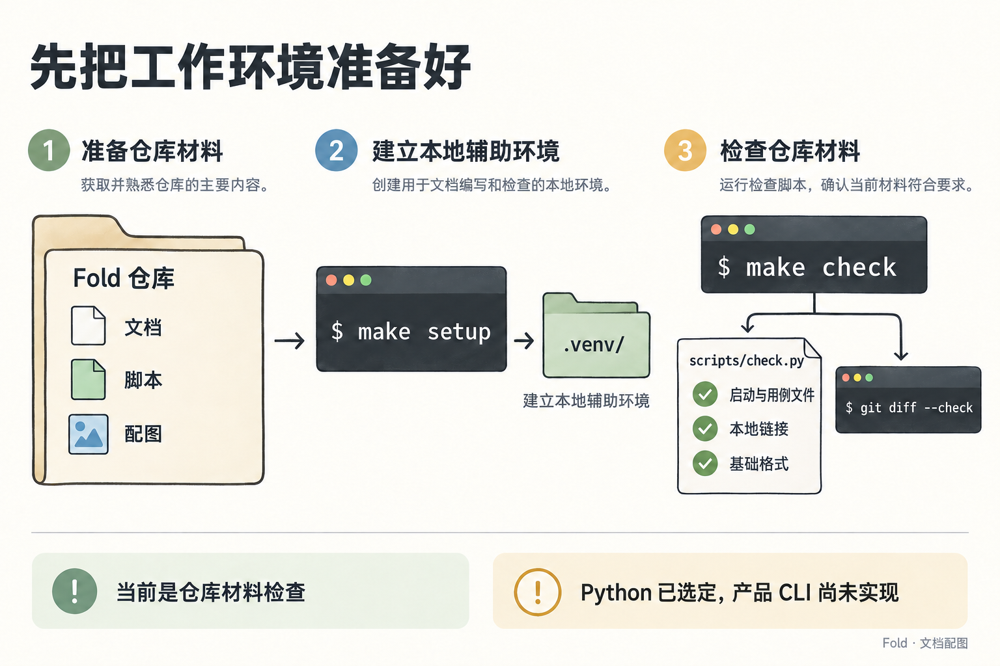

# 工作环境与启动交付

状态：本文件描述已存在的仓库工具（含阶段 1 的内存内核用例运行器与判断评测脚本），并说明后续实现的验收要求。首切片核心 CLI 使用 Python 标准库；可选概览模块需要浏览器运行环境，见[决策记录](decisions.md)。

## 本轮环境

仓库基础检查使用 Python 标准库，不安装第三方依赖；Python 3.11+、Git 和 Make 足以运行下述 `make setup`、`make check` 和本地原型命令。文档与原型体验站另有 Node.js 构建入口，见下文。

`make setup` 默认用 `python3`。系统自带的 `python3` 低于 3.11 时（例如 macOS 的 3.9），初始化出的环境会让 `make check` 报“需要 Python 3.11 或更高版本”，这时删掉 `.venv` 后用 `make setup PYTHON=python3.12` 重建。当前仓库的 `.venv` 由 Python 3.12 创建；没有把本机路径写入项目配置。

在仓库根目录执行：

```sh
make setup
make check
```



*这些命令准备仓库工具环境并检查材料；首切片核心使用 Python 标准库，产品功能尚未实现。*

`make setup` 使用 `python3 -m venv .venv` 创建独立环境，不联网下载依赖。已有 `.venv` 时再次运行不会清空环境。可以用 `make setup PYTHON=/path/to/python3` 指定解释器。

可选状态概览的浏览器运行环境另行准备；`make setup` 不安装浏览器。未安装可视模块不影响普通 JSON 查询与核心 CLI。渲染器尚未实现，安装及调用命令随实现补入。

`make check` 使用 `.venv/bin/python` 运行仓库检查，再执行 `git diff --check`。也可以不用 Make，直接运行：

```sh
python3 -m venv .venv
.venv/bin/python -B scripts/check.py
git diff --check
```

## 检查的范围

`scripts/check.py` 检查启动交付文件与用例文件是否齐全，以及维护中的 Markdown 是否使用有效的仓库内文件链接；也检查这些文档是否存在行尾空白或缺少结尾换行。它支持内联 Markdown 链接，跳过代码围栏，不验证标题锚点、引用式链接和外部网址。

历史草案位于 `docs/reference/`，按原件保留，不参与维护中文档的链接和格式检查。

`git diff --check` 检查 Git 可见的变更格式。产品断言不在 `make check` 里，见下一节。

## 用例与判断评测

阶段 1 的内存内核（`fold/`）已经实现。两类验证分开运行：

```sh
make test                                                    # 用内存内核运行 conformance/cases
node scripts/export-scenario.mjs > .local/scenario.json      # 导出原型演示情境（只读，不改原型）
python3 scripts/eval_judgment.py --dry-run --frames f01      # 只生成提示，不调用模型
python3 scripts/eval_judgment.py --frames f01,f05 --report   # 用真实模型逐帧评测，产生调用费用
python3 scripts/eval_judgment.py --runner codex --frames f01 --report      # 改用 codex exec，默认 gpt-6.1-sol
python3 scripts/eval_judgment.py --skill <SKILL.md 路径> ...               # 评测指定版本的 SKILL.md
python3 scripts/eval_judgment.py --rescore .local/eval/<run-id> --report   # 用已保存响应重新计分
```

`make test` 运行 `scripts/run_cases.py`，即 `.venv/bin/python -B scripts/run_cases.py`。它只验证内存层：故障注入、重启恢复与概览渲染的断言标为 skipped，通过不代表文件存储或 CLI 已完成。

`scripts/eval_judgment.py` 以 teacher-forced 方式逐帧评测 [skill/SKILL.md](../skill/SKILL.md)：第 n 帧的起始状态是内核回放作者前 n−1 帧批次的结果，被测模型看不到作者的处置与批次。它调用 `claude -p`，默认模型 `claude-opus-5-5`（`--model` 可覆盖），`--jobs` 控制并行帧数。设置了 `ANTHROPIC_API_KEY` 时加 `--bare`；`--bare` 不读登录态，没有 API key 时改用登录态，并以 `--setting-sources ''`、`--strict-mcp-config`、`--disable-slash-commands`、`--tools ''` 和空工作目录隔离用户设置、hooks、MCP 与项目说明。每帧结果、`summary.json` 与 `report.md` 写到 `.local/eval/<run-id>/`，该目录不提交。真实调用有费用，全量 36 帧按 Opus 约数美元；先用 `--dry-run` 和少量帧确认提示。

`--runner codex` 改用 `codex exec`，默认模型 `gpt-6.1-sol`，消耗登录账号的额度而不按次计费。codex 没有与 `--system-prompt` 对应的命令行参数，脚本默认把同一份系统提示与用户提示原文用分节标题合成一条消息；codex 自带的基础指令仍在，这是与 `claude -p` 的已知差异。codex 是带工具的 Agent，每次调用在 `run_dir/codex/` 下新建空工作目录，并以 `-s read-only`、`--ephemeral`、`--skip-git-repo-check`、`--ignore-user-config` 隔离；另外关掉项目说明加载（否则会沿目录向上读到仓库根的 `AGENTS.md`）、环境上下文（否则注入真实日期与路径）、网页搜索以及 shell、code mode 等工具。完整参数记在 `meta.json` 的 `invocation`。每次调用的事件流、最后消息与 stderr 留在 `run_dir/codex/`，token 用量写进每帧结果与 `summary.json`；遇到速率或额度限制、登录失效时立即停止，已完成的帧照常计分，之后用同一 `--run-id` 加 `--resume` 续跑其余帧。`--skill` 指定被测的 SKILL.md，用于新旧版本对照；`--codex-system instructions` 改用 `model_instructions_file` 传系统提示（替换 codex 自带的基础指令），用来检验合成方式的影响。

五份评测报告各是什么、用了多少费用，见[评测索引](evaluations/README.md)：[判断评测报告](evaluations/judgment-run-2026-10-14.md)、[换用 Codex 的对照评测](evaluations/judgment-run-codex-2026-10-15.md)、[混合语料自由运行](evaluations/free-run-composite-2026-10-15.md)、[含家庭流的第二次自由运行](evaluations/free-run-composite-v2-2026-10-15.md)与[换回第一次背景的第三次自由运行](evaluations/free-run-composite-v3-2026-10-15.md)。teacher-forced 评测只比较判断与作者的编排，自由运行只与弱标注对照，都不是正确答案；指标分别列出，不合成总分。

## 真实语料

[corpus/](../corpus/README.md) 收集公开来源的真实输入，作为手写情境之外的第二个判断基准。原文版权归作者，只在本机重建，`raw/` 与 `frames.json` 不入库：

```sh
.venv/bin/python scripts/fetch_corpus.py curl-bagder       # 主来源：GitHub、CI、邮件列表、Mastodon、博客；需已登录 gh
.venv/bin/python scripts/fetch_corpus.py enron-steffes-j   # 对照来源：首次下载约 423 MB 的 CMU Enron 压缩包到 .local/cache/
.venv/bin/python scripts/build_corpus.py all curl-bagder   # 切帧并对照 ids.json，统计噪音并与原型情境并排
.venv/bin/python scripts/label_corpus.py curl-bagder       # 从后续行为推出弱标注；--audit 30 打印抽样供人工核对
.venv/bin/python scripts/fetch_corpus.py composite         # 混合人物的社区、生活问答、newsletter 与天气
.venv/bin/python scripts/compose_corpus.py build           # 拼出化名人物的两周；还有 labels、noise、audit
.venv/bin/python scripts/compose_corpus.py family          # 追加作者编写的家庭流（节拍表入库，见 corpus/composite/family/）
```

`scripts/fetch_corpus.py` 只用标准库与 `gh api` 子进程，顺序请求并限速、遵守 robots.txt，输出 `corpus/<source>/raw/`。主来源约需一千余次 GitHub 请求与数百次网页请求，二三十分钟；`--only` 只重抓部分流，`--start/--end` 改变窗口。抓取不调用任何模型，也不清洗或去重；唯一的改动是把电话号码样式替换为 `[phone]`。

`scripts/build_corpus.py` 的 `frames` 生成与原型导出同形的 `frames.json`（`batch` 为 `null`），已有 `ids.json` 时只对照并报告差异，`--write-ids` 才覆盖；`noise` 写 `noise.json` 并打印与手写情境并排的表，结论见各来源的 NOISE.md。`scripts/label_corpus.py` 写 `labels.json`，规则与可信度见各来源的 LABELS.md。真实语料没有作者批次，不能 teacher-forced；`scripts/eval_judgment.py --free-run` 让 Agent 从空状态开始逐帧维护自己的状态：

```sh
python3 scripts/eval_judgment.py --free-run --corpus corpus/curl-bagder/frames.json --dry-run   # 估算 token 与费用，不调用模型
python3 scripts/eval_judgment.py --free-run --corpus <frames.json> --max-cost 40 --report        # 真实调用，按帧顺序运行
python3 scripts/eval_judgment.py --free-run --corpus <frames.json> --run-id <id> --resume --report
python3 scripts/eval_judgment.py --free-run --corpus <frames.json> --rescore .local/eval/<id> --report
python3 scripts/eval_judgment.py --free-run --corpus corpus/composite/frames.json --persona-context "<人物设定>" --text-cap 1000 --dry-run
```

每帧把 SKILL.md、用户背景（附输出语言与“本人事件”的说明）、上一帧提交后的状态、本帧输入与宿主信号交给模型。输入只交 `id / channel / from / at / subject / url / text`、`self`（是否本人）与语料带有时的 `stream`（work / community / life / family / subscription，用户背景里附一句说明；语料含家庭流时，输出语言的说明另加一句瑞典语往来也用中文整理），不交由公开资料推断的作者类别与 `origin`；每帧超过 60 条或 2 万字符时把单条正文截到 1500 字符并记原长，不删条目，`--text-cap` 把这个长度收紧（估算超出预算时用）。`--persona-context` 换掉语料自带的人物背景。批次经内存内核提交，被拒绝时带回执重试，最多 3 次，仍被拒绝则该帧记 skipped、沿用上一帧状态。因为状态逐帧前传，帧只能顺序运行；`--frames` 只决定跑到哪一帧为止，`--resume` 先按记录重放已接受的批次再继续。每帧落盘提示、原始响应、回执、提交后的 state、token 与费用；累计费用达到 `--max-cost`（默认 40 美元）后不再开始新的一帧。`--dry-run` 按上次全量运行拟合的单价估算费用，状态增长用写明的假设。

自由运行不做作者对比，改与语料旁的 `labels.json` 做三项对照：被处置为 noise / duplicate 的输入相对强依据忽略列表的召回与精确率（弱依据单列）；同组输入被引用进同一条目、同一根层事项的比例（跨线程组单列）；同帧事项按弱档位的成对排序与 Agent 根层份额的一致率。衔接方式的取舍见[决策记录](decisions.md#推迟到后续切片)。语料带 `stream` 时，报告另列各流的处置分布，以及根层 64 份平均有多少来自每条流（按事项引用的输入分摊，`summary.json` 另记逐帧的值）。

`labels.json` 有 `family` 一节（作者编写的家庭流，依据 `authored`）时，它单独计分，不与前四条流由真实行为推出的指标混算：前四条流的三项对照只看前四条流的输入，口径与加入家庭流之前相同；家庭流另列忽略的召回与精确率、作者事项与并入关系的同组一致、按作者档（critical > high > normal > low > trace > none）的成对排序与作者档 × 份额表，分流召回表加 family 几行。家庭流只在这一帧确实交给了模型时计分，用不含家庭流的语料跑出的旧记录复算结果不变。作者登记的问题（`family.asks`）在契约的状态里没有可对照的字段，脚本不计分，报告里人工对照。

自由运行的结果可以打磨成原型的演示数据：

```sh
.venv/bin/python scripts/build_demo_data.py composite --import-run .local/eval/<id>   # 导出 Agent 批次到 prototype/data/composite/agent-batches.json
.venv/bin/python scripts/build_demo_data.py composite --report                        # 按 edits.json 修正、重放并写 scenario.mjs
```

修正只写在 `prototype/data/<name>/edits.json`：对 Agent 批次的增删改、处置更正、旁白、回应路径与手写反馈。脚本从空状态用内存内核逐帧重放，任何一帧被拒绝就停下；写出后再用原型引擎回放核对。演示数据的正文截到 500 字符并保留链接，不收 Enron 营销邮件；本人在来源处的回复、评审、合并与关闭按线程挂到当时的事项与回应路径上。每处修正与理由记在同目录的 POLISH.md。

## 体验站构建与发布

体验站使用子域名 [fold.vibecoding.icu](https://fold.vibecoding.icu/)，由 `wrangler.jsonc` 的 Custom Domain 配置绑定到同一个 Worker，Cloudflare 管理 DNS 与 HTTPS 证书；根域名不绑定此项目。

体验站是独立的静态文档与交互实验，使用 Node.js 22+。VitePress 提供导航和中文本地搜索；Mermaid 与 MathJax 分别呈现文档已有的流程图和公式。依赖版本由 `package-lock.json` 固定，不改变首切片核心 CLI 使用 Python 标准库的决定。

```sh
npm ci
npm run site:dev
npm run site:build
npm run site:preview
```

本地站点默认在 `http://127.0.0.1:4174`。`scripts/prepare-site.mjs` 从仓库文档和原型源码生成 `site/.generated/`，随后 VitePress 输出 `dist/`。修改原始文档后，重新运行上述开发或构建命令同步内容；不要直接编辑生成目录。`make prototype` 仍可单独在 4173 端口运行原型。

`npm run deploy` 先重新构建，再通过已登录的 Wrangler 发布 `dist/`。`wrangler.jsonc` 只配置静态资源托管，不配置数据库、生产业务 API 或真实账户接入。原型默认数据集是化名改写的真实公开数据，判断来自一次真实模型的自由运行并经人工打磨；`?data=story` 的手写情境中，私人消息与 Agent 判断为演示编排。

原型的每种形式可以用本机 Chrome 无头截图并检查页面报错，只用 Node 22 内置能力，不装依赖：

```sh
python3 -m http.server 4173 --bind 127.0.0.1 -d prototype &      # 或 make prototype
node scripts/shoot-forms.mjs                                      # 全部形式，1440×900，写到 .local/polish-base/
node scripts/shoot-forms.mjs --data story --only d,watch --frame 12 --out .local/shots
node scripts/shoot-forms.mjs --only d --check d-respond           # D 的回应控件交互检查
node scripts/shoot-forms.mjs --only all --check all-sync          # 合页 all.html：逐节等每页报告所在帧，再选一帧确认全部跟上
```

每种形式写 `<out>/<form>.png`，另写 `report.json`（URL、页面报错、检查结果）；有报错时退出码为 1。`--eval "<js>"` 在截图前执行一段脚本，`--base` 改原型地址，`CHROME` 环境变量指定浏览器。

体验站的“原型体验”面板与首页共用 `site/.vitepress/theme/prototypes.mjs` 列出的 21 个原型，顺序、默认帧与弹框里加的 `embed=1`、`card=0` 都照合页 `all.html`。卡片预览图是 `site/previews/<id>.webp`（640×400，共约 570 KB），原型界面明显变化后按同样的参数重截：原版与 A/B/C/D 隐藏方案切换栏，形式页收起概念卡，复盘图与回应组件页用各自的默认帧，再用 Homebrew 的 `cwebp` 缩到 640 像素宽：

```sh
out=.local/previews
node scripts/shoot-forms.mjs --out $out --only original,a,b,d --frame 26 --eval "document.documentElement.classList.add('is-embedded')"
node scripts/shoot-forms.mjs --out $out/c --only c --frame 25 --eval "document.documentElement.classList.add('is-embedded')"
node scripts/shoot-forms.mjs --out $out/w --only watch,multiples --frame 26 --eval "document.querySelector('[data-card]').click()"
node scripts/shoot-forms.mjs --out $out/r --only radio,strips,frontpage,receipt,orb,departures,blame,chat --eval "document.querySelector('[data-card]').click()"
node scripts/shoot-forms.mjs --out $out/s --only lineage,timing,provenance,yield,notation,respond
for f in $out/*.png $out/*/*.png; do cwebp -quiet -q 82 -m 6 -sharp_yuv -resize 640 0 "$f" -o "site/previews/$(basename "$f" .png).webp"; done
```

全部原型合页（`prototype/all.html`）可以导出为一个自包含的 HTML 文件，在 Finder 里双击、用 Safari 或 Chrome 以 `file://` 打开就能用，不需要服务：

```sh
node scripts/export-all.mjs                                          # 写到 .local/export/fold-prototypes.html
node scripts/export-all.mjs --out ~/Downloads/fold-prototypes.html
node scripts/export-all.mjs --out .local/export/all.html && node scripts/shoot-forms.mjs --base "file://$PWD/.local/export" --only all --check all-sync
```

浏览器在 `file://` 下不能跨文件加载模块，脚本因此用 esbuild（devDependencies 固定为 0.21.5，与 VitePress 所用版本相同）把合页和 17 个原型页面的模块打成一个 ES module，与样式、页面模板一起内联，每份只存一份，约 3 MB，大头是演示数据。21 节各用一个 srcdoc iframe 运行这段代码；页面读取的 `location.search`、`location.pathname` 与 `history.replaceState` 在打包时换成 `window.__foldLocation`，由它保存每节的 `?variant=`、`?frame=`、`?data=`、`embed=1`、`card=0`。懒加载、离视野卸载、顶栏切帧与切数据集与合页相同；单文件版没有单独页面，所以不显示“单独打开”、打磨记录与画廊链接，iframe 里指向其他页面的链接只提示、不跳转。第三条命令导出成 `all.html`，再用上面的 all-sync 检查逐节核对。导出的文件含默认演示数据的化名改写文本，转给别人之前与体验站一样先看公开许可的决定。

发布前运行 `make check` 和 `npm run site:build`，并核对文档链接、公式、流程图、搜索及原型交互。站点构建成功不等于产品 CLI 的持久化与完整验收已经完成。

默认演示数据与小册子的截图含化名改写的真实公开文本，`npm run site:build` 会把它们一起放进 `dist/`。2026-10-15 用户决定照现状公开，来源、许可与已知的署名缺口见[演示数据的来源与许可](../prototype/data/composite/SOURCES.md#公开与许可)；`npm run deploy` 只在用户指示时运行。

## 小册子

[brief/index.html](brief/index.html) 是一份 16 页、A4 分页的图文说明，给人快速理解这项工作，不是规范出处；每页的数字在页脚注明来自哪份文件。它是单个 HTML 文件，样式与脚本内联，不依赖外部库；配图只用原型的真实截图（`brief/assets/`，最宽 1200 像素、每张 300 KB 以内）与 CSS 画的示意。第 13 页内嵌原型的手机首页，用相对路径 `../../prototype/index.html`，所以要从仓库根目录或体验站打开，打印时换成同一帧的截图。

- 本地阅读：在仓库根目录运行 `python3 -m http.server 4190 --bind 127.0.0.1`，打开 `http://127.0.0.1:4190/docs/brief/`。
- 体验站：`scripts/prepare-site.mjs` 把 `docs/brief/` 原样复制到站点的 `/docs/brief/`，Markdown 里指向它的链接改写为这个地址。
- 打印：工具栏的“打印”按 A4 一页一张；也可以用无头 Chrome 的 `--print-to-pdf` 导出。PDF 不入库。
- 截图更新：先用 `node scripts/shoot-forms.mjs --only <形式> --frame <帧> --scale 2 --out .local/<目录>` 按两倍像素密度截出原型画面，再用 `magick <in>.png -crop <宽>x<高>+<x>+<y> +repage -resize 1200x -colors 256 PNG8:<out>.png` 裁出所需区域并缩小；原型或演示数据改动后，涉及的截图与数字要一起核对。
- 版面检查：每页固定为 1000×1414，超出部分会被裁掉；改动后在宽屏与手机宽度各看一遍，再打印一次确认仍是 16 页。窄屏样式只对 `screen` 生效，打印始终用 A4 版面。

## 实现时使用哪份规范

产品 CLI 的输入、回执与重试规则见[信息契约](information-contract.md)，调用指引见 [Skill 设计](skill-design.md)，文件写入与恢复见[架构](architecture.md)。这些能力尚待实现，不属于上面的仓库检查命令。

产品 CLI 只接收 JSON；YAML 是设计用例的表达格式。测试运行器可以读取或转换用例，不因此给产品 CLI 引入 YAML 支持。

设计中的 `fold state` 可选导出同一快照对应的 JSON 与概览 PNG，也可附加差异数据。浏览器负责真实 HTML/DOM 渲染与截图，不用图像生成模型绘制业务状态；参数、产物和失败行为以[信息契约](information-contract.md)为准，模块边界见[架构](architecture.md)。

## 文件清单

| 文件 | 用途 |
| --- | --- |
| [README.md](../README.md) | 阅读入口与项目当前状态 |
| [AGENTS.md](../AGENTS.md) | 仓库开发协作约定 |
| [decisions.md](decisions.md) | 已对齐方向、首切片决定、推迟清单 |
| [product.md](product.md) | 从原稿和讨论提炼的产品定义 |
| [domain-model.md](domain-model.md) | 事件、反馈、时间输入的基础形式与业务策略的边界 |
| [user-stories.md](user-stories.md) | 五个具体使用情境、呈现示例与成功观察 |
| [information-contract.md](information-contract.md) | 声明字段、份额与排序规则、快照与事件结构 |
| [skill-design.md](skill-design.md) | 何时调用、上下文视图、判断指引、CLI 动作与验证计划 |
| [formal-model.md](formal-model.md) | 输入输出、语义估计、预算与执行的数学探索 |
| [architecture.md](architecture.md) | 顶层设计与职责边界 |
| [conformance/cases](../conformance/cases) | 六组一致性用例：往返、超额拒绝、批次回执与复核、补丁与子树、操作边界、状态概览 |
| [visual-guide.md](visual-guide.md) | 按文档定位配图与对应章节的索引 |
| [assets/illustrations](assets/illustrations) | 项目内保存的配图与生成提示词 |
| [development.md](development.md) | 本文：环境与检查说明 |
| [brief/index.html](brief/index.html) | 小册子：16 页图文说明，给人快速阅读 |
| [reference/design-v0.3.md](reference/design-v0.3.md) | 用户原始设计草案的原样副本 |
| [Makefile](../Makefile) | 环境初始化、检查与用例入口 |
| [scripts/check.py](../scripts/check.py) | 无第三方依赖的启动检查 |
| [fold/](../fold) | 阶段 1：纯函数内核、内存存储与文字简报 |
| [scripts/run_cases.py](../scripts/run_cases.py) | 用内存内核运行一致性用例；[yaml_subset.py](../scripts/yaml_subset.py) 解析用例 |
| [skill/SKILL.md](../skill/SKILL.md) | 首版 Fold skill：面向使用 Fold 汇报工作的 Agent |
| [scripts/export-scenario.mjs](../scripts/export-scenario.mjs) | 把原型的手写演示情境导出为 JSON |
| [scripts/shoot-forms.mjs](../scripts/shoot-forms.mjs) | 用本机 Chrome 无头截取原型各形式并检查页面报错 |
| [scripts/export-all.mjs](../scripts/export-all.mjs) | 把全部原型合页导出为可双击打开的单个 HTML 文件 |
| [scripts/build_demo_data.py](../scripts/build_demo_data.py) | 把自由运行的批次按 edits.json 修正、重放成原型演示数据 |
| [scripts/eval_judgment.py](../scripts/eval_judgment.py) | 用真实模型逐帧评测判断：手写情境与作者批次对比；真实语料自由运行，与弱标注对照 |
| [evaluations/](evaluations/README.md) | 评测报告与索引 |
| [corpus/](../corpus/README.md) | 真实语料：来源调查、许可与入库范围、重建方法 |
| [scripts/fetch_corpus.py](../scripts/fetch_corpus.py) | 按来源与时间窗抓取真实语料的原文 |
| [scripts/build_corpus.py](../scripts/build_corpus.py) | 真实语料切帧、ID 清单与噪音统计 |
| [scripts/label_corpus.py](../scripts/label_corpus.py) | 从真实后续行为推出弱标注 |
| [scripts/compose_corpus.py](../scripts/compose_corpus.py) | 把几个真实来源拼成化名人物的两周，并生成弱标注与噪音统计 |
| [scripts/family_stream.py](../scripts/family_stream.py) | 家庭流：由节拍表渲染成品、生成作者标注，并做不可回溯检查 |
| [.editorconfig](../.editorconfig) | 编码、换行和缩进约定 |
| [.gitattributes](../.gitattributes) | 文本文件统一使用 LF 换行 |
| [.gitignore](../.gitignore) | 忽略环境、缓存和本地临时文件 |

`.venv/` 是命令生成的本机环境，不提交版本库。`.local/` 可用于本机试验数据，已被 Git 忽略；产品 CLI 的默认存储目录是工作目录下的 `.fold/`。

## 读完以后如何继续

按 [decisions.md](decisions.md) 的实施顺序推进。六组用例覆盖：

- `01-us01-roundtrip.yaml`：覆盖、合并、父子事实一致与批注往返。
- `02-us03-overflow-reject.yaml`：超额拒绝、Agent 让位与历史查询。
- `03-batch-receipts-and-checks.yaml`：批次重试、结果查询、无变化复核和仅确认提交。
- `04-patch-and-subtree.yaml`：补丁保留与清空、子树撤下及反馈可达、沿原 ID 逐项重新纳入。
- `05-operation-boundaries.yaml`：条目操作的适用范围与拒绝边界。
- `06-state-overview.yaml`：可选概览、范围选择、差异与渲染失败边界。

`scripts/run_cases.py` 调用内存核心，配合内存事件、批注与文字简报验证行为。内存用例通过只证明这一层的实现，不代表文件持久化、故障恢复或产品 CLI 已完成；首切片完成需要后续层的对应验收。

故障验证可结合两种方式：用测试钩子稳定触发指定边界，再用少量真实子进程崩溃与 CLI 往返检查实际文件和进程行为。不能只用进程内异常模拟就宣称持久化恢复完成，也不必把每项核心断言都变成子进程测试。

概览验收需要检查实际生成的 PNG 和 DOM：布局是否对应所选层级与份额，字体是否可读，长文本是否溢出，版本、范围和省略提示是否清楚，并与对应 JSON 核对。仅有 JSON 断言通过不足以证明视觉呈现正确；缺少浏览器或渲染失败时也不能把旧图片当成成功产物。

`make check` 只检查材料；`make test` 运行内存层断言。本地存储、产品 CLI 与概览渲染器尚未实现，对应命令随实现补入。

## 提交署名

2026-10-14 至 10-15 的提交里，`Co-Authored-By` 有两种写法：一部分写 Claude Opus 5.5，即实际执行这些改动的模型；另一部分写 Claude Fable 5.1。两种署名并存，不改写历史；判断某次改动由哪个模型执行，以本说明与对应评测报告里记录的模型为准。
