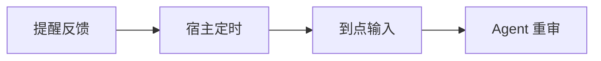

# Fold 领域模型：信号、关系与业务策略

状态：基础形式的设计说明，供业务建模与 Skill 判断共用。本文不规定某种通知中心、待办清单或看板的完整行为；现有命令与字段仍见[信息契约](information-contract.md)。

Fold 接收到的不只是“事情发生了变化”。用户对已有表达的反馈、没有新事件的一段时间、业务系统发起的一次回顾，都可以成为新的判断依据。领域模型需要让这些输入可表达、可关联，Skill 帮助 Agent 理解它们；如何改变关注与采取动作，由业务用途、策略和当下语境决定。

**用户与信息的关系，和信息在业务中的价值，是两个不同维度。** 已阅可以消除“还没告诉用户”的价值，却不必消除这件事的近期影响；已处理可以消除某个行动需要，却仍可能留下值得关注的结果。把这些关系分开，同一种反馈才能适用于不同业务。

## 三个层次各自回答什么

| 层次 | 回答的问题 | 例子 |
| --- | --- | --- |
| 事实与关联 | 收到了什么，来自谁，在何时，针对什么？ | 用户对某条表达标记已阅；宿主报告一个窗口内没有收到事件。 |
| 信号含义 | 这份输入改变了哪些判断依据，还不能说明什么？ | 用户确认接收过这部分信息；它不直接说明事情已处理，也不保证信息失去用途。 |
| 业务策略与决定 | 在这个系统里，这意味着怎样的关注或操作？ | 通知中心将已阅内容的权重设为 0；近期重点概览继续保留同一事项。 |

事实与反馈保留原意；解释不能冒充原始输入，策略决定也不能倒写成现实事实。业务可以提供确定规则，也可以给出判断目标与适用条件，由 Agent 完成其余语义判断。

## 需要表达的基础形式

| 形式 | 需要保留的关系 | 不在这一层固定什么 |
| --- | --- | --- |
| 事项与当前表达 | 正在谈什么，当前怎样表达，依据是什么；后续内容与先前内容怎样关联 | 事项必须是任务，或者必须经过一套完成状态机。 |
| 事件或观测 | 来源、时间、内容及其关联对象；没有事件的窗口也可以被描述 | 收到某种事件就统一增加或减少多少权重。 |
| 对用户的期待 | 这次表达希望用户知晓，还是需要其决定、输入、行动或其他回应；这些期待可以并存 | 把进展、沟通目的和用户回应挤进一个互斥枚举。 |
| 用户反馈 | 谁对什么内容或期待作了何种回应，原话或输入是什么，反馈发生在什么上下文 | “已阅”“已处理”各自唯一对应的展示或权重动作。 |
| 时间信号 | 哪段时间经过了、为何此刻再次处理、原来的相关事实或用户意图是什么 | Fold 必须内置哪种 tick、定时器或周期任务。 |
| 业务策略 | 当前系统维护什么价值，权重表示什么，对这些信号有何规则或偏好 | 让某个业务的默认行为成为所有业务的领域公理。 |

对用户的期待与事项进展可以交叉，例如“工作已完成，但需要用户确认结果”。现有 `kind` 中的 `needs-you / fyi / in-progress / done` 是首切片的简化表达，不能用它们独立推导全部反馈含义。

反馈需要能定位它针对的表达、事项或具体问题。若业务需要区分版本、部分内容或多个回应对象，就保留足够的目标引用与范围；内容更新、合并后，原关联仍应可追溯，供 Agent 判断旧反馈是否仍然适用。本模型不预先规定统一的语义版本算法或逐句覆盖结构。

## 反馈方式构成可处理的回路

输出可以登记可用的反馈方式，说明每种动作的含义、所需输入及回传关联。用户产生反馈后，系统能够把它关联到原输出与相应的处理能力，重新进入判断过程。可以用下面的关系表达，而不先固定接口字段：

```text
输出：内容引用 + 对用户的期待 + 可用反馈动作及处理引用
反馈：原目标引用 + 动作/语义 + 用户输入 + 来源与时间
处理：将反馈与相关状态交给业务规则或 Agent
```

“已阅”“提供决定”“报告已处理”“稍后再提醒”是不同的反馈含义；它们可以来自按钮、回复或其他宿主能力。注册回传方式，使消费端知道如何表达和传递用户意图；反馈怎样改变状态，仍由业务策略决定。

Skill 应帮助 Agent 区分这些信号：

- **已阅：** 用户明确确认接收了相应内容。它提供关于知晓状态的依据，不自动表示同意或处理完成。单纯展示页面、Agent 读状态或缺少反馈，都不等于用户明确已阅。
- **已处理或提交回应：** 用户报告完成了所指行动，或给出了所求输入。这通常会显著改变原有等待判断；影响的范围取决于所指对象，不能扩成“整个事项都已完成”，也不能改写为“已独立核验外部结果”。
- **稍后再提醒：** 用户希望未来某时重新关注某个对象。它提供新的时间意图，不自动表示已阅或完成，也不改变事项原本的行动截止。

现有批注的 `saved / acknowledged` 记录保存和 Agent 处理确认，回答的是另一类问题。它们不能代替用户已阅、用户已处理或业务执行结果；也不必把所有反馈都包装成同一套批注状态。

## 时间流逝与延后提醒怎样进入模型

业务系统可能在零事件窗口结束时调用 Agent，也可能周期性回顾，或在发现资料陈旧时唤醒它。这些输入往往同时包含时间、观测范围和调用原因。Skill 要让 Agent 理解：没有新事件仍可能需要重新判断旧状态；但没有收到消息本身，也不证明现实中没有变化。

“过两小时再提醒我”可以产生另一种时间输入：



在 \(t_0\)，用户对对象 \(x\) 提出延后提醒；宿主可以将它转成独立的定时安排。在 \(t_1\)，系统输入一个关联原反馈、原对象和约定时间的新事件，含义是“用户曾要求在此时重新关注这个对象”。定时器是业务系统的一种实现，Fold 需要理解的是这条关联及本次输入的含义。

Agent 在 \(t_1\) 使用当前状态、当前时间和业务策略重新判断，不能把 \(t_0\) 的判断原样当作现在的结论。提醒时机与 `due_at`、`stale_after` 表达不同含义，不能互相替代。

用户的提醒意图本身可以成为再次提及的依据，不需要先把原已阅事实清除。假如到点时已有证据表明事项失效，一种业务策略可以降低关注，只告知“你之前让我提醒，但原事项已失效”；另一种业务可能有不同处理。这个例子说明到点需要重审，不建立所有业务都必须如何通知的规则。

## 同一信号可以产生不同的合理决定

| 相同的内容与反馈 | 业务用途 A | 业务用途 B |
| --- | --- | --- |
| “明日 10 点生产切换”，用户已阅 | 通知中心关注尚未告知的信息，可以将其权重设为 0 | 近期重点概览关注临近事项的影响，可以继续保留较高关注 |
| “材料已提交”，用户报告处理完成 | 待办清单关注尚需用户执行的动作，可以不再突出提交动作 | 办理进程概览关注整体进展，可以保留提交结果与后续等待 |
| 用户约定的提醒时间到达，原报价已经失效 | 提醒应用可以给出轻量的失效说明，回应原约定 | 决策辅助应用可以重新整理当前可选方案，并结合策略决定怎样提及原报价 |

这些是策略对照，不是内置的业务模式或固定默认。业务判断中的权重为 0，可以表示当前用途不再分配关注，不等于删除原信息或反馈。现有五档与 active 条目正份额是首切片的具体协议约束；零关注如何映射为退出当前集合或其他表示，应在操作契约接入时确定，不能假装现有 `weight` 参数已经接受数字 0。

因此，处理关系可以概括为：

```text
处理决定 = 判断（当前状态，新输入及关联反馈，当前时间，用户上下文；业务策略）
```

同一反馈在不同业务策略下产生不同决定，是这个模型应该容纳的结果。Skill 的任务是帮助 Agent 正确解释输入、识别业务用途并作有依据的判断；操作工具负责执行合法决定。判断指引见 [Skill 设计](skill-design.md#理解反馈与业务策略)。
