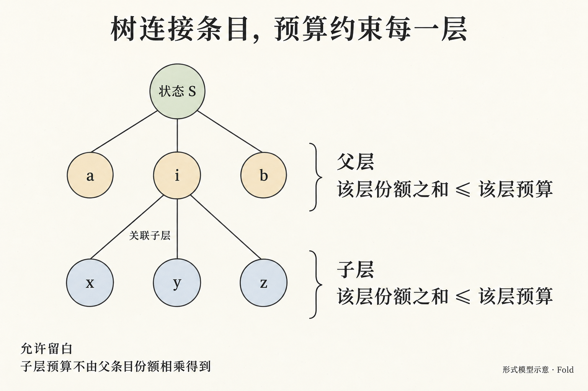
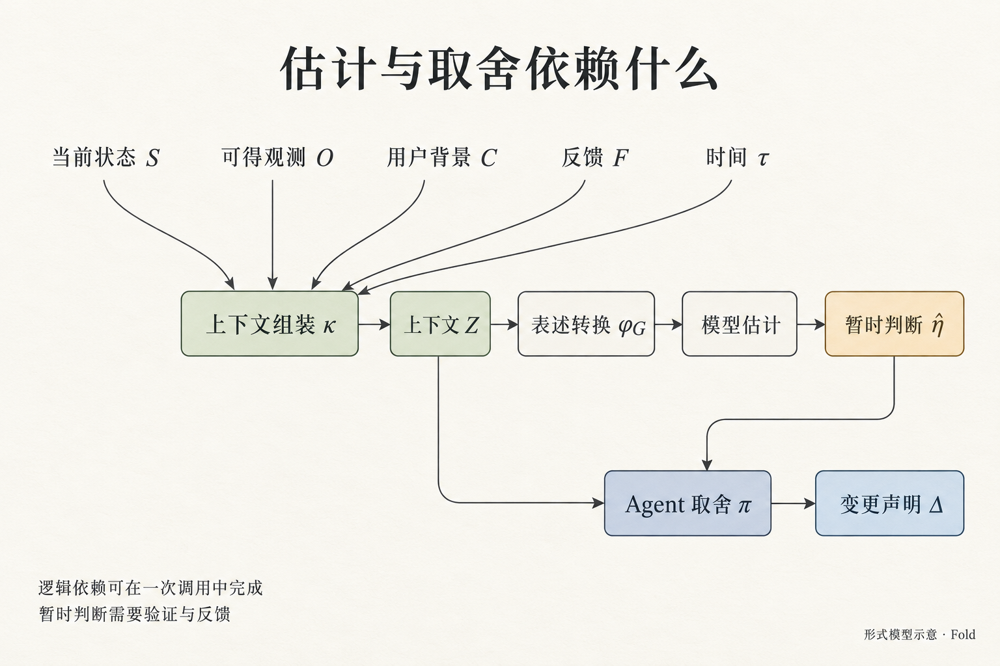
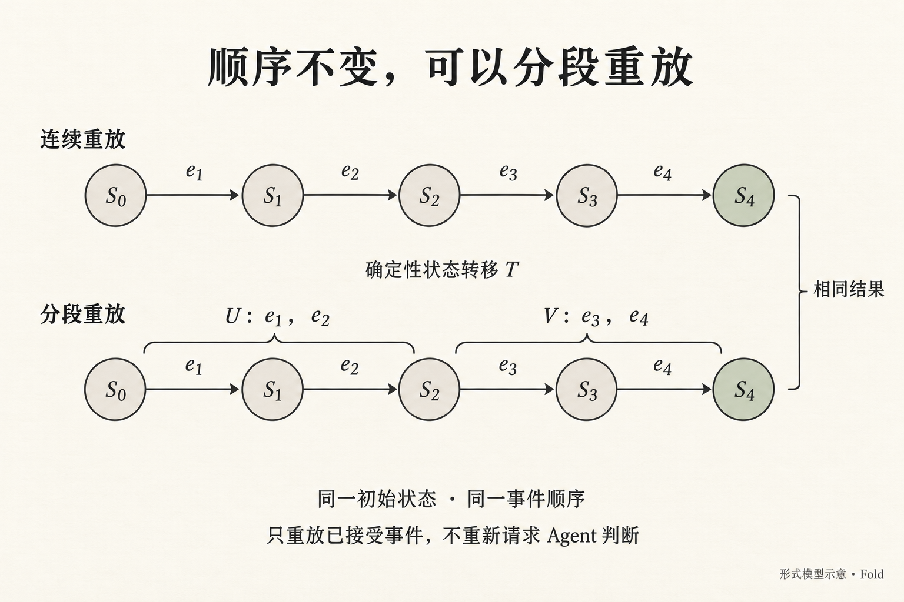

# Fold 的形式模型：从异构信息到可复用状态

状态：设计稿，用于区分可检查的约束与需要判断的部分。符号不是实现接口；字段见[信息契约](information-contract.md)，未决问题见[决策记录](decisions.md)。

**Fold 对多源信息作有上下文的语义估计，把判断维护成受约束、可追溯的结构化状态，供不同应用使用。** LLM 使中间的估计成为可调用的能力；skill 帮助它保持判断尺度与上下文；内核执行明确的变化。

## 1. 先定义输入和输出

令 \(c\) 表示信息渠道，\(\mathcal R_c\) 表示该渠道的原始输入空间。对原始输入 \(r\)，入站适配器使用渠道语境 \(\mu_c\)，产生规范观测：

$$
A_c(r,\mu_c)=[o_1,\ldots,o_n],
\qquad o_i\in\mathcal O.
$$

\(\mathcal O\) 是共同的信息源表达结构，\(\mathcal O^*\) 是其有限序列空间。一条邮件可能拆出多条观测；没有可靠依据的内容保留为未知或转述。首切片不启用独立的入站适配器，Agent 根据已有信息进行语义判断并提交声明，来源观测可以作为声明附件。

把一次处理可用的新增观测记作 \(O_k\)。经过上下文组装、Agent 判断和内核接受后，输出属于另一套预定义结构：

$$
Y_{k+1}\simeq
\bigl(S_{k+1},E_k,\operatorname{trace}_k\bigr).
$$

\(S\) 是当前结构化状态，\(E\) 是已接受的变化，\(\operatorname{trace}\) 是指向观测或历史的追溯关系。入站观测 \(o\) 与已接受的状态事件 \(e\) 是不同类型：收到“账单已支付”的消息，不等于已确认付款，更不等于已经决定怎样展示它。

整条链可以写成：

$$
\{\mathcal R_c\}_c
\xrightarrow{\{A_c\}}
\mathcal O^*
\xrightarrow{\text{上下文与语义估计}}
\text{声明批次}
\xrightarrow{\text{校验与执行}}
\mathcal Y
\xrightarrow{h_j(\,\cdot\,;\gamma_j)}
\text{下游应用}.
$$

\(h_j\) 是某个消费端，\(\gamma_j\) 是它的配置。

## 2. 为什么 LLM 的介入值得单独建模

需求一侧，持续工作的 Agent 不只汇报已委托的任务，还会观察、发现和转述用户未逐项预设的信息。数量与语境多样性一起扩大了需要整理的范围，逐条阅读的时间很快超过用户愿意用于接收信息的时间。

能力一侧，排序、过滤、摘要与预算约束本身不是新问题，人可以做这些判断，规则也能编码已知情况。Fold 要验证的假设是：LLM 能降低在开放、异构情境下反复定义判断规则的成本，用自然语言背景估计“这对这个用户现在意味着什么”。估计可以执行，不代表已经测准；重要性含有偏好和价值取舍，没有一份脱离用户处境的唯一真值。Fold 需要让估计有依据、能比较、能受反馈修正。

## 3. 输出中的状态与注意力预算

*树表达条目之间的关系，预算约束分别作用于各层。节点大小不编码份额，子层预算不由父条目份额相乘得到。*

当前状态 \(S\) 以有限条目树为主体，并包含 revision、批注确认等记录信息：层包含条目，条目可以包含子层。对任意层 \(\ell\)，记 active 条目集合为 \(I_\ell\)，预算为 \(B_\ell>0\)，条目份额为 \(s_i\)。基本约束为：

$$
s_i\geq 1,\qquad
\sum_{i\in I_\ell}s_i\leq B_\ell.
$$

份额由档位 \(w_i\) 派生：

$$
s_i=\max\Bigl(1,\Bigl\lfloor B_\ell\cdot\rho(w_i)\Bigr\rfloor\Bigr),
\qquad
\rho=\{\text{critical}:\tfrac38,\ \text{high}:\tfrac3{16},\ \text{normal}:\tfrac3{32},\ \text{low}:\tfrac3{64}\},\quad
s_{\text{trace}}=1.
$$

Agent 默认使用档位，也可以给出显式 \(s_i\) 覆盖派生值，但要附 `reason`。覆盖的继承与取消遵循[信息契约](information-contract.md)。定义份额比例与留白：

$$
p_i=\frac{s_i}{B_\ell},
\qquad
p_{\varnothing}=1-\sum_{i\in I_\ell}p_i\geq 0.
$$

这些是分配比例，不是概率。24 对 12 表达了两倍的展示份额，不证明心理上的重要性恰好为两倍。

子层 \(c(i)\) 有自己的 \(B_{c(i)}\)，子项份额不计入父层预算，也不要求小于父项的 \(s_i\)。局部预算无法给用户连续展开的总阅读成本提供统一上界。

withdraw 使目标及其整个子树退出 active 集合，因此其后代也不再参与当前各层的展示与分配。历史和子树中的未确认批注仍可达；不在 active 集合不等于资料已删除。

故事 US-03 中，\(B=64\)：原状态为周报 24、PR 12、机票 12、账单 6、阅读 6、例会 3、过滤 1，合计 64。只加入签证 24 得 88，内核拒绝。第二次提交为签证 24、周报 12、PR 6、机票 6、账单 6、例会 3、过滤 1，阅读撤下，合计 58。这只验证算术成立；若用户补充“阅读材料用于明天会议”，Agent 的取舍可能改变。

## 4. 把 Agent 展开成有上下文的估计过程

*箭头表示判断所需的依赖：上下文既支持估计，也直接参与取舍。这些逻辑环节可以在一次调用中完成。*

令 \(k\) 为整理次数，\(\tau_k\) 为调用方传入的显式时间。先组装可供判断的上下文：

$$
Z_k=\kappa\bigl(V(S_k,\tau_k),O_{\leq k}^{\mathrm{available}},F_k,C_k\bigr).
$$

- \(V(S_k,\tau_k)\)：当前状态的时长投影，含各项内容、份额、rank、`age`、`since_update`、`until_due`、`until_stale`；
- \(O_{\leq k}^{\mathrm{available}}\)：可取得的新旧观测及来源；
- \(F_k\)：状态为 `saved` 的待确认批注，以及 `acknowledged` 记录和首次确认绑定；包括已撤下子树中仍待确认的批注；
- \(C_k\)：用户目标、明确偏好、承诺和其他有关背景，由宿主提供；
- \(\kappa\)：按判断需要组织这些内容，包括按需取回子层与历史，不等于把全部原文塞入一次调用。

首切片不采集用户阅读行为：`last_seen_at` 和 `since_seen` 一律为 `null`，表示未采集。`state`、`annotate` 以及 Agent 的批注确认都不能据此推导用户已阅读。`last_checked_at` 可由最近的 checked 事件取得，它记录 Agent 的检查，不是用户阅读。

旧份额不能成为唯一的上下文筛选依据，否则曾经被缩小或撤下的信息永远无法重新获得重视。只读新增信息，也不足以判断它该从当前哪一项获得空间。

设 \(\theta\) 表示模型，\(G\) 表示 skill 的目标定义、表述方式与示例，\(\phi_G\) 为表述转换：

$$
\widehat\eta_k
\sim\operatorname{Estimate}_{\theta}
\bigl(\,\cdot\mid\phi_G(Z_k)\bigr).
$$

\(\widehat\eta_k\) 的概念组成包括：

| 待估计的量 | 一个具体判断 | 与真实测量的区别 |
| --- | --- | --- |
| \(\widehat Q_k\)：用户此刻需要回答哪些问题 | 用户回来首先需要知道“还缺哪份签证材料” | 用户可能补充模型不知道的目标 |
| \(\widehat w_{q,k}\)：遗漏某个问题的后果 | 缺流水会阻碍已计划的行程；普通推荐可晚些看 | 依赖语境的价值判断，没有全局固定单位 |
| \(\widehat\ell_{q,k}(S)\)：一种表达可能造成的理解损失 | “PR 都好了”掩盖了一项仍等 CI 的事实 | 模型能预测误解风险，不能直接观测人实际读懂了什么 |

这些符号不要求模型输出三个数值。比较两个候选摘要、说明哪项让位、指出遗漏后果，也是在执行估计。Agent 据此形成完整的声明批次：

$$
\Delta_k\sim\pi_{\theta,G}
\bigl(\,\cdot\mid Z_k,\widehat\eta_k\bigr).
$$

估计与取舍可以在一次调用中完成。重要性依赖同层其他内容：一条信息单独看值得展示，与它的结论已经被另一项覆盖，是两种判断条件。

## 5. 理想目标与模型估计的关系

理想化地说，Fold 希望在合法且忠实于证据的状态里，选出让用户阅读后对其真正关心的问题答错或遗漏最少、阅读成本最低的那一个。这个目标有三层限制：

- “用户关心什么”“答错的代价”“实际读懂了什么”都不可直接测量；模型给出的是估计。
- 帽子不能去掉：估计不等于用户真实理解，也不证明问题集合完整。
- LLM 提供了能生成候选的执行者；是否足够准确，仍要通过用户回答关键问题、纠正判断及实际阅读体验验证。

## 6. Skill 怎样帮助估计保持一致

skill 同时作用于“问法”和“看见什么”。前者由 \(\phi_G\) 表达：围绕同一目标作判断，例如“用户下次回来时，省略这条信息会漏掉什么、影响什么行动”。后者由 \(\kappa\) 表达：把当前状态、来源、反馈、用户目标和时长放入判断所需的上下文。

对不改变事实、目标和相关背景的表述改写 \(h\)，我们希望：

$$
\operatorname{Estimate}_{\theta}(\phi_G(h(Z)))
\approx
\operatorname{Estimate}_{\theta}(\phi_G(Z)).
$$

约等于指核心问题、比较关系与取舍理由相近。固定映射保证相同预算、档位且没有覆盖时得到相同份额；它不保证语义判断正确。有随机性时，要通过多组对照观察。

令 \(D_k\) 为本批可分配声明集合，排除 withdraw。份额覆盖率为：

$$
r_{\mathrm{override},k}
=\frac{|\{d\in D_k:\ d\text{ 显式给出非 null 的 share}\}|}{|D_k|}.
$$

空批或没有可分配声明时该比率不适用。继承的旧覆盖与用于取消覆盖的 `share: null` 不计入分子。比率用于观察默认五档需要多少例外，不以降低比率代替合理取舍。

档位稳定率在事实、用户背景、当前状态、预算和时间相同的等义改写对照中计算：按同一事项比较两次输出，记录同档位对比数占总对比数的比例，并单列遗漏或无法对齐的事项，不能静默移除这些事项来抬高比率。稳定率与覆盖率都要同语义正确性一起检查；稳定的错误判断仍然是错误。

当新背景改变了遗漏后果，例如阅读推荐其实是明天会议材料，模型应更新估计依据。一致性包含抵抗无关表述变化，以及响应有关语境变化。具体对照见[Skill 设计](skill-design.md)。

## 7. 确定性从执行边界开始

以下只描述尚未提交请求的候选计算；已提交请求的识别与回执复用遵循[批次与回执](information-contract.md#批次与回执)，不重复进入候选计算。

内核尝试按声明批次构造候选状态 \(\widetilde S=A(S_k,\Delta_k,\tau_k)\)。这里 \(\Delta_k\) 包含声明、批注确认和调用身份，\(\tau_k\) 是本次计算传入的 `now`。调用层提供当前状态、批注与归档引用。令：

- \(\mathcal L_B\) 为结构和预算合法的状态集合；
- \(P\) 为引用存在、层级不成环、批注继承和显式操作等变更约束。

$$
\operatorname{core}(S_k,\Delta_k,\tau_k)=
\begin{cases}
(\mathrm{accept},\widetilde S,E_k),
& A\text{ 成功},\ \widetilde S\in\mathcal L_B,\ P\text{ 成立};\\
(\mathrm{reject},S_k,\mathrm{errors}),
& \text{其他情况。}
\end{cases}
$$

全部输入与规则版本相同，内核产生相同结果。它检查 \(\mathcal L_B\) 和 \(P\)，不判定内容是否忠实于证据。校验拒绝的批次不进入事件流，不改变 \(S_k\) 和 revision。

候选构造先检查声明必需字段，再应用补丁并检查最终状态。操作约束不只关心最后长成什么样，也关心变化是否明确获准：

- 子层目标集合变小，需要对被移除的原 active 直接孩子逐项声明撤下；父项的解释不能替代操作。
- 首切片仅支持同层 active 叶子的合并，来源项不能有历史子树，结果也须为叶子；`detail-of` 不在支持范围内。
- 补丁继承、撤下与恢复保留身份、来源和反馈的连续性，具体字段及拒绝条件见[信息契约](information-contract.md)。

接受批次不必改变条目。令 \(\Pi(S)\) 为内容、关系、来源与分配设置等业务状态，排除 `reason` 和自动元数据；令 \(N_k\) 为本批声明要确认、且此前尚未确认的批注集合。revision 的变化为：

$$
\operatorname{rev}(\widetilde S)-\operatorname{rev}(S_k)
=\begin{cases}
1,&\Pi(\widetilde S)\ne\Pi(S_k)\ \text{或}\ N_k\ne\varnothing;\\
0,&\text{否则。}
\end{cases}
$$

这个定义区分了三类变化：

- 无业务变化且 \(N_k\) 为空时，仅记录检查；同内容补丁或只改解释不能制造更新。
- 只有新增确认时，版本反映反馈处理状态的变化，条目的 `updated_at` 不变。重复确认保留首次绑定，不属于 \(N_k\)。
- 来源附件属于业务状态，单独更新来源会更新条目时间；资料变化并不证明事项取得了进展。

**批次原子性与收到回执分开。** 一批变化整体成立，不意味着调用方一定收到成功结果。重复识别与结果核对见[批次与回执](information-contract.md#批次与回执)，文件提交及恢复见[本地提交与恢复](architecture.md#本地提交与恢复)。

将每条完整的已接受批次记录记为 \(e\)，其内部 changes 作为一个整体由确定性函数 \(T\) 重放：

$$
S_n=\operatorname{foldl}\bigl(T,S_0,[e_1,\ldots,e_n]\bigr).
$$

若 \(U,V\) 是同一条有效历史的前后两段，用 \(+\!+\) 表示顺序拼接：

$$
\operatorname{foldl}(T,S_0,U+\!+V)
=\operatorname{foldl}\bigl(T,\operatorname{foldl}(T,S_0,U),V\bigr).
$$

*以四条完整批次记录说明分段恒等式：U 包含前两条，V 包含后两条，分界处承接同一个状态。*

这个恒等式的适用边界是：

- 可以在完整批次之间分段，不能任意交换事件顺序或拆开同批 `changes`。
- \(n\) 是批次记录数，不是 revision：检查记录可以增加记录数而不增加 revision。
- 每条记录包含重放所需的信息；重放不重新请求 Agent 判断，也不用今天的时钟重判昨天的状态。

**多源观测的语义归约，与已接受事件的机械重放是两层。** 前者是组装上下文、估计、提出变化和校验的完整过程，会受用户背景与反馈影响；后者保存并复现已经作出的决定。

## 8. 结构化输出怎样产生不同应用

| 下游用途 | 消费方式 | 需要另外定义的内容 |
| --- | --- | --- |
| 文字简报（首切片） | 按 rank 组织 active 条目，依档位折叠并保留追溯入口；不截断核心摘要 | 根据后续阅读反馈评估总行数预算与额外折叠策略 |
| 可选视觉概览与 diff | 将捕获的状态及端点差异渲染为页面截图，辅助 Agent 观察全局与定位变化 | 通过对照验证范围选择与视觉表达是否减少遗漏、产生误读 |
| Pinboard / 其他 UI | 从份额、层级、摘要和 kind 生成界面 | 媒介适配、布局稳定与交互 |
| 推送 | 对 `kind` 与 `weight` 执行消费端策略 | 阈值、去重及实际发送 |
| 整理日志 | 消费已接受变化流与历史状态 | 记录粒度、保存期限 |
| 完整输入日志 | 同时访问输入观测及必要原始资料 | 是否保存全部输入、保留范围 |

当前状态是经过选择与表达的结果。只保存它和接受事件，无法恢复所有未上板的观测；需要事无巨细的原始输入日志时，必须另行保留相应输入。

视觉消费端仍是同一状态的投影。令 \(q\) 为 Agent 选择的范围、深度与字段，\(b,c\) 为两个 `event_seq` 位置，\(c\) 在本次读取中捕获一次，则：

$$
G_{q,b\to c}(\tau)
=h_{\mathrm{view}}\!\left(
V(S_c,\tau),\,
\delta\bigl(V(S_b,\tau),V(S_c,\tau)\bigr);q
\right).
$$

未请求 diff 时省略 \(\delta\) 项。两端使用同一个 \(\tau\)，\(\delta\) 只比较端点，不复述期间全部事件；撤下与合并仍保留旧项的变化标记。

\(h_{\mathrm{view}}\) 在所选范围内等价呈现已有内容，由真实页面渲染生成图片，并明示范围与省略；它不改写摘要、不产生新的状态或事件，也不触发确认与阅读记录。

Agent 按条目 ID 回到 JSON 核对，视觉表达的完整性与理解效果另行验证。参数及输出契约见[视觉概览规范](information-contract.md#state-的视觉概览与-diff)，对照方法见[Skill 设计](skill-design.md#视觉辅助的对照待执行)。

## 9. 几个模型不能混淆的边界

**时长投影与状态变化。** \(V(S,\tau)\) 可以显示“已逾期两天”，同时不改变条目和份额。若 \(d_i\) 为行动截止：

$$
\tau>d_i\ \not\Rightarrow\ i\notin I_\ell.
$$

信息失效 `stale_after` 同理。真正撤下需要 Agent 的 `withdraw` 声明。

**收到反馈与取得结果。** 用户留言只能证明获知了这段内容；“帮我预约”不推出预约已完成，“我已付款”也需要保留它是用户告知的来源。

批注状态 saved 应解释为“尚未收到处理确认”，不能解释为“Agent 未读取”；acknowledged 表示已纳入整理或得到回应。首次确认 revision、外部行动结果和用户阅读行为分别表达。

**语义预算与媒介容量。** \(\sum s_i\leq B_\ell\) 不保证矩形能排下、文字能放下或读者能迅速理解。下游装不下时应有显式折叠规则，不把机械裁切伪装成 Agent 的语义取舍。

**保留细节与摘要质量。** 子层、历史和来源支持追问，但不证明摘要没有遗漏。结构检查、模型估计的对照评估与用户体验观察各自回答不同问题。
