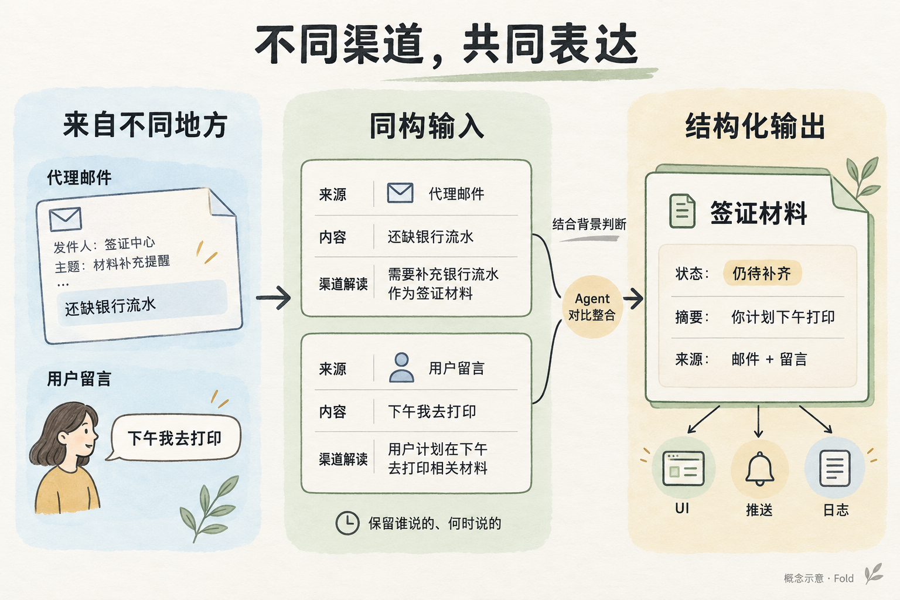
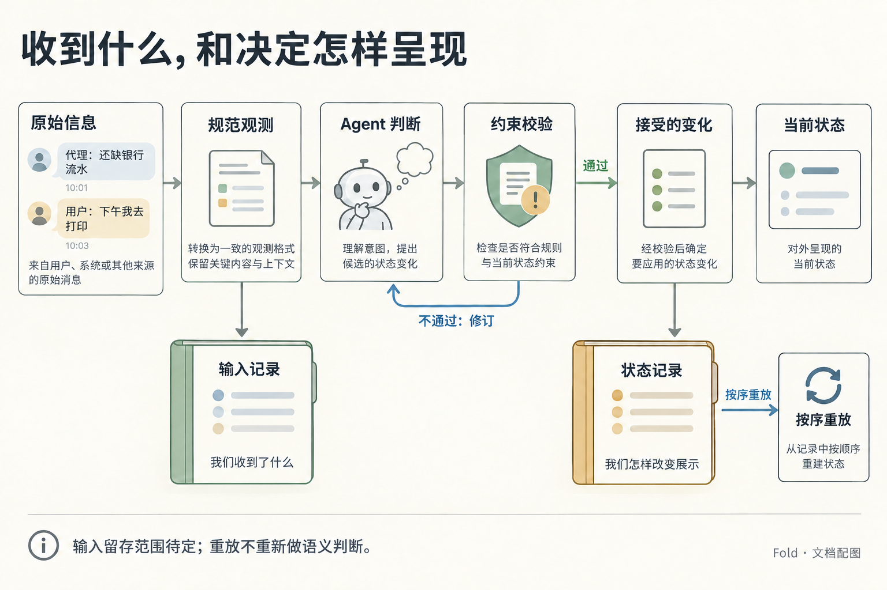

# Fold：输入与输出的共同语言

状态：设计基线。第 4 到第 6 节是首切片的外部行为规范，统一定义字段、操作和回执；本地持久化方法由[架构](architecture.md#本地提交与恢复)定义。第 2、3 节的 Observation 属于后续切片。范围、实现顺序与后续问题见[决策记录](decisions.md)。人物与数据均为虚构。

产品动机见[产品方向](product.md)，模块边界见[顶层架构](architecture.md)，估计与执行的数学关系见[形式模型](formal-model.md)，如何教 Agent 使用这些表达见[Skill 设计](skill-design.md)。

## 1. 输入来自世界，输出供多个应用使用

Fold 的输入可以是 Agent 自己做事产生的进展，也可以是它观测到的告警、发现的资料、别人转告的变化或用户主动发来的消息。是否由 Agent 执行，不决定这条信息是否值得被整理。

一轮工作的基本关系是：

```text
原始信息与渠道语义
  → 来源适配器 → 同构的 Observation（后续切片）
  → Agent 结合当前状态、用户背景与反馈进行估计和整理
  → 声明批次 → 内核校验与执行 → 结构化输出
  → 文字简报、Pinboard、推送消费者、输出日志
```

| 边界 | 负责产生什么 | 不由它决定什么 |
| --- | --- | --- |
| 来源适配器 | 有来源、时间、原始内容及渠道解读的规范输入。 | 不把渠道自带的优先级直接当成用户的重要性。 |
| Agent 与 Skill | 跨来源关联、语义估计、摘要与完整取舍，提出声明批次。 | 不把收到信息、意图或推测写成已经完成的行动。 |
| 内核与存储 | 校验并保存合法状态、明确变化及其依据，提供可读取的结构。 | 不以固定公式替 Agent 裁决关注价值。 |
| 下游消费者 | 按约定字段排序、过滤、展示、通知或记录。 | 不从份额自行推导紧急性，也不悄悄改变共享状态。 |

“来源适配器”解决信息表达问题；CLI、MCP、SDK 的调用适配器解决如何调用 Fold 的问题。两者是不同层的职责。

首切片的状态声明由 Agent 提交，也接受用户保存批注。声明可以带 `sources` 附件记录来源，只做必要的结构检查，不核验来源事实，也不据此自动分配份额。

## 2. 规范输入保留什么（后续切片）

称一份规范输入为 `Observation`：**某个来源在某时提供了什么内容，以及该渠道怎样解释这些内容。** 它不是世界真相的认证，也不是已经决定展示的条目。

不同渠道需要共享一组可识别的语义位置：

- 身份与来源：能追到谁提供、从何处取得，以及可能关联哪个事项；关联尚不清楚时保留未知。
- 内容与证据：保留来源的原始陈述，或可访问的原文引用；摘要不能冒充原文。
- 来源时间：区分观测或收到的时间与事情发生的时间；未知发生时间用未知表达。
- 渠道解读：解释专有术语、状态码、时间含义与范围，并标明哪些来自渠道规则、哪些是适配器的推断。

适配器可以由代码、模型或二者组合完成。同构意味着字段表达一致，不意味着各渠道已经达成语义共识：“邮件标为高优先级”与“监控系统 P1”可以作为来源信息保留，但不默认落在同一条用户重要性尺度上。

## 3. 两条来源如何进入同一轮整理（后续切片）



*统一表达保留来源差别；用户计划打印，并不表示材料已经齐全。图中省略了声明批次、内核校验与保存。*

沿用[用户故事 US-01](user-stories.md)的签证情境。签证代理发来邮件，用户随后留下一句话。`subject_ref` 是候选关联，尚未识别到同一事项时可以为空。

```json
{
  "id": "obs-mail-17",
  "source": {"channel": "email", "author": "签证代理", "ref": "mail:17"},
  "subject_ref": "visa-trip-oct20",
  "observed_at": "2026-10-09T10:01:00+08:00",
  "occurred_at": null,
  "content": "还缺纸质银行流水，请在10月12日18点前送到。",
  "interpretation": {
    "basis": "邮件正文明确说明材料及送达期限",
    "meaning": "10月12日18点是材料送达截止，不是这条消息可撤下的时间。",
    "unknowns": ["用户是否已经准备好流水"]
  }
}
```

```json
{
  "id": "obs-user-18",
  "source": {"channel": "user_message", "author": "小林", "ref": "message:18"},
  "subject_ref": "visa-trip-oct20",
  "observed_at": "2026-10-09T10:03:00+08:00",
  "occurred_at": null,
  "content": "我下午去打印，原定10月20日的出差照常。",
  "interpretation": {
    "basis": "用户陈述；按消息日期解读“下午”",
    "meaning": "用户计划今天下午打印，并确认出差安排仍有效。",
    "unknowns": ["打印是否实际完成", "材料是否已送达"]
  }
}
```

两个 `occurred_at` 都为空，避免声称已经知道缺材料从何时开始，或打印已经发生。在首切片里，这两条内容会作为签证声明的 `sources` 附件出现，而不是独立的 Observation 记录。

## 4. 声明与输出的结构

### 批次与回执

`commit` 只接受 JSON 对象，不接受裸声明数组。调用方在发出请求前生成 `batch_id`，并保留原始请求，直到取得确定结果：

```json
{
  "batch_id": "us01-followup",
  "declarations": [
    {
      "id": "visa-materials",
      "relation": "supersedes:visa-materials",
      "summary": "已约周五 10 点；等你下午打印的银行流水。",
      "weight": "critical",
      "kind": "needs-you",
      "reason": "预约已确认；流水仍未补齐。"
    },
    {
      "id": "visa-appt",
      "relation": "supersedes:visa-appt",
      "summary": "已确认周五 10 点办理。",
      "weight": "high",
      "kind": "done"
    }
  ],
  "acknowledges": ["ann-1"]
}
```

`batch_id` 是本地存储范围内唯一、非空且不超过 128 字符的请求标识。actor 与 now 由命令参数提供并记录；now 用于首次接受时的计算，不参与已提交批次的重复判定。

declarations 和 acknowledges 均可省略，默认空数组。同一批不能有两个声明同时改写同一条目 ID，包括嵌套声明。修改单个子项可直接按其全局 ID 提交，不必复制整棵树。

`annotate` 同样由调用方通过 `--batch-id` 提供请求标识，actor 在首切片固定为 `user`。其批注 ID 由工具产生；重复原请求返回原批注 ID，不新建第二条批注。

| 结果 | 回执与持久化含义 |
| --- | --- |
| 新请求完成保存 | `accepted: true`、`batch_status: committed`，返回 batch_id、event_seq、revision、now 和实际结果。checked 也是已保存的批次。 |
| 已保存 ID 再次提交相同操作 | `accepted: true`、`batch_status: already_committed`，返回首次接受的结果、revision 和 now；本次 events_appended 为 0，不重新执行、不刷新时间。 |
| 已保存 ID 携带不同操作 | `accepted: false`，错误 `batch_id_conflict`，带 differing_fields 与 original_receipt。本次操作未执行，原批次的 committed 结果仍然有效。 |
| 新请求校验不通过 | `accepted: false`，返回约束、目标和实际值；不改变状态/revision，不追加事件、不占用已提交 ID。 |
| 未收到确定回执或写入中断 | 结果未知。以 `fold history --batch <id>` 核对，不从退出或超时推断“没有写入”。 |

重复判定在同一存储内先按 batch_id 找到已接受记录，再比较以下内容：

- 命令类型和 actor 必须相同，不能把另一位执行者的操作静默当成重试。
- commit 比较 declarations 与 acknowledges；annotate 比较目标 item 与正文 text。只比较 declarations 不足以识别整个操作。
- commit 比较解析后的 JSON 内容，不比较文件路径；补齐省略数组的默认值，对象键顺序不影响比较，数组顺序保留。不用当前状态展开补丁后再比较，也不把自然语言改写当成相同内容。
- now 不参与比较。只换调用时间仍取回原结果，沿用首次接受的时间；若该 ID 从未落地，则以这次传入的 now 计算。一次新的检查或新的操作仍须生成新的 ID。

冲突回执中的 differing_fields 列出不同的顶层语义字段，例如 actor、declarations 或 acknowledges。original_receipt 包含原批次的 committed 回执及实际结果，明确显示已有记录，而不是提示调用方直接换 ID 重试。

结果未知时先按 batch_id 查历史，再沿用同一 ID、actor 与操作内容重试；调用时间可以更新。只有确认是另一项操作时才分配新 ID，不能为了消除冲突绕过原结果。明确收到校验拒绝时，该 ID 尚未被占用，可以沿用它提交修正方案。历史查询与重试之间的竞争由[本地提交协议](architecture.md#本地提交与恢复)中的互斥和再次核对处理。

### 声明字段

| 字段 | 输入要求 | 取值与效果 |
| --- | --- | --- |
| `id` | 必填，不可 null | `[a-z0-9-]{1,64}`；全存储范围唯一，同一事项生命周期内不变。 |
| `title` | 新建时必填，不可 null | 非空，≤ 12 字；supersede 省略时保留。 |
| `summary` | 最终有子层时必需且不可为空 | ≤ 60 字；父层摘要应自足。无子层时可用 null 清空。 |
| `weight` | relation 不是 withdraw 时必填，不可 null | critical / high / normal / low / trace。 |
| `kind` | relation 不是 withdraw 时必填，不可 null | needs-you / in-progress / done / fyi。 |
| `relation` | 默认 new，不可 null | new / supersedes:<id> / merges:[ids] / withdraw；detail-of 不在首切片内。 |
| `due_at` | 可省略或 null | ISO 时刻，行动截止；null 清空。 |
| `stale_after` | 可省略或 null | ISO 时刻，信息失效；null 清空。 |
| `share` | 可省略或 null | 显式覆盖须为正整数且同时给 reason；null 取消覆盖。 |
| `reason` | 降档、改变或取消份额覆盖、撤下时必填 | 非空的人类可读说明；撤下子层或子项也适用。 |
| `sources` | 可省略、null 或数组 | `[{channel, ref, quote?, observed_at?}]`；null 与空数组都归一为 []。 |
| `children` | 可省略、null 或声明数组 | 同结构递归；省略保留子层，显式列表给出目标子层。移除原有子项必须同时显式 withdraw，null/[] 也遵守此规则。 |

withdraw 只需 id、relation 和 reason，不必重新提供 weight、kind 等原内容。批次的 acknowledges 只能引用已保存批注；引用不存在时整批拒绝，不默默忽略错误 ID。

### 补丁、子层与留存

supersede 是补丁语义：除上表明确要求每次提交的字段外，省略字段保留原值。它保留 created_at、批注、来源和未声明的子层，旧版本在历史中可查。显式 null 仅能清空允许为空的字段，最终合成状态仍须满足类型、必填与层级约束；不能清空 id、title、weight 或 kind。

存储以 `share_override` 记录显式覆盖，`share` 始终是可用的数值结果。supersede 省略 share 时继承原覆盖；没有覆盖则根据本次 weight 派生。`share: null` 将 share_override 置 null，并按本次 weight 重算，不能产生空份额。

显式 children 列表描述目标子层：已有子项按其 ID 与 relation 更新，新子项按 new 创建。既有子项必须仍属于该父项，不能借 children 列表或嵌套 supersedes 改挂到另一层；此类移动返回 unsupported_move。只改单个既有子项时，单独 supersede 其 ID，并省略父项 children。

如果目标列表遗漏原有 active 子项，本批必须另外显式 withdraw 每个被移除的直接孩子，并分别给出 reason；该撤下自动覆盖对应的整棵子树。父项上的 reason 不替代这些动作。children:null 或 [] 表示目标子层为空，同样需要明确撤下原有孩子；通过后父项归一为无子层。

缺少显式撤下时，整批拒绝为 explicit_withdraw_required。错误包含 parent、尚未显式撤下的 omitted_children，以及这些子树中实际会退出展示的全部 affected_ids。提示明确说明“这些子项将被撤下，请补充 withdraw 或保留它们”，不笼统报告缺少 reason。由同一父子变更派生的结构更新不算重复声明；内核对整批最终状态校验，不能因父声明先出现就提前拒绝。

withdraw 使目标及其后代退出当前展示，释放它们在各自当前层中的份额。原 ID、父子关系、内容、来源、批注和撤下原因在历史中保留，可按 ID 查询；后代的未确认批注仍进入待确认反馈视图。不能用清空 children 绕过这条留存规则。

重新纳入使用 supersedes 指向原有 withdrawn ID，恢复该条目为 active，保留 created_at、资料与反馈；状态改变属于业务变化，更新 updated_at。仅恢复本批明确声明的条目，旧后代不自动恢复：省略 children 只保留当前 active 子项，历史 withdrawn 子项保持撤下。恢复子项沿用原父子归属，其最终父项必须 active，可在同一批中先恢复父项；否则返回 inactive_parent 并整批拒绝。恢复后的每层重新检查预算，恢复父子关系也计入相关条目的结构变化。

首切片的嵌套通过 children 完成；detail-of 返回 unsupported_relation，不猜测它是新增细节还是移动既有条目。跨层移动属于后续切片。

首切片的 merges 只支持同层 active 叶子合并：

- 至少引用两个不同的既有条目，目标使用新的 ID，沿用来源条目的共同父层。
- 来源条目均不得有当前或历史子树，目标也不得声明非空 children。有此类结构时返回 unsupported_merge_structure 及涉及的 IDs；来源不在同层时返回 merge_layer_mismatch。
- 新条目按 merges 中的 ID 次序继承来源附件，再追加新声明的 sources；完全相同的附件只保留一份。null/[] 不删除合并继承的来源。
- 批注按原批注 ID 继承，保留作者、正文、保存时间、确认状态和首次确认 revision。合并本身不确认批注，原始关联仍可追溯。
- 被合并条目退出当前层，标为 merged 并记录 merged_into，历史可查；其待确认批注随新条目继续可达。对 merged 旧 ID 的写入返回 item_merged 和后继 ID，不把合并解释成可以直接恢复的 withdraw；拆分与恢复旧合并项留给后续切片。

父子 kind 没有固定组合约束，父事项仍需用户参与、某个子步骤已经完成是合法状态。但同一事实的摘要应一致：上面的预约提交同时更新父项和预约子项，而不是让“已预约”与“待确认”一起成为成功用例。

### 有效变化、确认与版本

先应用补丁、归一化与派生，再比较每个条目自己的业务字段：title、summary、weight、share_override、kind、期限、sources、直接子项身份/归属和活动状态。

updated_at 表示条目资料或结构最近更新的时刻，不是“现实事项有了进展”的证明。只增加来源也算资料更新，会影响同份额时的排序；若摘要要声称事情推进，仍须有相应事实依据。

系统生成的时间、rank 和单独的 reason 改写不构成业务变化；相同内容的 supersede 不归档新版本、不刷新 updated_at。无业务变化时提交的 reason 只留在批次请求记录中，不改写条目已有 reason。仅子项内容变化不刷新父项，改变父子归属则属于相关条目的结构变化。

| 本批有效结果 | 记录 type | revision | 条目 updated_at |
| --- | --- | --- | --- |
| 有业务变化，可同时确认批注 | commit | 增加一次 | 只更新发生业务变化的条目 |
| 无业务变化，有新增确认 | acknowledge | 增加一次 | 全部保持 |
| 无业务变化，无新增确认 | checked | 保持 | 全部保持 |
| 用户保存批注 | annotation | 保持 | 全部保持 |

批注状态只有 `saved / acknowledged`。saved 表示尚未收到处理确认，不能证明 Agent 没读过；acknowledged 表示已在一次成功整理中确认或回应，不证明建议已采纳或外部行动已完成。首次确认绑定该次 revision；再次引用已确认批注不重复确认、不覆盖首次 revision，也不单独引起版本增长。

同内容 supersede 加新 acknowledges 属于 acknowledge；重复确认且无业务变化属于 checked。checked 仍带 batch_id、actor、now 并写入历史，可据此显示最近一次无变化检查的时间，它不是用户阅读记录。

### 份额与排序

没有显式覆盖时，脚本按 weight 派生 share：critical 3B/8，high 3B/16，normal 3B/32，low 3B/64，trace 1，向下取整、最小 1。B = 64 时为 24 / 12 / 6 / 3 / 1。总和超过预算时整批拒绝。

rank 按 share 降序，同 share 时 needs-you 优先，再按 updated_at 新者优先，最后按 id 字典序。Agent 不提交 rank。checked、仅确认以及相同内容的 supersede 不改变条目时间，因而不会凭空刷新这项排序依据。

### 快照、事件与时间视图

下面展示 US-01 最后一次提交后的简化快照；省略了部分普通字段，但各层 items 列出了该层全部条目：

```json
{
  "revision": "r3",
  "last_event_seq": 4,
  "root": {
    "budget": 64,
    "used": 42,
    "items": [
      {
        "id": "visa-materials",
        "title": "签证材料",
        "summary": "已约周五 10 点；等你下午打印的银行流水。",
        "weight": "critical",
        "share_override": null,
        "share": 24,
        "rank": 1,
        "kind": "needs-you",
        "status": "active",
        "reason": "按用户批注完成预约；流水仍未补齐，事项未完成。",
        "created_at": "2026-10-09T08:30:00+08:00",
        "updated_at": "2026-10-09T14:05:00+08:00",
        "last_seen_at": null,
        "due_at": "2026-10-12T18:00:00+08:00",
        "stale_after": null,
        "annotations": ["ann-1"],
        "sources": [{"channel": "email", "ref": "mail:17", "quote": "还缺纸质银行流水，请在10月12日18点前送到。", "observed_at": "2026-10-09T10:01:00+08:00"}],
        "children": {
          "budget": 64,
          "used": 42,
          "items": [
            {"id": "visa-bank", "summary": "需要近 6 个月纸质流水", "weight": "critical", "share": 24, "rank": 1, "kind": "needs-you", "status": "active"},
            {"id": "visa-appt", "summary": "已确认周五 10 点办理。", "weight": "high", "share": 12, "rank": 2, "kind": "done", "status": "active"},
            {"id": "visa-passport", "summary": "已交", "weight": "normal", "share": 6, "rank": 3, "kind": "done", "status": "active"}
          ]
        }
      },
      {"id": "weekly-report", "title": "周报草稿", "summary": "草稿已完成，收入数字有一处需要核对。", "weight": "high", "share": 12, "rank": 2, "kind": "done", "status": "active"},
      {"id": "pr-batch", "title": "PR 进展", "summary": "2 / 3 已合并，剩余一项等待 CI。", "weight": "normal", "share": 6, "rank": 3, "kind": "in-progress", "status": "active"}
    ]
  },
  "annotation_status": {"ann-1": "acknowledged"},
  "annotation_bound_to": {"ann-1": "r3"}
}
```

每个已接受的写请求只追加一条完整 JSONL 记录，包含 event_seq、batch_id、type、actor、now、revision、用于重复核对的规范请求以及恢复所需的 changes/确认信息。内部 changes 可以包含多个条目操作，重放时作为一个整体应用。checked 和 annotation 也占用 event_seq，因此事件序号不等于 revision。快照的 last_event_seq 说明已经应用到哪条记录。

事件记录是提交与恢复的事实来源，快照是可重建缓存。完整记录落地后，即使快照更新或回执返回中断，仍可按 batch_id 查到本次提交，并在读取状态前补齐快照；不以快照暂时落后推断批次失败。具体本地写入与恢复顺序见[架构](architecture.md)。

交给 Agent 的 state 视图在快照上增加 age、since_update、until_due、until_stale，以显式 now 计算；期限为空时对应投影为 null，到期只改变时长表述，不改变 status。首切片不采集用户查看，last_seen_at 和 since_seen 均为 null，表示未采集，不能写成 never。state 读取和用户批注均不自动产生阅读证据。

消费关注与呈现时，主要信号为：

| 字段 | 回答的问题 | 不能推出什么 |
| --- | --- | --- |
| weight / share | 当前层为它分配多少关注？ | 不是通用紧急性或通知许可。 |
| rank | 先呈现哪项？ | 由确定规则派生，不单独表达判断。 |
| kind | 用户需要做什么？ | needs-you 不等于必须立刻打断。 |
| status | 是否在当前展示树中？ | active 才展示；withdrawn 或 merged 都不等于资料删除。 |

身份、来源、批注和时间字段同样是结构契约的一部分。重要性与紧迫性的依据写在 reason 和 summary 中，供人和模型阅读；首切片不另设精确数值评分。

## 5. 同一输出可以有哪些消费者

- **文字简报（首个消费者）：** 按 rank 排序；critical 和 high 各自成段并加粗标题；normal 每项一逻辑行；low 和 trace 折成一逻辑行尾注“另有 n 项次要事项”；有 active children 的标“▸ n 项细节”；时间用时长；只展示 active 条目，尾注给历史入口。份额和档位影响表达篇幅，只做投影，不重算份额。
- **Agent 状态概览（首切片的可选读取方式）：** 将同一份 state JSON 按所选范围渲染成预览图，可叠加语义 diff，辅助 Agent 定位全局关系与变化。具体读取约定见下节。
- **Pinboard 与其他 UI（后续）：** 使用稳定身份、摘要、层级与份额展示当前局面；坐标与布局稳定属于渲染器。
- **推送消费者（后续）：** 依赖 `kind` 与 `weight` 做阈值，不用 `share`；发送、去重与送达由消费者负责。
- **输出日志：** 按序记录每次已接受的变化，附快照 revision，供细查 Agent 当时如何调整状态。它只覆盖实际留下的输出记录，不能还原所有原始输入。

首切片不另设“12 行”等总行数硬限制，也不为满足行数截断核心摘要。逻辑行指输出文本的换行分隔，终端宽度引起的视觉换行不计入；低档位折叠和历史入口是明确的展示规则。总行数预算与额外折叠策略在取得实际阅读反馈后评估，见[决策记录](decisions.md)。

### state 的视觉概览与 diff

视觉概览是 state 的另一种表达：在声明的范围和字段内，图上的内容与 JSON 等价，身份、数值和事实均来自同一次读取。它辅助 Agent 看清整体与变化，不产生第二份业务状态。经过选择的图片不代表完整 JSON，也不承诺从像素恢复全部字段；图中必须标明范围与省略，精确操作仍按 ID 回到 JSON 核对。

```sh
fold state --now <ts> --overview <output-dir>
fold state --now <ts> --overview <output-dir> --view view.json --diff-from <event_seq>
```

普通 state 的 stdout JSON 结构保持不变。请求 overview 时，工具在与状态存储分离的产物目录附加生成 state.json、overview.json 和 PNG；请求 diff 时再生成 diff.json。state.json 保存与本次 stdout 相同的状态对象；overview.json 是渲染说明，不写入快照或事件。坐标、图片路径与选择配置都属于读取产物。

Agent 通过 view.json 选择内容，不提供坐标、HTML、图片提示词或另写一套摘要。例如：

```json
{
  "items": ["visa-materials", "weekly-report"],
  "depth": 1,
  "fields": ["summary", "weight", "share", "kind", "annotations"],
  "changes_only": false
}
```

| 选择项 | 含义与默认值 |
| --- | --- |
| items | 要查看的条目 ID；默认 null，展示当前根层 active 条目，diff 时并入基线根层旧项。显式 ID 须存在于当前或基线可见树中，空数组表示不选择条目。 |
| depth | 从所选条目再向下展开多少层，默认 0；非负整数。子层仍用各自预算，不把子项份额计入父层。 |
| fields | 默认 summary、weight、share、kind、annotations。还可选择 reason、sources 及已定义的时间字段；只能引用 state 读取视图中的字段，不新增判断。 |
| changes_only | 默认 false，保留未变上下文并高亮变化；true 仅展示有变化的所选条目，必须同时指定 diff 基线。 |

ID、title、status、层级归属、版本范围、图例与省略提示始终保留。各层预算和已用份额取完整层的真实值，另标所选范围，不因筛选重算。批注展示读取视图已有的内容与确认状态；字段若只含引用，图也保留引用，不猜测其内容。整份状态仍待确认的反馈若在所选范围外，也要有数量提示，避免图中不可见被误解为不存在。

diff 使用 event_seq 定位基线，0 表示空初态；不能只用 revision，因为保存批注也可能改变 state 视图而不增加 revision。读取时固定当前事件位置，并从事件恢复基线；两端都用同一个 now 投影。范围之外、无法取得或晚于当前位置的基线返回 invalid_diff_base，不猜测另一份状态。

先比较两端的条目业务字段、结构状态与批注，将完整端点差异写入 diff.json，再对图片应用视图选择。diff.json 记录 base_event_seq、source_event_seq、now 与 changes；每项变化含 item、type、fields 及 before/after 的 JSON 片段，不存在的一侧为 null。type 为 added、updated、withdrawn、restored、merged 或 annotations_changed，同一条目可以有多类变化。

这是端点差异，不是期间全部事件的汇总。只发生 checked、阅读查询或时长流逝时，不把条目全部高亮；派生排位、自动时间与变化说明也不单独制造业务 diff。渲染位置变化不等于业务变化。

默认图保留当前条目，并为基线中已撤下或合并的旧项显示旧内容标记及后继关系，注明不计入当前预算。高亮同时使用文字标签，不能只靠颜色；所选字段显示 before/after 或明确的新增、撤下标记。选择排除的条目或字段仍有变化时，图上提示未展示变化，并在说明中列出对应 ID，不能把局部图宣称为全部差异。

overview.json 包含 status（ready / failed）、source_event_seq、source_revision、now、base_event_seq、base_revision、view、shown_ids、omitted_ids、hidden_change_ids 和 images。无 diff 时基线为 null；omitted_ids 说明范围、深度或变化筛选排除的条目，hidden_change_ids 也包含已展示条目中尚未展示的字段变化。图片须能关联这些说明和原始 state.json / diff.json。

产物目录可以复用，但每次渲染前须使旧成功说明失效，并保存本次 state.json。返回的 images 只列本次成功生成的图片；旧 PNG 即使仍在目录中，也不能成为本次结果。未完成的截图不发布 ready 说明。

工具内部完成布局与真实渲染，例如生成 HTML/CSS，再用浏览器 DOM 截图产生 PNG。不得用生成式图片重画业务状态、改写摘要或靠模型估计数值。选定内容过多时保持文字可读，明确分成多张 PNG 并在 images 全量列出，不静默裁切，也不靠无限缩小字体塞进一张图。

可视读取不提交声明、不增加事件、不确认批注，也不写用户阅读时间。选择配置不合法时返回 invalid_view；浏览器不可用时返回 renderer_unavailable。请求的图未完成，CLI 返回非零退出码，overview 标为 failed 并带 error，images 为空；本次已取得的 state JSON 仍可用，不返回旧图冒充新结果。浏览器依赖与捕获流程见[架构](architecture.md#state-的可视渲染)。

## 6. 三条必须保留的边界



*两类记录回答不同问题。图中 10:01 与 10:03 是观测时间，不是事情发生时间。*

**声明不等于已接受的批次记录。** 新请求校验不通过时，错误返回 Agent 修订，不进入事件流，也不改变当前状态和 revision。重复 ID 的回执须区分“此前已提交”和“不同内容冲突”，不能一概解释为从未写入。重放按 event_seq 应用完整批次，不重新调用模型解释原始消息。

**说了什么不等于做成什么。** “用户说已付款”“系统确认付款”“Agent 已确认这条批注”是不同事实。批注保存、acknowledges 记录的处理确认、展示调整及外部行动结果分别追踪，不用一个通用 status 表达。

**消费者的投影不等于新的共同状态。** 文字简报的折叠或推送的筛选只影响该消费者的结果；若要改变共享条目及份额，必须提交声明并进入相同的校验与执行流程。
