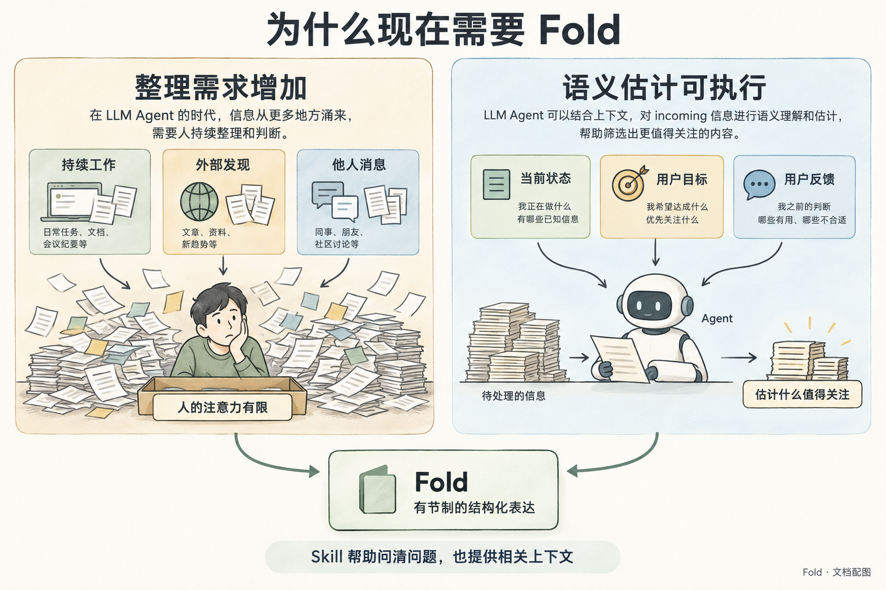

# Fold：产品方向

状态：项目启动稿。整理自[原始设计草案](reference/design-v0.3.md)与启动讨论；尚未确认的机制见[决策与开放问题](decisions.md)。

## 为什么做

当多个 Agent 持续替人工作，工作进展、外部观测与发现、别人或用户告知的消息都会不断进入它们的上下文。这些信息加在一起，可能超过一个人的注意力。用户还得阅读、比较、去重，并判断现在需要自己做什么。

Fold 让 Agent 完成这部分整理：把来自不同渠道的信息，结合当前状态和用户处境，归约为一个有预算、按重要性表达、持续更新的结构化状态。

这里有一个核心设计假设：**LLM 在增加信息规模的同时，也让跨语境的重要性、延后后果与表达价值估计成为可调用的能力。** 我们希望借此判断“用户下次接触这些信息时，什么会改变其理解或行动”。这个能力需要通过场景验证，尚未证明它在 Fold 中足够准确、一致；也不意味着此前所有方法都无法作出类似判断。

*Fold 的设计假设：LLM 既增加待整理的信息，也提供理解语境、估计关注价值的能力。*

Skill 帮助估计的两个方面是：把问题与事实转换成一致、可比较的表述，让 Agent 看见相关状态、目标、偏好与反馈。具体提案见[skill 设计](skill-design.md)。

用户可以在方便的时候回来掌握局面，下游应用也可以根据同一输出组织界面、通知或日志。期望建立的是：**我知道哪些信息值得关注，也能理解这些信息为何出现在面前。**

## 当前设计原则

- **预算属于信息接收者。** 为同一个人服务的多个 Agent 共享预算，各自精简不等于整体精简。
- **预算促使 Agent 做取舍。** 新增、覆盖、合并、嵌套、撤下都应服务于当前的汇报需要；允许留白。
- **份额表达关注价值。** 内容多不意味着重要；一项值得多少注意力，需要 Agent 结合用户处境判断。
- **来源可以不同，判断需要共同上下文。** 渠道把信息及已有解读转成统一表达，保留出处与不确定性；某个渠道的标签不直接决定全局重要性。
- **先理解要点，细节按需展开。** 摘要应让人理解当前局面；需要进一步了解时，再获取相关细节与依据。每一层都约束需要同时关注的信息量。
- **当前状态会被整理，变化需要可追溯。** 用户应能理解某件事为什么被简化表达、与其他内容合并，或暂时不再出现在当前汇报中。
- **人可以轻量反馈。** 用户留一句批注，Agent 在后续工作中读取、理解，并让下一次整理反映这个方向。

这里确认的是职责与体验方向。预算单位、份额表达方式、批注处理机制和历史保存形式仍需设计。

*先用摘要掌握当前局面，再按自己的需要深入了解。这里描述理解信息的过程，具体呈现方式由下游应用决定。*

针对其中一个要点继续追问时，相关细节可以包括背景、判断依据和待确认事项。它们围绕这个要点展开，摘要本身仍应让人理解当前局面；不要求一次阅读所有细节。

## 从具体场景开始

[用户故事](user-stories.md)用五个情境展开这种体验：离开半天再回来、账单逾期与报价失效、满额时出现更重要的事情、用户更正偏好，以及多 Agent 更新后追查某条内容的去向。每个故事都写出 Agent 的判断、用户实际看到的内容、反馈如何返回，以及做对和做错的区别。

其中 US-01 展示一个完整往返：工作产生进展，Agent 整理状态，用户回来查看并批注，Agent 接住后再更新实际结果。首轮实现可以从这条路径中选择一个真实样本；具体载体与范围仍待共同确定。

[数学模型](formal-model.md)进一步描述状态、预算与 LLM 语义估计，并区分可检查的约束与估计质量。每层预算有上限，不等于用户连续展开的总阅读成本有固定上限。

## 从信息来源到下游用途

Fold 的输入既可以是 Agent 的工作结果，也可以是一次外部观测，或用户说的一句话。入站适配器把它们转成同构的信息源表达，保留原始内容或引用、渠道已有解读、来源、身份、时间与不确定性。统一格式便于一起处理，并不表示内容已经被证实。

Agent 判断时会结合多种信号，包括来源陈述与渠道解读、用户目标与偏好、当前状态、时间条件及已有反馈。它在共同语境中估计哪些信息会影响用户的理解或行动，决定怎样取舍与表达，再由脚本验证并执行这些明确变化。

输出是一份遵循预定义结构的状态与变化，其中可以包含自然语言摘要、解释与未知，供下游排序、过滤和状态管理使用。具体字段、数值尺度与交付方式尚未冻结。

[信息契约](information-contract.md)用两条同构输入及一份结构化输出说明这个边界，保留原始陈述与渠道解读的差别。

例如，用户说“这篇文章是明天讨论要用的”，外部观测又发现“原机票报价已失效”。两者都进入同一种输入表达，保留各自出处；Agent 在共同上下文中重新估计，保留讨论材料，并更新机票的当前状况。同一份输出可供三个下游使用：

- **Pinboard 或其他 UI：** 展示讨论材料与机票状态，按份额、层级和媒介特性组织阅读。
- **推送应用：** 按用户配置的策略筛选值得通知的变化。重要性、紧迫性等结构化信号可参与阈值判断，但尺度需要校准，份额或面积不能直接等同于发送条件。
- **日志应用：** 展示谁在何时依据什么改变了状态，供追查与复盘。

Pinboard 是把份额映射为面积的示例消费者；文字简报也可以消费同一输出。面积、字数与朗读时长如何对应需要验证，不能直接换算。推送的实际发送由下游应用负责，通用内核不承担发送动作。

详尽日志需要保存结构化变更历史与必要的来源引用。若需要回看原文，还要保证引用内容留存可读；仅保存有损摘要不能恢复全部输入。日志粒度、原始资料保留范围与保存方式仍待设计。

## 成功信号

- 用户在短时间内辨认出需要自己处理的事，也知道其余事项的主要进展；“约一分钟”可作为初期观察目标。
- 同一件事的新进展替换了旧进展，用户无需自己从多条汇报中拼出当前状态。
- 父层摘要足以理解结果或下一步，展开是用户的主动选择。
- 用户批注被接住，之后的状态能体现实际处理结果，或明确说明仍待处理。
- 用户能解释重要性的分配，并能通过反馈纠正它；预算减少了阅读负担，也没有掩盖关键事项。
- 来源措辞等无关变化不会无故颠倒主要取舍；用户目标或相关事实改变时，估计能合理调整。

这些是待观察的体验信号，不是已经证明的效果或确定的验收阈值。

## 当前非目标

- Fold 不承担任务执行、工作调度或完整任务管理；批注可能引发行动，但行动由 Agent 所在的系统负责。
- 通用内核不发送消息，也不根据条目面积自动决定是否打断用户；下游推送应用可以承接通知策略与发送。
- 启动阶段不承诺同时交付多语言内核、MCP、各框架 SDK 和多种界面。
- 本轮只建立可共同审阅的项目基础；尚未开始实现产品。

## 核心术语

| 术语 | 当前含义 |
| --- | --- |
| 规范信息源表达 | 来自不同渠道的信息及其解读，用共同结构表达，保留来源与未知。 |
| 语义估计 | 结合事实、当前状态与用户处境，估计关注价值、表达价值及延后或省略的后果。 |
| 状态 | 经整理后的结构化结果，供界面、推送策略或日志等下游消费。 |
| 条目 | 状态中的一个汇报单元，可关联细节、来源与批注。 |
| 层 | 一组共享预算的条目；条目可包含下一层。 |
| 预算 | 一层允许占用的注意力总量；具体单位待定。 |
| 份额 | 条目占用的预算，用来表达相对关注价值。 |
| 声明 | Agent 提出的状态或变更意图；输入形式待定。 |
| 批注 | 用户留下的文字反馈；记录反馈不等于已经完成其中的行动。 |
| 快照 / 事件 | 某时刻的完整状态 / 状态变化及其原因；具体存储方式待定。 |

