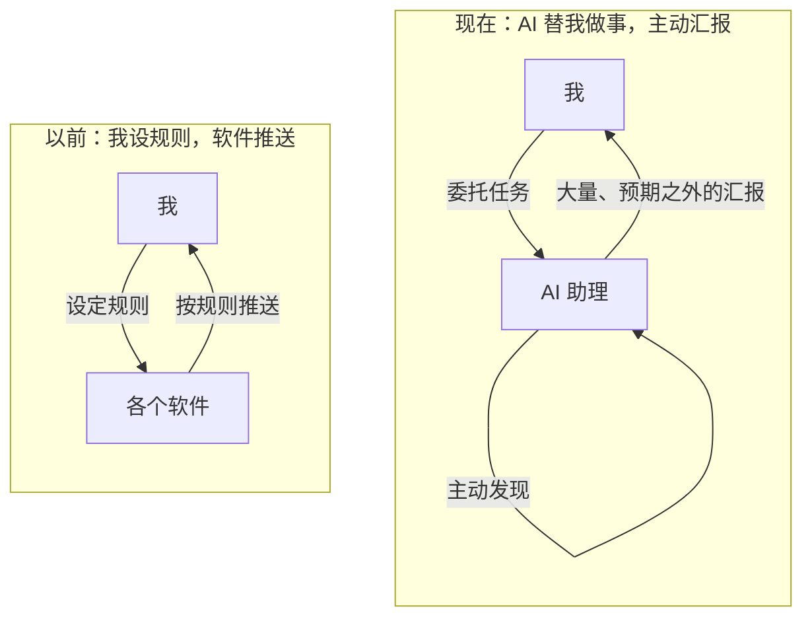
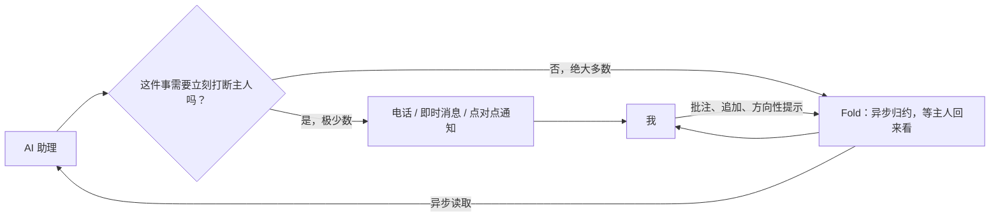
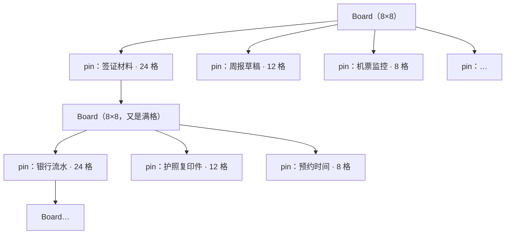
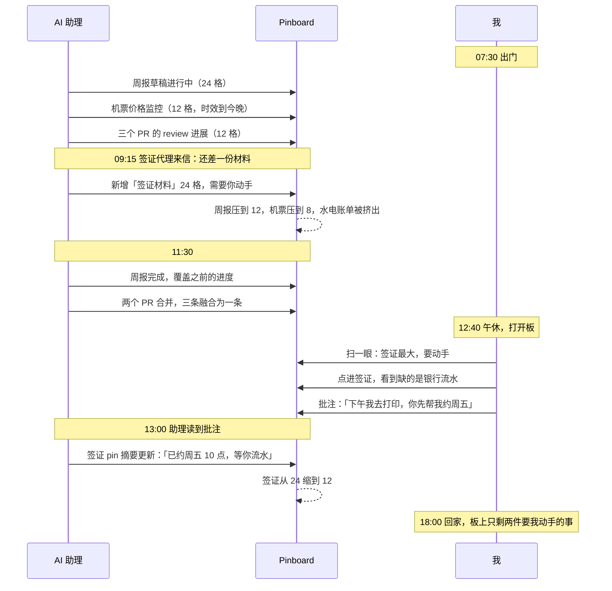
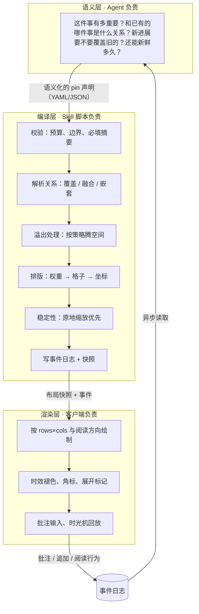
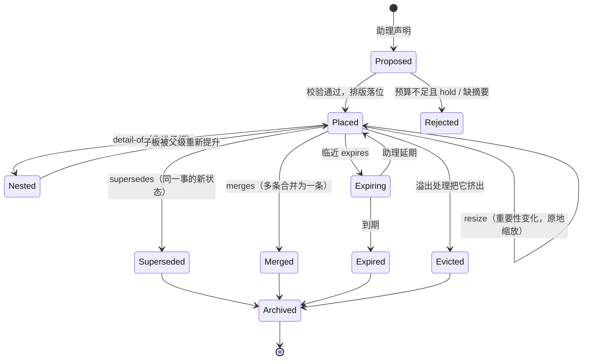
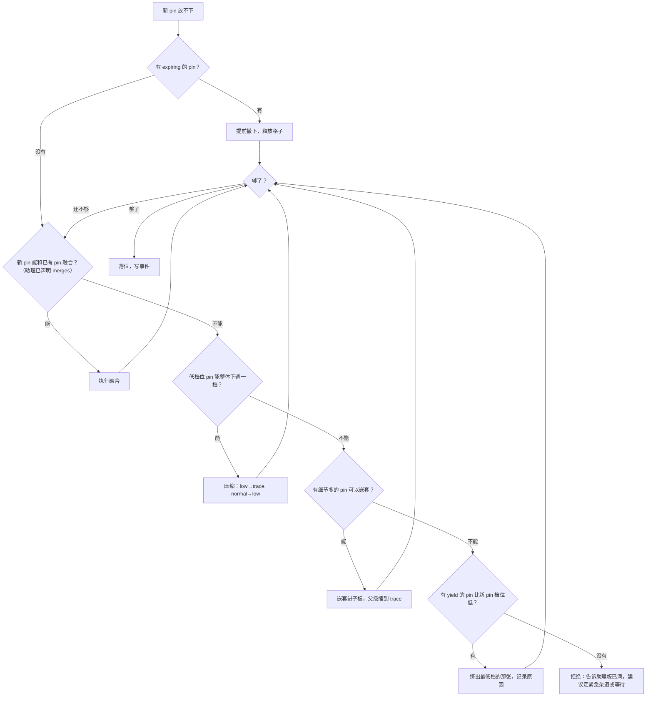
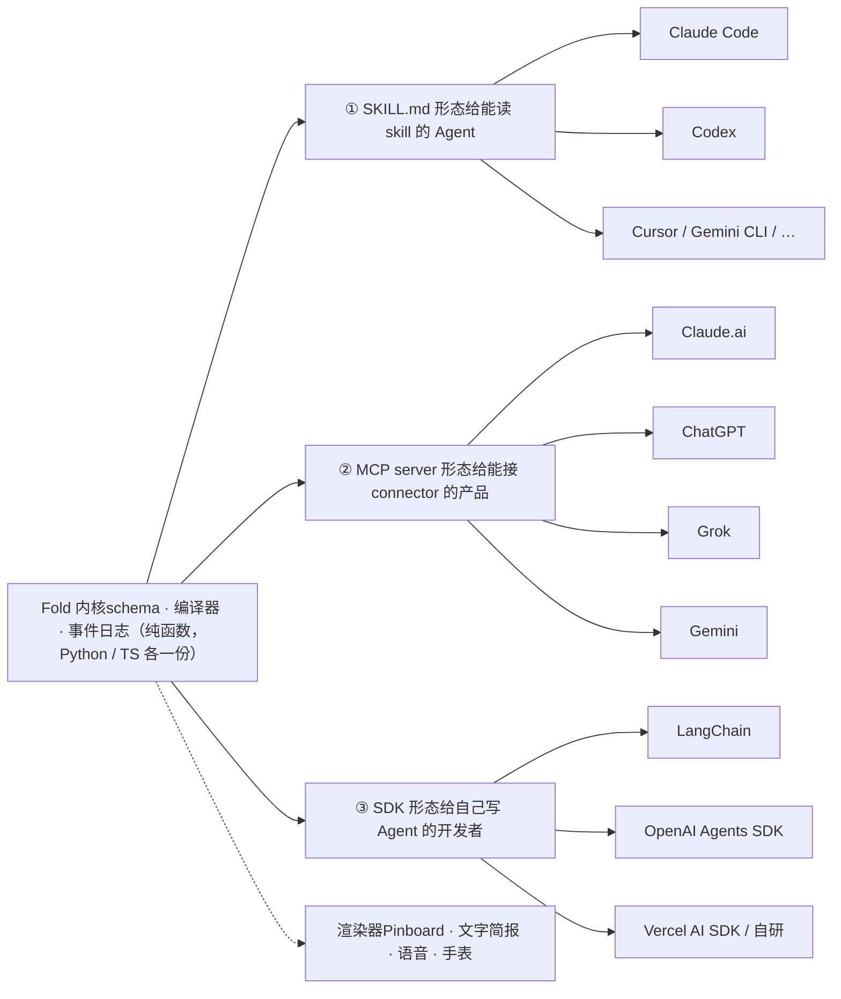
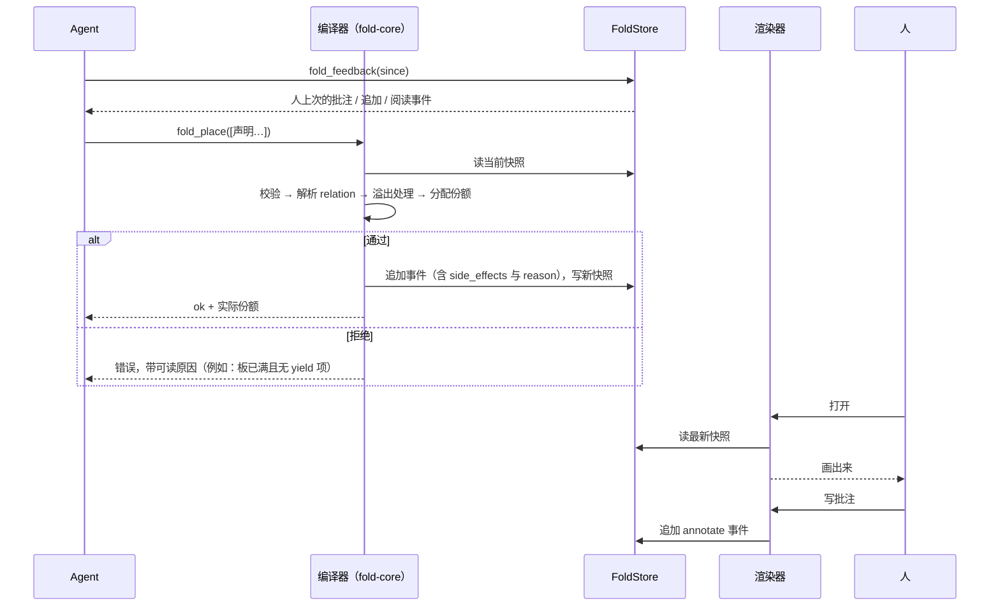

[阅读指南与术语表](#p0) [一、哲学与设计直觉](#p1) [通知模式变了](#p1-1) [我们要的渠道](#p1-2) [一句话定义](#p1-3) [二、产品具象化](#p2) [可交互原型](#p2-1) [核心模型](#p2-2) [视觉通道](#p2-3) [预算规则](#p2-4) [两个主体的用户故事](#p2-5) [功能清单](#p2-6) [三、技术设计](#p3) [分层架构](#p3-1) [语义词汇表](#p3-2) [操作与状态转移](#p3-3) [排版算法](#p3-4) [溢出处理](#p3-5) [时间建模](#p3-5b) [时光机](#p3-6) [批注回路](#p3-7) [Skill 的职责边界](#p3-8) [四、集成指南](#p4) [三种形态](#p4-0) [Claude Code / Codex](#p4-1) [LangChain 等框架](#p4-2) [成品助理](#p4-3) [渲染器不止一个](#p4-4) [附录：给研发的起手资料](#p5) [一条声明的旅程](#p5-1) [模块与边界](#p5-2) [接口契约](#p5-3) [编译器流程](#p5-4) [仓库布局](#p5-5) [一致性用例](#p5-6) [容易做错的地方](#p5-7) [结语：回到源动机](#p6)

设计文档 · 草案 v0.3 · 2026-10-09

# Fold

一个给 Agent 用的 skill：把一连串进度归约成一个有限的、按重要性排布的状态，供人异步查看。Agent 不再实时争夺你的注意力，而是把你需要知道的事情渐进地整理在一起；你回来扫一眼，就知道什么重要、什么在推进、什么可以不管。

Fold 是协议和 skill 本身；**Pinboard** 是它的示例应用——一块 8×8 的注意力板，用来告诉开发者"这个东西可以这么用，可以长成这样"。

一个有限的注意力预算。份额就是重要性。任何一项都可以展开成另一层同样的结构。

### 阅读指南与术语表

本文假设读者没有任何前置知识。四个部分可以按顺序读：第一部分解释为什么要做，第二部分用示例应用建立直觉，第三部分是内核的精确定义，第四部分是怎样交付给不同的 Agent。最后的附录是给研发的：目录、接口契约、一个端到端的样例和测试用例。

| 术语 | 含义 | 英文 / 代码里的名字 |
| --- | --- | --- |
| Agent / 助理 | 替人做事的 AI 程序。可能是编码 Agent、个人助理产品，或开发者自己写的 LangChain 程序。 | agent |
| 主人 / 用户 | Agent 替他做事的那个人。Fold 的信息接收者。 | human |
| Fold | 本项目。一个 skill 加一个内核：把 Agent 的一串进度归约成一个有预算的状态。 | fold |
| 声明 | Agent 写给 Fold 的一条语义化输入："这件事多重要、和什么有关、还能新鲜多久"。 | declaration |
| 预算 | 一层状态能容纳的注意力总量。Pinboard 里是 64 格；文字简报里是行数。 | budget |
| 份额 | 一个条目在预算里占的量。表示重要性。 | share |
| 档位 | Agent 填的离散重要性，五档。编译器把它换算成份额。 | weight |
| 条目 / pin | 状态里的一项。在 Pinboard 里渲染成一张 pin。 | item（内核）/ pin（Pinboard） |
| 层 / 板 | 一组共享同一份预算的条目。任何条目都可以有自己的下一层。 | layer（内核）/ board（Pinboard） |
| 编译器 | 内核里把声明变成状态的那段纯函数：校验、解析关系、溢出处理、分配份额、写事件。 | compiler |
| 渲染器 | 把状态变成人能看的东西：板、文字、语音。不做任何决策。 | renderer |
| 事件 | 状态的每一次变化，带原因。Agent 和人的动作都是事件。 | event |
| 快照 | 某一时刻完整的状态树，可直接渲染。 | snapshot |
| 批注 | 人在某个条目上留的方向性文字。不是任务。 | annotation |
| store | 存事件日志和快照的地方。一个人一个 store，多个 Agent 共用。 | FoldStore |

## 一、哲学与设计直觉

### 通知模式变了

以前，所有软件通知的规则都是我自己定的。我喜欢用 Line，就让 Line 每条都推；某些邮件不重要，就限制它的推送频率。无论信息多还是少，我都能接受——因为规则是我设的，我也知道自己有管理它的义务。这套认知已经内化了。

有了 AI 助理之后情况不一样了。我让它去做各种各样的事：每天七八个周期性任务、几个额外的 project，它还会主动推一些它觉得我该知道的东西。这些信息的量很大，更关键的是——**很多是我预期之外的**。不是我设的规则产生的通知，而是一个替我做事的主体，在替我判断"你需要知道这个"。于是交流负担从"我管理规则"变成了"我被持续打断"。



左边的信息量是我自己控制的；右边的信息量由 AI 的工作量决定，我既没法预期，也没有现成的管理习惯。

### 我们要的渠道

Fold 要构建的，是我和助理之间的一条**异步通信渠道**。它不替代其他渠道——真有紧急的事，助理依旧可以打电话、发即时消息、触发点对点通知。Fold 是那条更日常的、更像信任伙伴之间的交流方式。



Fold 承接绝大多数日常信息；紧急渠道保留，但使用门槛很高。

这条渠道有两个基本性质：

- **不依赖实时对话与及时反馈**助理有自己的时间线和进度安排。它不需要我在场才能推进，也不需要我秒回才能继续。我回来看板的时间，和它工作的时间，是解耦的。
- **核心进展一目了然**我让它帮我做的事，我能一眼看出重要事项的进展。不是翻聊天记录，不是看 20 条通知，而是扫一眼一块板。

还有一个隐含的目标：**路径惯性**。任何新的交互方式都有学习成本，但用了一段时间之后，用户应该形成自己的认知惯性——知道每天回来先看哪个角、什么颜色意味着要动手、什么样的 pin 可以不点。最终用户能清楚地知道：未来我只需要看这些，其他细节交给助理。这种"我知道自己该看什么"的确定感，才是真正减轻负担的东西。

### 一句话定义

把所有直觉压缩到一句话，它要足够短，短到一句话就能向新人解释清楚，又要足够完整，完整到后面所有机制都能从它推出来。抽象的版本（Fold）和具象的版本（Pinboard）各一句：

Fold：一个有限的注意力预算。份额就是重要性。任何一项都可以展开成另一层同样的结构。

Pinboard：一块面积有限的板。面积就是重要性。任何一张 pin 都可以展开成另一块板。

为什么叫 Fold：函数式编程里 fold 就是"把一串输入归约成一个状态"。Agent 在一天里产生几十条进度，Fold 把它们归约成一个状态；这个状态有预算、会覆盖、会过期、可以展开。名字不绑定任何界面——板、一段文字、一句语音，都只是这个状态的不同渲染。

- **面积有限**，所以助理必须做取舍：压缩、移除、融合、折叠。注意力预算是硬约束，不是建议。
- **面积就是重要性**，所以重要程度不是用文字说出来的，是用视觉直接体现的。一眼就能看出哪件事大。
- **pin 可以展开成板**，所以压缩是无损的。被压掉的细节只是不再占我的一级注意力，而不是消失了。我想看细节，一层一层点进去。

**为什么不是"通知中心"**通知中心是一个队列：时间顺序、每条等权、看完即删。Fold 的状态是一个空间：重要性顺序、份额不等权、持续被整理。队列的问题恰恰是它把"整理"的工作留给了人。

## 二、产品具象化：Pinboard 示例

这一部分抛开技术，用 Fold 的示例应用 Pinboard 来讨论交互模式：板长什么样、人怎么看它、助理怎么用它。Pinboard 是 Fold 仓库里 `examples/pinboard` 下的一个参考渲染器——它把 Fold 的抽象状态（预算、份额、层级）直接映射成一块 8×8 的板（64 格、面积、子板）。先给出一个可以点的原型，再把原型背后的规则写清楚。

### 可交互原型

下面是一天中某个时刻的板。点一张 pin 看详情、写批注；带「展开」的 pin 可以点进去，进去之后仍然是一块满格的 8×8 板。底部的时光机可以拖回今天早上，看板是怎么一步步变成现在这样的。

[ ] 阅读方向从右上开始

需要你动手 已完成 时效快到了 你批注过

时光机

08:0009:1511:3014:00

原型数据是编的，布局算法是真的：pin 按重要性顺序从阅读入口开始逐个落位，总面积不超过 64 格。切换阅读方向只改变渲染，不改变助理的任何输出。

### 核心模型：pin 和 board 是同一种东西

板是一个网格，默认 8×8 = 64 格。每张 pin 占整数个格子，所有 pin 的格子加起来不超过 64。任何一张 pin 都可以展开成一块子板，子板又是一块完整的 8×8。这就是磁盘空间整理工具的逻辑：treemap 上一个小方块，点进去是一个完整的世界。



递归的结构。父板上 pin 的面积表示"这件事值得你多少注意力"，不表示"里面有多少内容"。

两个关键决定：

- **每一层都是完整预算**磁盘工具是按比例的：父级占 10%，子级总共也只有那 10%。注意力板应该反过来——你一旦点进去，就表示此刻注意力全在这件事上，子板应该用满它。于是"重要性"和"内容量"被解耦：一件重要但细节少的事可以很大，一件细节很多但不重要的事可以很小。
- **嵌套是第四种压缩手段，而且是无损的**面对新信息，助理原本只有三个选择：压缩、移除、融合，三个都有损。有了"可以展开"之后，多了"嵌套"（nest）——把细节收进子板，父板上只留一张小纸条。被嵌套的内容没有消失，只是不再占一级注意力。

### 四个视觉通道，各管一件事

一张 pin 有好几个维度要表达，每个维度用独立的视觉通道，不要混用。否则一张大 pin 你分不清它是重要、是急、还是只是内容多。

| 维度 | 视觉通道 | 由谁决定 | 含义 |
| --- | --- | --- | --- |
| 重要性 | 面积（格子数） | 助理（语义层） | 这件事值得你多少注意力。全板唯一的"预算"。 |
| 时效 | 边缘与褪色（虚线、变淡） | 助理声明，渲染层执行 | 这条信息还能新鲜多久。过期自动褪色，再自动撤下。 |
| 是否有细节 | 可展开标记 | 由子板是否存在推导 | 点进去有更多，不点也不影响理解摘要。 |
| 位置 | 板上的坐标 | 渲染层（按阅读方向） | 主轴即阅读顺序即重要性；助理只输出排序，不操心左右。 |
| 性质 | 颜色/标记 | 助理 | 需要你动手 / 进行中 / 已完成 / 仅告知。 |
| 人的介入 | 角标 | 人 | 这张 pin 上有你的批注，助理会读到。 |

#### 关于位置

位置天然带着"阅读顺序"的含义，而阅读入口是文化相关的：中英文从左上开始，阿拉伯语、希伯来语从右上开始。所以这不该写死——助理只输出重要性排序，渲染层按用户的阅读方向决定第一名落在哪个角。原型里的那个开关演示的就是这件事。

两条轴可以分别承载一个维度。顺着阅读方向的主轴表示重要性最自然，因为它和"先看什么"重合。另一条轴可以放时间、类别，或"需要我动手 / 只是告知"。但建议最多只给第二条轴一个含义——位置的信息密度不高，人在板上找东西靠的是"大概在那边"，不是精确坐标。

### 预算规则

- **64 是硬约束，不是建议**所有 pin 的面积加起来不超过整块板。助理要给一件事加分，就必须从别的事上扣。"重要"因此才有意义——它是相对的、是一种排挤。允许超额然后滚动，整个模型就垮了。
- **允许留白**没什么重要的事时，板可以不满。空白本身就是信息："今天没什么要你操心的"。硬凑 64 格的鸡毛蒜皮比留白糟糕得多。
- **最小 1 格，最大半板**再小的事也看得见；再大的事也不能把别的全挤掉。真到需要超过半板的程度，它就该走紧急渠道直接打断你，而不是当一张 pin。
- **布局要稳**treemap 工具的老毛病是数据一变全部重排，你找不到刚才那块在哪了。对注意力板这是致命的——它本来就是给"回来扫一眼"用的。重要性变化时尽量原地缩放；位置只在你打开板的那一刻重算，中间不动；或者只有跨过阈值才换位。
- **64 只是默认值**棋盘是对的直觉——它暗含"pin 占整数格"，这让助理的决策可量化（12 格还是 8 格），让布局可对齐，也让预算可泛化：手机竖屏 4×8，桌面 8×8，挂墙大屏 16×8。同一套数据换一块板，助理只是在不同预算下做同样的决策。设计上写成 `rows × cols`，不要让 64 变成常量。
- **时效向上传播**子板里的东西全过期了，父板上那张 pin 也自动失效或缩小，不需要助理单独处理。
- **时间以时长出现，不以时刻出现**助理看到的不是"09:15 发生"，而是"3 小时前发生、你上次看是 1 天前、还剩 6 小时失效"。板上每张 pin 都背着这几个时长，助理据此判断一件事是不是已经凉了。人看板时也一样：标注"2 小时前"比标注"14:03"更容易判断要不要管。
- **嵌套不是免费的**如果嵌套没有代价，助理会把所有东西都塞进子板，父板永远干净但毫无信息量。嵌套起来的 pin 必须在父板上留一句真正有用的摘要，而且子板变化时摘要需要重写。这样助理自然只在细节真的多的时候才嵌套。

### 两个主体的用户故事

在这种模式里，人和 Agent 都是主体。Agent 的视角是：利用好这个窗口，清晰地整理并向主人表达信息。人的视角是：作为接收者，在板上备注、追加、批注，让 Agent 异步获取更新并继续工作。



一天的往返。注意人只打开了两次板，批注是方向性的，不是具体指令。

Agent 视角

#### 我有七件事要汇报，但只有 64 格

签证这件事会卡住主人一整周的出差，它最重要，给 24 格。周报今天就能做完，给 12 格就够。机票价格今晚失效，标上时效。水电账单只是告知，下周才到期——这次不上板了，下次有空位再说。

Agent 视角

#### 新进展来了，覆盖还是追加？

周报从"进行中"变成"已完成"，这是同一件事的新状态，直接覆盖，不要让主人看到两张周报 pin。三个 PR 里两个已经合并，它们不再值得各占一格，融合成一条"PR：2/3 已合并，剩一个等 CI"。

人的视角

#### 我只看最大的那块

中午打开板，左上角一块大的，蓝边——要我动手。点进去，缺的是银行流水。其他的看一眼就知道在推进，不点。整个过程不到一分钟。

人的视角

#### 我想提醒它一句，但不想发指令

在签证 pin 上写一句"下午我去打印，你先帮我约周五"。这不是任务，是方向。助理读到之后会自己决定怎么做，做了之后 pin 的摘要会变，我下次回来就能看到。

人的视角

#### 为什么早上那条不见了？

拖时光机回 09:15，看到水电账单是被签证那件事挤出去的，理由写在那儿。我同意这个判断，但顺手在板上追加一条"账单周三前提醒我"，助理会接住。

人的视角

#### 用了两周之后

我已经知道：每天只看左上两块，蓝边才动手，虚线的可以不管，绿的扫一眼。不再需要看聊天记录。我也知道了助理大概怎么判断重要性，偶尔批注一句纠正它。

### 从用户故事里长出来的功能清单

| 功能 | 来源 | 说明 |
| --- | --- | --- |
| 8×8 注意力板 | 一句话定义 | 面积即重要性，预算硬约束，允许留白。 |
| 无限 dive in | 磁盘整理的直觉 | 任何 pin 展开成子板，子板是满格新棋盘；面包屑返回。 |
| 覆盖 / 融合 / 嵌套 / 移除 | 三种进度情况 + 嵌套 | 助理的四种整理手段，每一种都有明确的视觉结果。 |
| 时效褪色 | 时效性失效 | 快过期的 pin 自动变淡、虚线；过期自动撤下并向上传播。 |
| 阅读方向参数 | 位置信息 | 渲染层决定入口在哪个角；助理不操心。 |
| 布局稳定 | 回来扫一眼 | 原地缩放优先；位置只在打开时重算。 |
| 批注与追加 | 人也是主体 | 在 pin 上写方向性提示；在板上追加新条目；助理异步读取。 |
| 时光机 | 可追踪、可追溯 | 拖回任意时刻看板的状态；每次变化附带原因。 |
| 反馈回路 | 重要性由谁定 | 你点进去看了很久的，下次类似的事给更多面积；看都没看就划掉的，下次缩小。 |
| 多尺寸板 | 64 的泛化 | 同一数据在 4×8 / 8×8 / 16×8 上渲染，助理按不同预算决策。 |

## 三、技术设计：Fold 的内核

整个产品的核心来自于给 Agent 的定义。只有当助理知道最终整理出来的东西在用户眼里长什么样、用户怎么消费它，它的整理才有目标。否则它只会把一切都当成一个可嵌套的 N×N 信息块——知道"可以嵌套、可以排布"远远不够。它需要一套**语义词汇表**（有点像 CSS），一套**操作定义**（每个变化意味着什么），和一个**把语义变成布局的编译器**（Skill 里的脚本），把排版、校验、溢出处理这些心智负担从助理身上拿走。

### 分层架构



Agent 只说"我想告诉用户什么、多重要、和什么有关"；脚本负责把它变成一块合法的、好看的、稳定的板。

### 语义词汇表：助理能填的东西

这是助理面对的全部接口。刻意只保留语义，不出现任何坐标、尺寸、颜色。

| 字段 | 取值 | 视觉结果 | 助理需要回答的问题 |
| --- | --- | --- | --- |
| `id` | 稳定字符串 | — | 这是哪件事？后续覆盖、融合都靠它。 |
| `title` | ≤ 12 字 | pin 标题 | 一眼能认出来的名字。 |
| `summary` | ≤ 40 字 | pin 正文 | 不点进去也能理解当前状态的一句话。嵌套时必填。 |
| `weight` | `critical / high / normal / low / trace` | 面积：约 24 / 12 / 6–8 / 2–4 / 1 格 | 在当前所有事里，这件对用户有多重要？ |
| `kind` | `needs-you / in-progress / done / fyi` | 蓝边 / 默认 / 绿底 / 淡色 | 用户需要做什么？ |
| `relation` | `new / supersedes:<id> / merges:[ids] / detail-of:<id>` | 新 pin / 替换 / 合并 / 进子板 | 和板上已有的事是什么关系？ |
| `expires` | 时间戳、`in:<时长>` 或 `on:<event>` | 临近褪色、过期撤下 | 这条信息还能新鲜多久？ |
| `children` | pin 列表 | 可展开标记 + 子板 | 细节值得单独一块板吗？ |
| `evict_policy` | `yield / hold` | — | 板满时，这条愿意让位吗？（默认 yield） |

一个真实的声明长这样：

```
# 09:15 签证代理来信
- id: visa-docs
  title: 签证材料
  summary: 还差一份银行流水，周五前要交
  weight: critical
  kind: needs-you
  relation: new
  expires: 2026-10-16T18:00
  children:
    - { id: visa-bank, title: 银行流水, summary: 需要你去银行打印近 6 个月, weight: critical, kind: needs-you }
    - { id: visa-passport, title: 护照复印件, summary: 已交, weight: high, kind: done }
    - { id: visa-appt, title: 预约时间, summary: 可约周五 10:00，等你确认, weight: normal, kind: fyi }

# 11:30 周报写完了
- id: weekly-report
  summary: 草稿已完成，在 Docs 里等你过目
  weight: high
  kind: done
  relation: supersedes:weekly-report     # 同一件事的新状态，覆盖旧 pin

# 11:30 三个 PR 合并成一条
- id: pr-batch
  title: PR 进展
  summary: 2/3 已合并，剩 #412 等 CI
  weight: normal
  kind: in-progress
  relation: merges:[pr-410, pr-411, pr-412]
```

注意 `weight` 是五档离散值而不是数字。助理擅长判断"这件事比那件重要"，不擅长判断"24 格还是 22 格"。档位到格子数的映射由编译层根据当前板的尺寸和拥挤程度决定。

### 操作与状态转移

每一个变化都是一个有名字的操作，写进事件日志。下面是一张 pin 的生命周期：



Archived 不是删除。时光机能回放所有状态，被挤出的 pin 也能在下次有空位时被助理重新提起。

| 操作 | 助理怎么表达 | 编译层做什么 | 用户看到什么 |
| --- | --- | --- | --- |
| place | `relation: new` | 校验预算；不足则进溢出处理；按阅读顺序落位 | 多了一张 pin |
| resize | 改 `weight` | 重算格数；优先原地缩放，不换位 | pin 变大或变小，位置没动 |
| supersede | `supersedes:<id>` | 新 pin 继承旧 pin 的位置和批注；旧 pin 归档 | 同一位置内容更新了 |
| merge | `merges:[ids]` | 释放被合并 pin 的格子；新 pin 落在其中最重要那张的位置；批注全部继承 | 几张变一张 |
| nest | `detail-of:<id>` | 校验父 pin 有 summary；子板按同一套规则独立排版 | 父 pin 出现展开标记 |
| expire | 声明 `expires` | 临近时标记 expiring；到期归档；子板全部过期则父级降级 | 褪色 → 消失 |
| evict | （助理不直接做） | 溢出处理的最后手段，只挤 `yield` 的 pin，记录原因 | 一张 pin 消失，时光机里能查到为什么 |

### 排版算法

排版完全由脚本完成，助理不参与。输入是一组带 `weight` 的 pin，输出是每张 pin 的 `(row, col, w, h)`。

1. **档位 → 格数。**按板的总格数 `N = rows × cols` 分配：critical ≈ 3/8 N，high ≈ 3/16 N，normal ≈ 1/8 N，low ≈ 1/16 N，trace = 1。上限 N/2，下限 1。多张同档位的 pin 共享该档的份额，拥挤时整体下调。
2. **格数 → 矩形。**选最接近正方形的 `w × h`，且 `w ≤ cols`。24 → 6×4，12 → 4×3，8 → 4×2，6 → 3×2，4 → 2×2，2 → 2×1。
3. **排序。**按格数降序；同格数按 `kind`（needs-you 优先），再按最近更新时间。
4. **落位。**在占用网格上从阅读入口开始逐格扫描，找到第一个能放下矩形的位置；放不下就旋转再试。阅读入口由渲染层参数决定，算法本身只认"逻辑左上"。
5. **稳定性约束。**如果一张 pin 上一次快照里已有位置，先尝试在原位置缩放；只有当原位放不下、或它的排序跨过了半板分界线时才允许换位。
6. **检查。**总格数 ≤ N；没有重叠；每张 nested pin 有 summary；没有 pin 超过 N/2。任何一项不过，返回助理一条可读的错误，而不是悄悄修正。

原型里跑的就是这套算法的简化版（第 1 步用了预设格数，第 5 步省略）。

### 溢出处理：新 pin 放不下时



顺序是刻意的：先处理本来就要走的（过期），再做无损的（融合、嵌套），最后才做有损的（压缩、挤出）。每一步都写进事件日志。

### 时间建模：让助理对时间有感知

前面的时效（`expires`）只回答一个问题："这条信息什么时候就没意义了"。但时间对重要性的影响不止这一个：一件三天前报的、用户看过两次却没动的事，和一件十分钟前刚冒出来的事，即使档位相同，也不该占同样的注意力。助理需要对时间有感知，这个因素必须建模进去——哪怕现在能做的还很有限。

#### 为什么不能只填时刻

如果状态里只有 `"ts": "2026-10-09T09:15:04Z"`，助理要先知道现在几点、再做减法、再判断这个差值算久还是算短。这对语言模型是一个很差的输入：它不擅长在时刻之间做算术，更不擅长把算术结果换成"久不久"的判断。所以 Fold 的原则是：**存储用时刻，呈现用时长**。编译器在生成给助理看的状态时，把所有时刻换算成相对于"现在"的时长，并且用自然语言能直接读的形式。

#### 三个时钟

每个条目背着三个时长，分别回答三个不同的问题：

| 字段 | 回答的问题 | 助理怎么用 |
| --- | --- | --- |
| `age` | 这件事上板多久了？（距首次 place） | 太老又没变化的 fyi 可以降档或撤下 |
| `since_update` | 上次有进展是多久前？（距最近 supersede/resize） | 长期没进展的 in-progress 要么该升级成 needs-you，要么该缩小 |
| `since_seen` | 用户上次看到它是多久前？（距最近 view 事件；从未看过则为 `never`） | 看过多次仍没动的 needs-you，说明用户在回避或不认同，别继续放大它 |
| `until_expires` | 还剩多久失效？（`expires` 减现在） | 快到期的提前让位 |

除了条目级的时钟，状态顶层还带着用户自己的时间：

```
"user": {
  "last_seen": "1 天 2 小时前",          // 用户上次打开任何渲染器
  "typical_return": "通常在 12:30 和 18:00 左右看",   // 从 view 事件统计，没有足够数据时为 null
  "expected_return_in": "约 3 小时"       // 由上面推出；null 表示不知道
}
```

有了这个，助理能做的判断就不只是"这件事重不重要"，而是"在用户大概三小时后回来看这一眼时，这件事还重不重要"。一条二十分钟后就会自动解决的告警，不值得上板。

#### 现在能做什么，将来能做什么

v0.1 里，时间的作用完全是**语义的**：编译器只负责把时长算出来、以可读的形式交给助理，不自动改任何份额。助理读到"这条 fyi 已经 3 天没变化、用户看过 2 次"之后，自己决定是否降档或撤下。这是刻意的——在没有数据之前，任何自动衰减曲线都是拍脑袋，不如先让助理用常识做，并把它的决定记进事件日志。

将来的方向是把衰减做进编译器：不同 `kind` 有不同的半衰期（fyi 衰减快，needs-you 几乎不衰减），`since_seen` 多次累积会压低份额，而 view 事件的统计能告诉我们用户真正在意什么。这些曲线的形状，应该从 v0.1 积累的事件日志里学出来，而不是现在设计出来。schema 为此预留了位置：份额分配的输入里已经有这四个时钟，只是现在的函数不读它们。

声明里的 `expires` 也顺着这个原则放宽：除了绝对时刻和 `on:<event>`，还接受时长写法 `in:6h`、`in:3d`。助理说"这件事六小时后就没意义了"，比它算出一个具体时刻容易得多。

### 时光机：状态转移可追溯

板的每次变化都是一个事件；每个事件应用之后产生一个快照。时光机就是在快照之间滑动，并把两个快照之间的事件列出来，附带原因。原型底部的那条滑杆就是它。

```
{
  "ts": "2026-10-09T09:15:04",
  "actor": "agent",
  "op": "place",
  "pin": "visa-docs",
  "cells": 24,
  "side_effects": [
    { "op": "resize", "pin": "weekly-report", "from": 24, "to": 12,
      "reason": "为 critical 级新 pin 腾空间，high 档整体下调" },
    { "op": "resize", "pin": "flight-watch", "from": 12, "to": 8,
      "reason": "同上" },
    { "op": "evict",  "pin": "utility-bill", "cells": 2,
      "reason": "trace 级且 yield，仍差 2 格；下周才到期，有空位时可重新提起" }
  ],
  "snapshot": "snap-0915"
}
```

三条设计要求：

- **原因是必填的。**每个副作用都要有一句人能读懂的 reason。它既是给用户看的解释，也是助理下次决策的依据。
- **批注也是事件。**人写的批注、追加、甚至"点进去看了多久"，都以同一种格式进日志。助理读的是同一条日志，所以它能看到"主人在 12:40 点了签证、写了批注、没点 PR"。
- **快照是可渲染的。**快照就是一份完整的布局结果，渲染层拿到任何一个快照都能直接画出来，不需要重放事件。

### 批注回路：人作为主体

批注是方向性的，不是指令。所以它的数据结构刻意很松：挂在哪张 pin 上、一段自由文本、时间。不定义"任务"、"截止"、"优先级"这些字段——一旦定义，批注就变成了另一个任务系统。

```
{ "ts": "2026-10-09T12:41:30", "actor": "human", "op": "annotate",
  "pin": "visa-docs", "text": "下午我去打印，你先帮我约周五" }

{ "ts": "2026-10-09T12:43:02", "actor": "human", "op": "append",
  "text": "水电账单周三前提醒我" }           // 没挂在任何 pin 上，追加到板
```

助理读到批注后的处理也是语义化的：它可以 `supersede` 那张 pin（摘要更新为"已约周五 10 点，等你流水"），可以调低 `weight`，也可以把 `append` 变成一张新 pin。批注本身会跟着 pin 走——supersede、merge 都继承批注，这样人写的东西不会因为助理的整理而丢失。

### Skill 的职责边界

最后把分工说死。这是整个技术设计里最重要的一条：**不要把排版的心智负担压在 AI 身上。**这里的"排版"在 Pinboard 里是格子和坐标，在别的渲染器里可能是段落顺序或语音时长——Fold 内核只产出带份额的层级状态，渲染是渲染器的事。

| 助理（语义） | Skill 脚本（编译） | 渲染层（视觉） |
| --- | --- | --- |
| 这件事对用户有多重要？ | 档位 → 格数 → 矩形 → 坐标 | 按 rows×cols 画网格 |
| 和已有的事是什么关系？分开说还是合着说？ | 执行覆盖、融合、嵌套，继承位置和批注 | 按阅读方向决定入口在哪个角 |
| 新进展要不要覆盖旧的？ | 校验预算、边界、必填摘要，不过就报错 | 时效褪色、角标、展开标记 |
| 这条还能新鲜多久？ | 溢出处理，按固定顺序腾空间 | 时光机滑杆、批注输入框 |
| 读批注，决定下一步 | 写事件日志和快照 | 把阅读行为写回事件日志 |
| 不碰：坐标、尺寸、颜色、溢出处理 | 不碰：重要性判断、要不要融合 | 不碰：任何决策 |

这样分完之后，助理面对的接口只剩三个问题：这件事多重要、和别的事什么关系、新进展覆不覆盖旧的。它只需要关注"我想告诉用户什么"。剩下的——有没有溢出、分布合不合理、方块放哪——由脚本做正确性检查、边界检查、自动融合，甚至视觉美化。认知压力降下来了，输出的质量反而会更稳。

## 四、集成指南：让常见的 Agent 直接拥有这个能力

Fold 的内核（第三部分）只是一个"语义声明 → 归约 → 带份额的状态 + 事件日志"的编译器。它本身不依赖任何框架。集成的问题是：怎样把这个编译器交到不同类型的 Agent 手里，并且让 Agent 知道它该什么时候、怎么用。按 Agent 的开放程度，有三种形态。

### 三种交付形态



同一个内核，三种包装。渲染器是独立的一层，任何形态都可以接任何渲染器。

三种形态共享同一份"Agent 面对的说明"，也就是第三部分的语义词汇表加一段使用指引。区别只在于这段说明怎么送达、编译器在哪里跑：

| 形态 | 说明怎么送达 | 编译器在哪跑 | 人的批注怎么回来 | 适合 |
| --- | --- | --- | --- | --- |
| ① SKILL.md | Agent 自己按 description 匹配并读取 | skill 目录里的脚本，Agent 本地调用 | 本地状态文件，Agent 下次运行时读 | 开发者机器上的编码 Agent、cron 跑的个人助理 |
| ② MCP server | tool description 里带精简版词汇表 | server 端 | server 端存储，提供 `fold_read_feedback` 工具 | 不能装 skill、但能接 connector 的成品助理 |
| ③ SDK | 开发者把说明放进 system prompt 或 tool schema | 进程内 | 开发者自己决定（数据库、消息队列） | 自己搭 Agent 的团队 |

### ① Claude Code、Codex 和其他读 SKILL.md 的 Agent

这是最省事的一条路，因为 Agent Skills 已经是一个开放标准：一个 skill 就是一个目录，里面有 SKILL.md 加可选的脚本和参考文件，SKILL.md 必须包含 name 和 description。同一份 SKILL.md 可以不加修改地在 Codex CLI、Claude Code、Cursor、Gemini CLI 等 30 多个平台上工作。

Fold 仓库的顶层就是一个合法的 skill 目录：

```
fold/
├── SKILL.md                 # 给 Agent 读的：什么时候用、怎么填语义字段
├── scripts/
│   ├── fold.py              # 编译器 CLI：fold place / fold compile / fold feedback
│   └── fold.ts
├── references/
│   ├── schema.md            # 第三部分的语义词汇表，完整版
│   └── overflow.md          # 溢出处理顺序与理由
├── examples/
│   └── pinboard/            # 示例渲染器：第二部分的那块板
└── agents/
    └── openai.yaml          # Codex 专用的 UI 属性（可选）
```

SKILL.md 的开头大致是这样。description 是关键：Agent 靠它决定什么时候激活，所以要描述"场景"而不是"功能"：

```
---
name: fold
description: >
  当你在替用户持续做事、而用户此刻不在场时使用。把进度、结果、
  发现归约到一个有限的注意力预算里，而不是逐条通知。适用于：
  后台任务完成、周期任务有新进展、同一件事状态更新、多件事可以
  合并汇报、信息有时效。不适用于：需要立即打断用户的紧急事项。
---

# 你在做什么

用户不在。你的工作会继续，但你不能把每个进展都推给他。
把要告诉他的事写成 Fold 声明，运行 `scripts/fold.py place`，
编译器会负责预算、合并、排版。用户回来会看到一个整理好的状态。

# 你只需要回答三个问题
1. 这件事对用户有多重要？（weight: critical / high / normal / low / trace）
2. 它和已有的事是什么关系？（relation: new / supersedes / merges / detail-of）
3. 新进展要不要覆盖旧的？（同一件事 → supersedes；不同事 → new 或 merges）

# 开始前
运行 `scripts/fold.py feedback`，读用户上次留下的批注和追加。
它们是方向性提示，不是任务清单。
再运行 `scripts/fold.py show`，看一眼现在的板。里面的时间都是时长：
一件事上板多久了、多久没进展、用户上次看是多久前、还剩多久失效，
以及用户大概多久后会回来看。据此决定要不要把凉掉的事降档或撤下。

# 不要做的事
- 不要指定位置、尺寸、颜色。编译器会做。
- 不要为了填满预算而上报琐事。留白是信息。
- 不要在 weight 之外用措辞强调重要性。面积会说话。
```

安装方式按各家的目录约定：Codex 会从当前目录向上扫描每一级的 `.agents/skills` 直到仓库根；用户级的目录是 `~/.claude/skills`、`~/.codex/skills`、`~/.cursor/skills` 等。通用的 skills CLI 可以按目标 Agent 自动放到对应位置：

```
# 项目级：放进 ./.claude/skills 或 ./.agents/skills
npx skills add <you>/fold

# 只装给某一个 Agent
npx skills add <you>/fold --agent claude-code
npx skills add <you>/fold --agent codex
```

在编码 Agent 里，典型用法是：开发者说"去把这三个 issue 修了，我去开会"，Agent 工作期间每有进展就调一次 `fold place`，而不是在终端里刷十几条输出。开发者回来先看一眼 `fold show`（或 Pinboard），再决定看哪个 PR。批注通过 `fold annotate <id> "…"` 写进去，Agent 下一轮开始时读到。

### ② LangChain 等框架：Fold 作为一组 tool

自己写 Agent 的开发者不需要 SKILL.md，需要的是能直接 import 的东西。Fold 的 SDK 把编译器暴露为三个 tool，加一段可以拼进 system prompt 的说明：

| tool | 输入 | 输出 | 对应内核操作 |
| --- | --- | --- | --- |
| `fold_place` | 一条或多条语义声明（第三部分的 YAML/JSON） | 校验结果；若拒绝，返回可读原因 | place / resize / supersede / merge / nest |
| `fold_state` | 可选：层级路径 | 当前带份额的状态树，供 Agent 在决策前"看一眼板" | 读快照 |
| `fold_feedback` | 自上次读取以来 | 人的批注、追加、阅读行为事件 | 读事件日志（actor=human） |

LangChain 下的最小接法：

```
from fold import FoldStore, fold_tools, FOLD_SYSTEM_PROMPT
from langchain.agents import create_agent

store = FoldStore(path="./fold-state", budget=(8, 8))   # rows × cols

agent = create_agent(
    model="...",
    tools=[*fold_tools(store), *my_other_tools],
    system_prompt=f"""你是用户的后台助理。用户现在不在。
{FOLD_SYSTEM_PROMPT}        # 即 SKILL.md 正文的精简版
""",
)

# 周期任务里：
for job in scheduled_jobs:
    agent.invoke({"messages": [("user", job.instruction)]})

# 用户回来时：
state = store.snapshot()                 # 交给任意渲染器
pinboard.render(state)                   # 或 text_brief.render(state)
```

这里 `FOLD_SYSTEM_PROMPT` 和 SKILL.md 的正文是同一份文本的两种打包，仓库里只维护一份源文件，构建时生成两份。这样"Agent 面对的说明"永远一致，不会出现 skill 版本和 SDK 版本教 Agent 两套做法。

OpenAI Agents SDK、Vercel AI SDK 的接法是同构的：把 `fold_tools` 换成各框架的 tool 定义格式即可。Fold 仓库里为每个框架放一个 20 行以内的 adapter，不做更多。真正的逻辑都在内核里，adapter 只是类型转换。

**多 Agent 的情况**如果一个系统里有多个 Agent 替同一个人做事，它们应该写同一个 FoldStore。预算是人的，不是 Agent 的——七个 Agent 不能各占 64 格。编译器会把来自不同 Agent 的声明放在同一次溢出处理里竞争，这正是预算存在的意义。

### ③ 成品助理：Meta Muse、Grok、Claude.ai、ChatGPT……

这类产品不能装 skill、不能改代码，但它们面对的恰恰是 Fold 要解决的问题。Muse 被设计为在用户关掉 app 之后继续工作，能把大目标拆成计划、监控进度，并在有变化或需要人批准时回来找用户——"回来找用户"的方式，就是 Fold 的用武之地。能不能集成，取决于产品开放了什么入口：

#### 入口 A：自定义 MCP connector（现在就能做）

这是 Fold 的第二种形态。截至 2026 年中，Grok 通过"Bring Your Own MCP"支持自定义 MCP server，成为继 Claude、ChatGPT、Gemini 之后第四个开放自带 MCP server 的主流助理。在 Grok 里添加时，到 grok.com/connectors 新建 Custom connector，填入 MCP server 地址即可，Grok 会自动发现 server 暴露的工具。

Fold 作为一个托管的 MCP server，暴露的就是上一节那三个 tool。使用说明放在 tool description 里（受长度限制，是词汇表的精简版），同时在用户的"自定义指令 / 记忆"里加一句："后台任务的进展用 Fold 汇报，不要逐条告诉我。"用户在任何地方打开 Pinboard（或收一份文字简报）看状态；批注通过 Pinboard 写回 server，助理下次调用 `fold_feedback` 时读到。

限制也要说清楚：聊天类产品的 connector 要求 server 可以从公网访问，本地启动的 stdio server 不行；Grok 的自定义 connector 只在付费层开放。更根本的限制是，助理什么时候调用这些 tool 仍然由它自己决定，Fold 只能靠 description 和用户指令去引导，不能强制。

#### 入口 B：纯文字渲染（没有任何入口时的兜底）

Muse 的主要界面是 WhatsApp 这样的消息流。即使它将来开放 connector，很多时候用户看到的仍然是一段文字。所以 Fold 必须有一个**文字渲染器**：把同一个带份额的状态树渲染成一段按重要性排序、长度受预算约束的简报。这件事反过来证明了 Fold 不是 Pinboard——没有板的地方，Fold 一样成立。

```
## 你不在的时候（09:15 → 14:00）

**签证材料** — 已约周五 10:00，等你下午的银行流水 ▸ 3 项细节
周报草稿 ✓ 已完成，在 Docs 里等你过目
PR 进展 ✓ 全部合并
水电账单 · 周三前提醒你，已排上
老板约了明早 9 点 · 15 分钟，聊 Q4 排期

（另有 2 条已过期或已解决，回复「历史」查看）
```

注意这段文字遵守的是同一套规则：份额大的在前且加粗，已完成的有标记，有子层的提示可展开，被挤出或过期的折成一行尾注。预算在这里体现为行数和字数上限，由渲染器根据渠道（WhatsApp、短信、语音播报）决定。

#### 入口 C：厂商采用（真正的终局）

对 Muse 这类把"持续在后台工作、择机回来找你"当作核心卖点的产品，最好的集成不是外挂一个 connector，而是产品本身内置这套归约逻辑。Fold 能为此做的是把自己写成一份足够短、足够可实现的规范——schema、操作语义、溢出顺序、事件格式——加一份参考实现和一套一致性测试。厂商不需要用 Fold 的代码，只需要让自己的 Agent 产出符合 schema 的状态，就能复用所有渲染器和用户已经形成的阅读习惯。第一部分说的"路径惯性"要跨产品成立，靠的就是这个。

### 渲染器不止一个

把 Pinboard 降为示例之后，渲染器这一层就清楚了：它们消费同一个状态树，各自决定"预算"和"份额"在自己的媒介里是什么。

| 渲染器 | 预算是什么 | 份额怎么表现 | 展开怎么做 | 批注怎么回 |
| --- | --- | --- | --- | --- |
| Pinboard（示例） | rows × cols 个格子 | 面积 | 点进子板 | 在 pin 上写 |
| 文字简报 | 行数 / 字数 | 顺序、加粗、是否单独成行 | 回复编号或关键词 | 直接回复消息 |
| 语音播报 | 秒数 | 先后、停顿、是否展开说 | "详细说第一件" | 说话 |
| 手表 / 锁屏 | 1–3 行 | 只渲染 critical 和 needs-you | 到手机上看 | 不支持 |
| 另一个 Agent | token 数 | JSON 原样，附份额 | 读子树 | 它自己 place |

最后一行值得注意：当接收方不是人而是另一个 Agent 时，Fold 的状态树就是一份结构化的交接文档。这也许是 Fold 比 Pinboard 更有生命力的地方——它定义的是"一个工作主体向另一个主体异步汇报"的格式，接收方是不是人并不重要。

## 附录：给研发的起手资料

这一部分把前面的设计落到可以直接开工的粒度：一条声明怎样穿过整个系统、每个模块的边界和接口、仓库怎么摆、第一批测试长什么样。这里没有排期——怎么排是研发自己的事。

### 一条声明的完整旅程



编译器是纯函数：输入（当前快照，声明列表）→ 输出（新快照，事件列表）。它不读时钟、不读文件；时间由调用方传入。这让它在 Python 和 TypeScript 里都能写成一致、可测的东西。

### 模块与边界

| 模块 | 职责 | 依赖 | 不做 |
| --- | --- | --- | --- |
| `fold-core` | schema、校验、编译器、快照与事件的数据结构。Python 和 TS 各一份，行为必须一致。 | 无 | 存储、网络、渲染、读时钟 |
| `fold-store` | 事件日志的追加与读取，快照的保存与取回。默认实现：本地目录里的 JSONL + JSON。 | core | 任何决策 |
| `fold-cli`（`scripts/fold.py`） | 给 skill 形态用的命令：`place`、`show`、`feedback`、`annotate`、`append`、`history`。 | core, store | 渲染（`show` 只输出文字简报） |
| `fold-mcp` | 把三个 tool 暴露为远程 MCP server。 | core, store | 自己的 schema |
| `fold-adapters` | 每个框架一个文件，把三个 tool 转成该框架的 tool 定义。每个 ≤ 20 行。 | core, store | 任何逻辑 |
| `renderers/*` | 读快照，画东西；把人的动作写成事件。 | store | 改份额、改顺序 |
| `prompt/agent-guide.md` | 唯一一份"给 Agent 的说明"源文件。构建时生成 SKILL.md 正文和 SDK 的 system prompt 常量。 | — | — |
| `conformance/` | 一致性用例：输入 + 期望输出。两个内核都必须全部通过。 | — | — |

### 接口契约

以下三个结构是 v0.1 要冻结的。字段只增不改。

#### 声明（Agent → 编译器）

| 字段 | 类型 | 必填 | 约束 |
| --- | --- | --- | --- |
| `id` | string | 是 | `[a-z0-9-]{1,64}`；同一件事在整个生命周期内保持不变 |
| `title` | string | 是 | ≤ 12 个字符（CJK 按 1 算） |
| `summary` | string | 有 children 时必填 | ≤ 40 个字符 |
| `weight` | enum | 是 | `critical \| high \| normal \| low \| trace` |
| `kind` | enum | 是 | `needs-you \| in-progress \| done \| fyi` |
| `relation` | string | 否，默认 `new` | `new` / `supersedes:<id>` / `merges:[id,…]` / `detail-of:<id>`；被引用的 id 必须存在于当前快照 |
| `expires` | string | 否 | ISO 8601 时间、`in:<duration>`（如 `in:6h`、`in:3d`，以 `now` 为基准换算后存为时刻），或 `on:<event-name>` |
| `evict_policy` | enum | 否，默认 `yield` | `yield \| hold`；`hold` 的条目不会被溢出处理挤出 |
| `children` | 声明数组 | 否 | 同结构，递归；子层独立预算 |

#### 快照（编译器 → 渲染器）

```
{
  "snapshot_id": "snap-0915",
  "ts": "2026-10-09T09:15:04Z",
  "budget": { "rows": 8, "cols": 8 },          // 总量 = rows × cols
  "user": { "last_seen_at": "2026-10-08T07:10:00Z", "view_times": ["12:30", "18:00"] },
  "layer": {
    "used": 62,
    "items": [
      {
        "id": "visa-docs", "title": "签证材料",
        "summary": "还差一份银行流水，周五前要交",
        "weight": "critical", "share": 24, "rank": 1,
        "kind": "needs-you", "status": "placed",      // placed | expiring
        "expires": "2026-10-16T18:00:00Z",
        "created_at": "2026-10-09T09:15:04Z",
        "updated_at": "2026-10-09T09:15:04Z",
        "last_seen_at": null,
        "annotations": [],
        "children": { "used": 46, "items": [ … ] }   // 可选；同结构
      }
    ]
  }
}
```

注意快照里**没有**坐标。`rank` 是重要性排序，`share` 是份额，渲染器据此自己排版。被归档的条目不在快照里，只在事件日志里。

快照里的时间全部是**时刻**（存储形态）。`fold_state` 交给助理的是它的**投影**：同一棵树，但每个条目多出 `age`、`since_update`、`since_seen`、`until_expires` 四个可读时长，顶层多出 `user.last_seen`、`user.expected_return_in`。换算以调用方传入的 `now` 为准。渲染器自己决定显示时刻还是时长。

#### 事件（所有变化的唯一记录）

| 字段 | 说明 |
| --- | --- |
| `ts` | 由调用方传入的时间 |
| `actor` | `agent:<name>` 或 `human` |
| `op` | `place \| resize \| supersede \| merge \| nest \| expire \| evict \| reject \| annotate \| append \| view` |
| `item` | 主要涉及的条目 id（`append` 没有） |
| `from` / `to` | 份额或状态的变化，仅 resize / supersede 有 |
| `reason` | 人能读懂的一句话。**除 place、annotate、append、view 外必填。** |
| `side_effects` | 这次操作连带引起的其他事件（内嵌，同结构） |
| `snapshot` | 应用之后的快照 id |
| `text` | 仅 annotate / append：人写的文字 |

#### 三个 tool（对所有形态一致）

```
fold_place(declarations: Declaration[], now: datetime) -> { ok: true, placed: {id: share}[] }
                                                        | { ok: false, reason: string }
fold_state(path?: string[], now: datetime) -> Snapshot 子树的投影：时刻换算为可读时长，附 user 时间（path 为 id 序列，空即根）
fold_feedback(since?: datetime)    -> Event[]（actor = human）
```

### 编译器内部的固定流程

1. **校验**每条声明的字段。任何一条不过，整批拒绝（原子性），返回第一个错误。
2. **解析 relation**：`supersedes` 让新条目继承旧条目的 rank 区间和 annotations，旧条目归档；`merges` 释放所有被合并项，新条目继承其中 rank 最高者的位置和全部 annotations；`detail-of` 把条目放进目标的 children 层。
3. **处理时间**：把 `in:` 写法的 `expires` 换算为时刻；把已过期的条目归档；距到期不足阈值（默认 12 小时）的标为 `expiring`；子层全部归档则父条目降一档。同时为每个条目算出四个时钟，为顶层算出用户时间——v0.1 只算不用，留给助理读。
4. **档位 → 份额**：设总量 N。critical = 3N/8，high = 3N/16，normal = N/8，low = N/16，trace = 1；上限 N/2，下限 1。同档多条时按该档总份额平分，向下取整。
5. **溢出处理**：若 used > N，按第三部分的顺序逐步腾空间：撤下 expiring → 执行可用的 merge → 低档整体降一档 → 把 children 最多的 normal 以下条目嵌套为 trace → 挤出份额最低且 `yield` 的条目 → 仍不够则拒绝本批。每一步生成一条带 reason 的 side_effect。
6. **排序**：share 降序；同 share 时 `needs-you` 优先；再按 `updated_at` 新者优先。写入 `rank`。
7. **输出**新快照和事件。编译器到此为止，不碰坐标。

### 仓库布局

```
fold/
├── README.md
├── SKILL.md                   # 由 prompt/agent-guide.md 生成；顶层即 skill 目录
├── agents/openai.yaml         # Codex 专用元数据（可选）
├── references/                # SKILL.md 引用的长文：schema.md、overflow.md
├── prompt/agent-guide.md      # 给 Agent 的说明，唯一源文件
├── scripts/fold.py            # CLI
├── packages/
│   ├── fold-core-py/
│   ├── fold-core-ts/
│   ├── fold-store/            # 默认本地实现；接口留给数据库实现
│   ├── fold-mcp/
│   └── fold-adapters/         # langchain.py、openai_agents.py、vercel-ai.ts
├── renderers/
│   ├── pinboard/              # 第二部分那块板，单文件 HTML，读快照 JSON
│   └── text-brief/
├── conformance/cases/*.yaml
├── examples/
│   ├── claude-code/           # 一个真实任务的端到端记录
│   └── langchain/
└── docs/design.html           # 本文
```

### 第一批一致性用例

一个用例 = 初始快照 + 一批声明 + 期望的新快照 + 期望的事件（含 reason 的关键词）。先写用例再写代码。下面是第二部分那一天的 09:15 一刻：

```
# conformance/cases/02-critical-arrives-evicts-trace.yaml
given:
  budget: {rows: 8, cols: 8}
  items:               # 08:00 的板，共 60 格
    - {id: report,  weight: critical, kind: in-progress}   # 24
    - {id: flight,  weight: high,     kind: in-progress}   # 12
    - {id: pr,      weight: high,     kind: in-progress}   # 12
    - {id: read,    weight: low,      kind: fyi}           # 4
    - {id: cal,     weight: low,      kind: needs-you}     # 4
    - {id: filter,  weight: trace,    kind: fyi}           # 2
    - {id: bill,    weight: trace,    kind: fyi}           # 2
when:
  now: 2026-10-09T09:15:00Z
  place:
    - {id: visa, title: 签证材料, summary: 还差一份银行流水, weight: critical, kind: needs-you}
then:
  used: 62
  shares: {visa: 24, report: 12, flight: 8, pr: 8, read: 4, cal: 4, filter: 2}
  archived: [bill]
  rank: [visa, report, flight, pr, cal, read, filter]      # cal 在 read 前：同份额 needs-you 优先
  events:
    - {op: place, item: visa}
    - {op: resize, item: report, from: 24, to: 12, reason_contains: 腾空间}
    - {op: resize, item: flight, from: 12, to: 8}
    - {op: resize, item: pr, from: 12, to: 8}
    - {op: evict, item: bill, reason_contains: yield}
```

建议至少先有这些用例：空层 place；supersede 继承批注；merge 三合一；过期自动归档并向上传播；嵌套要求 summary；溢出的每一步各一个；`hold` 条目不被挤出；全部 hold 且放不下时拒绝；超过半板的声明被夹到 N/2；`in:6h` 以传入的 now 换算；`fold_state` 投影里的时长正确且 `never` 处理正确。

### 容易做错的地方

- **把坐标放进内核。**一旦 schema 或快照里出现 x、y、color，渲染器就没法替换了。坐标只存在于 Pinboard 自己的内存里。
- **让编译器读时钟。**时间必须由调用方传入，否则测试不可重复。
- **为了演示放宽预算。**64 格放不下就是放不下，拒绝并返回原因，让 Agent 自己决定怎么办。
- **把批注做成任务。**批注只有 text 一个字段，没有 due、assignee、priority。
- **两份内核各自演化。**任何行为变化都先改 conformance 用例，再同时改两个实现。
- **维护两份给 Agent 的说明。**SKILL.md 和 system prompt 必须由同一个源文件生成。

## 结语：回到源动机

这个项目起于一个很小的不适。以前所有通知的规则都是我自己定的，信息再多，我也知道那是我的选择，也知道该怎么管。现在有一个替我做事的主体了，它一天干七八件事，每件事都有进展，每个进展它都觉得我该知道。它没有错——它确实在替我做事——但我没有任何现成的习惯去消化一个"替我做事的人"的汇报。于是交流负担从"我管理规则"变成了"我被持续打断"，而打断我的恰恰是我请来帮忙的那个。

Fold 的回答是：不要让它实时争夺我的注意力，让它把要告诉我的事持续整理在一起。整理这个动作本身就是重点。进度会覆盖进度，几件事会融合成一件，有时效的东西会自己过期，而我能给出的注意力是有上限的——新东西要进来，就得有旧东西让位。这四件事从来都在发生，只是以前由我在脑子里做，现在应该由助理在汇报之前做完。而且它们都发生在时间里：一件事多久没动、我多久没看、还剩多久失效、我大概什么时候回来——助理必须能感知这些，哪怕现在只能靠常识去用。

所以这里有一个预算。预算不是为了限制助理，而是为了让"重要"这个词有意义：如果什么都能放上来，那什么都不重要。预算是硬的，留白是允许的，一件事占多少份额就是它值得我多少注意力。这个份额直接变成视觉——在板上是面积，在文字里是顺序和粗细，在语音里是先说还是后说——我不需要读完才知道什么重要，我看一眼就知道。

所以这里有层级。预算有限，但信息不该因此丢失。任何一项都可以展开成另一层同样的结构，每一层都是一份完整的预算。我回来只看最顶层，想了解细节就一层一层点进去。这让压缩变成了无损的：被压掉的只是我的一级注意力，不是事实本身。

所以这里有两个主体。人不只是接收者。我可以在任何一项上留一句话——不是指令，是方向——助理下次工作时会读到，然后它的下一次整理会因此不同。我也可以拖回今天早上，看板是怎样一步一步变成现在这样的，每一步为什么。信任来自可追溯，不来自服从。

也所以，助理不该操心排版。它需要回答的只有三个问题：这件事对我有多重要，它和已有的事是什么关系，新进展要不要覆盖旧的。剩下的——预算够不够、谁让位、放在哪、多大——是算法的事。把认知负担从它身上拿走，它才能把力气花在"我想告诉你什么"上。

最后，这一切与板无关。板只是让人最快理解这件事的一种形状。真正定义的是一种关系：一个持续工作的主体，向另一个不在场的主体，异步地、有节制地、可追溯地汇报。接收方可以是人，也可以是另一个 Agent。用得久了，人会形成自己的惯性——知道每天只看哪里，知道什么颜色才要动手，知道其余的可以放心交出去。那种"我知道自己该看什么"的确定感，才是这个项目想给出的东西。