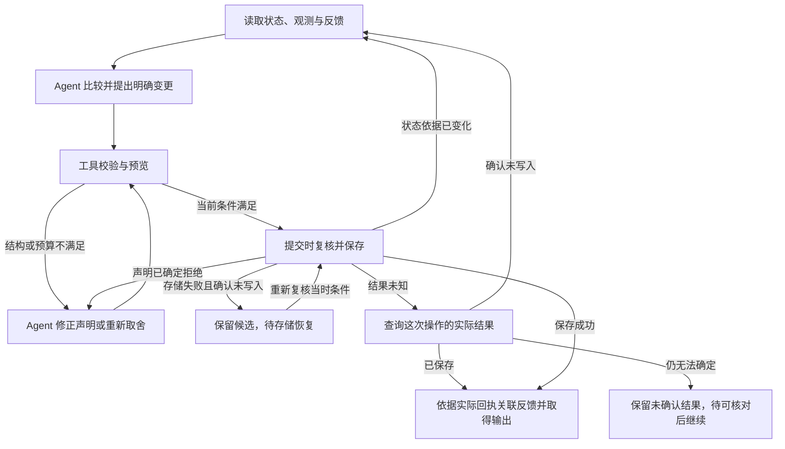

# Fold skill：语义判断与可靠操作

状态：设计推导，尚未编写可安装的 `SKILL.md` 或配套产品工具，也没有执行评估。本文承接[形式模型](formal-model.md)与[用户故事](user-stories.md)；实现边界见[架构](architecture.md)，待确认选择见[决策记录](decisions.md)。

输入不仅是 Agent 自身的工作日志，也包括外部观测、主动发现以及他人或用户告知。来源适配器先提供同构的[信息源表达](information-contract.md)；Skill 帮助 Agent 判断怎样整理，并提供可调用的操作能力，把决定维护成预定义的结构化状态。

## 已明确的方向与本文的提案

用户明确的方向是：LLM 一方面让后台工作与汇报数量增长，另一方面也让“这件事对这个人有多重要”这类难以写死的判断，可以通过语义估计来执行。Fold 应当利用这种能力。

完整的 Skill 应把**语义判断指引与成套可执行工具**一起交付，以明确的动作契约衔接。指引帮助 Agent 决定怎样表达与取舍；CLI 或其他形式的脚本负责规范的读取、结构操作、校验、保存和结果查询。程序化工作有稳定入口，Agent 就无需在每一轮重新实现它们。

其中，语义估计指引包含两方面帮助：**把待判断的问题转换成更准确、一致的表达；让 Agent 看见作出判断所需的当前状态与用户上下文。** 工具落实这些判断，但不以固定策略代替判断。

*问法更清楚、上下文更完整，估计才有依据；新的背景促使重新比较，不机械规定份额增加。*

图中的两种情境使用同一篇文章。只有推荐内容时，其用途尚不明确；补充“明天开会要用”后，Agent 获得了它与用户近期目标相关的新依据，需要结合其他事项重新比较关注价值。

配套操作能力是已明确的设计方向。下文关于输入组织、动作划分、回执、提交机制和对照评估的安排，是据此提出的具体方案；它们尚未成为冻结的字段、命令、固定提示词或调用流程。

## 估计要回答什么

建议把每次整理的目标统一表达为：

> 用户下次回来时，哪些内容会改变其理解或行动？如果延后表达、缩短表达或省略它，可能造成什么后果？

这使“重要”有了具体对象、时机与后果。它不仅包括需要用户动手的事情，也包括能让用户修正判断、了解结果或放心等待的信息。

例如“PR 已合并”可能无需行动，却能让用户停止等待；“只差银行流水”让用户知道下一步；一篇文章是否值得保留，要看它是否服务于用户明天的讨论。

模型需要估计这些差异，再比较可行的表达方案。它可以提出关注顺序、保留与让位关系、摘要或份额调整，不必先把所有事项压成一个裸露的 0–100 分。估计能以语义表达被检查和修正，不要求它一开始就具有精密测量的外观。

## 让估计看到足够的上下文

下面是一份候选读取视图。它描述需要知道什么，不指定一个工具必须返回多少字段。

| 上下文 | 为什么影响判断 |
| --- | --- |
| 当前同层的全部条目摘要、预算与份额 | 估计相对关注价值，知道新增内容将与什么竞争；已有份额只是此前判断的结果。 |
| 本轮新增或变化的观测、渠道解读、来源与时间 | 区分新进展、旧消息重述、尚未证实的说法，以及来源陈述与适配器的推断。 |
| 已明确的用户目标、偏好与承诺 | 知道什么后果与用户有关，例如明天的讨论、已经约定的办理时间。 |
| 尚未处理的反馈及已知处理结果 | 接住用户更正；区分留言存在、Agent 已读与行动已有结果。 |
| 当前时间、截止或失效的具体意义 | 判断等待的后果；用户下次查看时间未知时，不虚构一个精确时刻。 |
| 必要时的子层、原文与变化历史 | 检查摘要是否遗漏关键事实，理解条目为何被缩小、合并或撤下。 |
| 信息缺口、来源冲突与状态版本 | 明确哪些估计受缺失或过时上下文影响，避免把未知当作否定证据。 |

上下文需要选择：通常先看同层全貌，再按本轮变化与待解决的问题补充细节，不要求每次把整棵树和全部历史塞进模型。

但选择不能只依赖当前份额。一个长期占很小份额的条目，也可能收到决定性的用户反馈；如果读取策略因此不给模型看新证据，它就失去了被重新估计的机会。新变化、用户更正和与当前目标相关的历史，应有独立进入上下文的路径。

被归档的内容是否需要重新加入候选，也由与当前问题相关的新背景决定；“不在当前板上”不能直接等于“不值得再看”。

## 用一致的语义描述候选

入站适配器负责让不同渠道的内容具有共同结构；skill 进一步示范怎样把这些内容表达成可比较的判断问题，同时保留证据出处与不确定之处。不能因为来源将某项标为“高优先级”，就跳过与用户处境及其他事项的比较。

| 容易混淆的表达 | 更适合估计的表达 |
| --- | --- |
| “账单过期了。” | “付款截止已过，仍未支付；尚待处理的是账单。” |
| “这个报价今天过期。” | “此价格今天之后不能购买；出行需求是否仍存在另行判断。” |
| “大项目，写了很多进度。” | “当前哪项结果、阻塞或选择会改变用户的理解；细节量另行说明。” |
| “很紧急，所以最重要。” | “延后到下次查看会有什么后果，该后果与用户目标有何关系。” |
| “用户一直没有点。” | “未观察到展开；可能是摘要已足够，尚无明确不感兴趣的反馈。” |

重要性、紧迫性、任务规模和内容字数可以相关，但不是同一个量。规范表达的目的，是避免模型拿一个容易看见的表面特征替代实际估计。

转换也不能擅自补全事实。例如原始记录只说“已提交付款”，就不能规范成“付款成功”。来源、已知事实与模型对后果的推断，应能被区分。

## 比较方案，给出可核查的说明

建议让模型比较“保留或增加这项，会让什么让位；被让位的内容是否仍能充分表达”，而非仅为每个条目孤立打分。

沿用 US-03，可以先比较两种候选：

- 保留阅读推荐，减少周报的过程说明：适用于阅读与用户近期目标直接相关的情况。
- 暂时撤下阅读推荐，同时保留已完成周报的结论：适用于当前没有阅读用途证据、签证需要用户参与的情况。

模型选择其中一种时，输出足够支持复核的结果说明。例如：

> **依据：** 签证代理确认缺银行流水；用户已确定出差安排；周报已有完成稿。
>
> **本次调整：** 提高签证的展示份额，周报保留结果与待核对点，阅读推荐暂离父层。
>
> **让位理由：** 签证需要用户参与，周报过程信息已被结果替代；当前没有阅读推荐必须今天处理的证据。
>
> **未知：** 不清楚阅读推荐是否用于近期会议。若用户补充这种用途，应重新比较。

这份说明是依据与结果的简短摘要，不要求暴露内部思考过程。来源应在实际数据中可定位，不能靠措辞制造“已经核实”的印象。

这些说明最终应进入约定的结构字段，与身份、状态、来源和估计结果一起输出。自然语言用于表达内容与依据，不能让排序、过滤与状态管理都依赖消费者重新猜测一段自由文本。若下游要依据某个估计阈值推送，skill 的示例还需帮助模型稳定理解那个字段的尺度；当前没有确定这类字段、尺度或阈值。

未知不必被包装成“87% 置信度”。模型可以直接指出缺什么、它可能改变哪项判断，以及当前采用了什么暂定假设。是否需要补查、保留更多信息或请求用户澄清，应根据缺口对本次决定的影响处理，不必把每个缺口都变成打断。

## 用明确动作操作状态

Skill 的可执行部分应围绕 Fold 的概念对象提供操作：观测、条目、层、份额、反馈和变化记录。Agent 表达整理意图，工具负责把意图落实成约定的结构变化。不能每次都让模型自行遍历存储、重算预算、拼接历史，再猜测哪些引用应该一起修改。

这里需要固定的是**动作的含义与执行规则**。例如，同样是“撤下条目”，不能一次只移出当前层、另一次却连来源和反馈一起删除；同样是“调整份额”，不能有的入口拒绝超额、另一个入口静默缩小其他项。工具行为稳定后，Agent 才能把注意力放在是否应撤下、谁应让位及怎样表达上。

### 动作词汇与结构效果

下面列出需要设计的动作族，不是已实现的命令清单。每个动作须约定目标、必要输入、结构效果、保留关系和失败条件。

| 动作族 | Agent 需要作出的决定 | 程序必须明确执行的语义 |
| --- | --- | --- |
| 新增与更新 | 新信息属于新事项还是已有事项，当前摘要和依据是什么。 | 区分新建、局部修改与整体替换；以明确身份定位目标，按约定保留未修改内容与关联，不能从一句“更新一下”猜写入范围。 |
| 调整关注分配 | 哪些条目让位，各项应得到怎样的份额或分配声明。 | 根据已选定的份额协议计算各层总量与留白，验证约束，返回实际差异；不自行选择降档或驱逐对象。 |
| 关联、移动与展开层级 | 哪些细节属于哪个主题，哪些内容应进入子层。 | 检查目标是否存在、归属是否合法及是否形成环，落实明确的结构调整；跨层变化按各层预算分别检查。 |
| 合并与拆分 | 哪些内容应共同表达，合并后的摘要或拆分后的内容各是什么。 | 执行给定的对象映射与新表达，按约定维护来源、反馈和历史关联；没有关系迁移规则时不能自行丢弃或猜测。 |
| 撤下与重新纳入 | 哪项暂时退出当前关注范围，什么新依据支持重新纳入。 | 区分展示范围变化与资料删除，保留约定的追溯关系；重新纳入也形成明确变更，不能用历史查询暗中覆盖当前状态。 |
| 关联反馈与处理事实 | 哪条反馈影响了什么判断，已经取得了什么结果。 | 检查反馈、变更及结果引用，分别记录保存、读取、展示调整和外部行动结果，不把它们压成一个含糊的“完成”。 |

这不是把所有存储操作暴露给模型。一个“合并”动作可以在内部处理多处关系维护，但模型面对的仍是同一个有边界的概念动作；它不需要知道表名、文件布局或写入顺序。哪些动作采用独立入口、哪些作为同一次变更的子动作，仍待首个场景收敛。

### 覆盖一次完整整理的操作能力

成套工具应让 Agent 能从取得信息走到确认结果，也能在出错时继续。下面是能力划分，未规定必须有几条 CLI 命令，也不要求每次调用遍历所有步骤。

| 能力 | 输入与返回需要表达什么 | 对当前状态的影响 |
| --- | --- | --- |
| 接入或取得规范观测 | 接收者或处理范围、规范观测及来源；返回观测标识、接收或留存结果、缺失与不可取回的信息。 | 收到输入不等于决定展示。确定标识下的重复接收可由程序按约定处理；两条消息是否语义重复仍需判断。完整输入留存范围另行约定。 |
| 读取上下文与补充细节 | 指定层、条目或相关范围；返回摘要、预算、份额、状态依据、新观测、反馈，以及可查询的细节与来源引用。 | 读取范围与缺失须明确。读取是否另记“已读”应由契约说明，不能因查询就默认为反馈已处理。 |
| 校验与预览变更 | 提供读取时的状态依据、明确变更和理由；返回候选状态、差异、各层预算结果或具体错误。 | 候选计算不改写已保存状态。预览只对相应状态、规则与时间有效，不保证稍后的提交仍可接受。 |
| 提交与确认结果 | 提供完整变更及所依据的状态；返回实际保存结果、变化范围，以及供后续核对的标识或查询依据。 | 提交时仍需检查适用条件；只有实际保存成功才能报告更新完成。检查通过、内核接受与保存成功分别表达。 |
| 记录反馈处理进展 | 指定反馈及已发生的读取、回应或处理事实，关联相应变化或结果。 | 维护可查询的处理记录，不据此宣称外部动作已经执行；没有结果依据时保留未确认状态。 |
| 查询历史与消费输出 | 指定条目、范围或变化标识；返回结构化状态、历史及来源关系，并说明可取得的范围。 | 查询和筛选不修改共同状态，整理历史不冒充完整输入档案。下游发送仍由消费端负责。 |

“构造候选”本身可以是 Agent 的输出步骤，不必再增加一个工具让模型重复描述同一决定。程序可帮助组装和检查结构，但不能在规范化过程中改写事实、补造理由或替 Agent 作语义合并。

### 每个动作都要有可依赖的返回语义

接口至少应让调用者知道：本次针对哪个对象和哪份状态，实际执行了什么，哪些部分尚未完成，以及下一步需要修正哪项条件。结果应可被程序读取，同时有足够简短的解释供 Agent 使用；具体字段名和枚举仍未确定。

- **读取依据：** 标明范围、对应状态及必要的规则或时间条件；省略和未知不能伪装成空集合或“没有这件事”。
- **成功结果：** 返回实际变更与可再次查询的依据，区分候选生成、校验通过、状态已保存等事实；保存成功也不等于通知已送达。
- **失败结果：** 指出失败对象、约束和相关实际值，例如“本层超出 4 份”，而不是只给“提交失败”；同时说明哪些写入未发生、是否存在结果未知或部分完成。
- **重复调用：** 区分已确定拒绝与执行结果未知。核对依据应在提交回执完全丢失时仍可取得，不能只依赖成功响应里才出现的标识；可考虑调用前关联标识或其他可靠查询方式。提交标识、去重或幂等机制仍需约定，不能靠模型记忆猜测“应该没写进去”。

CLI、宿主脚本或其他工具形式应映射到同一套动作契约，复用内核与调用层的规则。CLI 可以采用结构化文件或标准输入承载声明，返回结构化结果与约定的退出状态；具体包装按宿主能力选择。使用者应能通过说明、示例和工具回执完成工作，正常使用不需要阅读脚本实现或临时写代码修改状态文件。

脚本能固定身份与关系维护、预算算术、结构检查、序列化和保存协议。它不能固定“什么对用户重要”的答案，也不能单靠引用存在就证明事实真实。相同执行规则减少的是操作标准的漂移；语义判断的准确性与一致性仍要用后文的对照验证。

## 一次整理怎样连贯地完成

一轮整理可以按下面的逻辑闭环组织。读取与补充细节可能发生多次，估计和提出变更也可以在一次模型调用中完成；图中不要求固定调用次数或单独的评分服务。

建议以一次完整整理作为变更表达的单位。例如 US-03 中“增加签证、减少周报、PR 和机票份额、撤下阅读推荐”是一份相互依赖的取舍，工具应能检查它整体产生的结果，Agent 不必为了绕过中间超额而自己安排底层写入次序。采用原子批次还是其他明确的提交机制仍是提案；若允许分步保存，就必须表达部分完成及恢复方式，不能沿用全有全无的成功描述。

不同失败需要不同的继续方式：

| 结果 | 下一步 |
| --- | --- |
| 字段、对象引用或结构不合法 | 根据具体错误修正声明；工具不猜测目标或自行删掉关联。 |
| 预算不满足 | Agent 结合上下文重新取舍，再检查；脚本负责说明超额发生在哪里。 |
| 状态依据过时或发生冲突 | 读取当前状态后重新判断，不能只替换版本号原样提交。 |
| 已知未写入的存储失败 | 保留候选，待存储可用后重新核对提交条件，再决定是否重试。 |
| 超时等导致写入结果未知 | 先按本次操作的查询依据核对结果，避免盲目重复执行；仍无法确认时保持未确认，不声称成功或失败。 |

这里描述的是使用者应能辨认的结果与恢复路径，没有假设当前已经具备原子事务、幂等键或特定版本协议。预览与实际提交应共享检查规则，提交仍以当时适用的状态和条件为准。

## 指引与工具怎样一起交付

未来的 Skill 入口应说明目标、判断方法、动作选择和结果解读；配套可执行资源提供读取、变更、校验、提交与查询能力，较长的动作契约和例子可按需读取。工具可以随 Skill 分发，也可以由明确声明的已安装 CLI 提供，但不能只给一句“自行调用脚本”而让使用者补齐实现。

维护时需要让说明、动作契约与工具行为对应同一版本：命令存在、输入形式有效、错误含义可解释，示例确实能通过相应工具执行。底层内核、存储和宿主包装可以分工实现，Agent 面对的仍是一套连贯操作。当前仓库的 `make check` 只检查文档与基础格式，并不是这里设计的产品校验工具。

## 两类一致性都需要

*无关措辞变化应保持主要判断稳定，相关背景变化应触发重估；这不要求每次得到完全相同的份额。*

按图设计对照时，上排两张推荐纸条是同一输入的两个替代版本，分别在相同上下文下交给 Agent，而非作为两条新消息一起输入。下排则保持推荐内容不变，增加“明天讨论要用”的背景，观察模型是否更新判断依据。

**无关变化下保持稳定。** 事实和用户背景相同，仅改写等义句、调整互不依赖观测的呈现顺序或替换无意义序号时，估计的主要取舍应当稳定。这里保留真实时间先后与引用关系，不能把改变事件顺序当作等义变换。某条消息排在提示的最后，也不应无故变得更重要。

稳定不要求每次生成完全相同的摘要，或在多种合理方案之间得到一模一样的份额。需要检查的是关键事项是否仍可见、相对关系是否无故反转、理由是否仍受相同证据支持。

**相关变化下能够调整。** 用户说明“这篇文章是明天会议必读材料”，或账单从未支付变成已确认支付时，估计应重新考虑这些变化。一直维持原排序，也可能是一种失败。

因此，脚本对相同输入总是输出相同结果，只能证明执行的确定性；它不能证明模型的估计准确、稳定或能合理响应新背景。

## 判断质量与操作可靠性分别验证

以下评估尚未执行。语义对照用少量故事检查 Skill 是否帮助估计，不是硬评分表，也不预设每例只有一个正确份额。

### 语义估计的对照

| 对照 | 保持什么、改变什么 | 要观察什么 |
| --- | --- | --- |
| 等义改写 | 保持 US-02 的事实与用户背景，改写句子、排列和序号。 | 逾期账单仍被理解为待处理；报价失效没有被误当成出行需求消失。 |
| 跨渠道表达 | 对同一已知事实提供邮件或监测输入，保留其来源、时间与确认程度。 | 能识别相同内容，同时保留来源证据的差别；不将渠道标签机械换成用户重要性。 |
| 相关背景改变 | 保持 US-03 的事项，补充“阅读用于明天会议”。 | 模型重新比较阅读与其他项，说明新依据怎样影响取舍；不要求固定增加几份额。 |
| 完整与缺失上下文 | 对 US-04 分别提供、隐藏用户“未点击也请保留”的明确反馈。 | 完整条件下能采用偏好；缺失条件下能识别未知，不把未点击伪装成不关心。 |
| 当前与旧版本上下文 | 对 US-05 分别提供 PR 已合并的当前状态、仍在等 CI 的旧状态。 | 模型能利用可见的新证据；知道输入过时时不声称已确认当前结果，并在重读后修正。 |

如果只给模型旧状态，且没有任何版本或新鲜度线索，不能要求它凭空知道更新。这个对照也检验上下文供给是否可靠，而非把读取失败全部算作模型判断失败。

记录每次使用的故事事实、用户背景、状态版本、说明版本和输出；对等义变体可重复少量运行，比较关键事实、主要取舍与理由。再让人依据同一背景检查：用户看完是否知道下一步，是否遗漏改变行动的重要信息。

结构检查与语义观察分开记录。预算正确但遗漏了用户更正，仍是估计或上下文组织的问题；语义判断合理但预算超额，则需要修正表达或执行输入。

### 操作契约的确定性检查

配套工具实现后，应直接验证下面的行为，而不是让模型用自然语言判断“脚本似乎做对了”。这些仍是待执行的验收情境。

| 情境 | 应核对的结果 |
| --- | --- |
| 相同状态、声明、规则与显式时间重复计算 | 候选结构、预算结果与接受或拒绝的判定一致；自动生成的标识和保存时间另按契约处理。 |
| 超额、目标不存在或层级形成环 | 返回可定位的错误；被拒绝的声明不改写当前状态，不静默挑选其他条目让位。 |
| 合并、移动或撤下带有来源与反馈的条目 | 实际关系变化符合动作契约，约定保留的引用仍可查询，不只检查最终条目数量。 |
| 预览之后当前状态又发生变化 | 提交按当时适用的条件重新校验，不能凭旧预览跳过冲突处理。 |
| 保存失败、回执丢失或重复提交 | 区分未写入、已保存和结果未知；按选定的查询与重复调用协议恢复，不虚报完成或盲目重复写入。 |
| 读取反馈或仅调整展示 | 结果不冒充外部行动完成，相关记录仍能分别解释。 |

最后再用真实使用路径检查整套 Skill：Agent 能否只依据指引、工具说明和回执完成整理及必要恢复，而无需临时重写预算、引用或历史维护逻辑。操作测试通过不代替语义评估；两者都应服务于用户能理解并纠正当前状态的体验。

## 用户反馈如何改善下一次估计

用户的更正首先是新的上下文：保存其原意与适用范围，在下一次相关整理时读到，并据此重估。必要时检查此前摘要是否误解了用户，而非简单给某个主题永久加分。

这里的“校正”不宣称模型权重被训练，也不假定偏好会自动跨会话保留。反馈存在哪里、怎样带入下一次调用、何时不再适用，属于需要设计的状态与读取机制。

后续可以从一个完整故事确定必要的动作集合，配套编写判断指引、操作契约与可执行入口，再分别验证语义对照和确定性行为。首轮命令形式、提交协议与实现栈仍待选定；当前文档没有提供可安装的 Skill 或可运行的产品 CLI。
