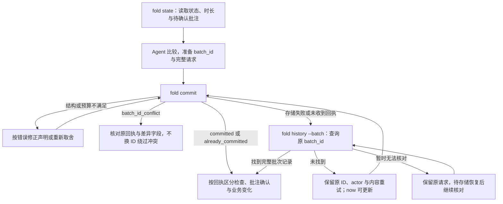

# Fold skill：语义判断与可靠操作

状态：「何时调用」「上下文视图」「动作与命令」「一次整理怎样完成」是首切片要求；对照评估是待执行的验证计划。未决问题见[决策记录](decisions.md)。

本文承接[形式模型](formal-model.md)与[用户故事](user-stories.md)；字段定义见[信息契约](information-contract.md)，实现边界见[架构](architecture.md)。

Skill 把**语义判断指引与成套可执行工具**一起交付。指引帮助 Agent 决定怎样表达与取舍；CLI 负责读取、校验、保存和查询，Agent 不在每一轮重新实现它们。

语义估计指引包含两方面帮助：**把待判断的问题转换成更准确、一致的表达；让 Agent 看见作出判断所需的当前状态与用户上下文。**


*问法更清楚、上下文更完整，估计才有依据；新的背景促使重新比较。*

## 何时调用

Fold 用于把持续变化的信息整理成可供后续使用的当前状态。用户不在场是首个验证场景，不是使用门槛。一次 Agent 运行里：

1. **开始时**：运行 `fold state`，读取当前层、时长投影和尚未收到处理确认的批注。批注是方向性提示，不是任务清单。
2. **工作中**：只在产生用户可见变化的里程碑提交，例如一件事完成、同一件事的状态改变、几件事可以合并说、发现需要用户参与的新事项。不要逐步提交过程消息。
3. **结束前**：提交本轮检查结果。有变化时提交声明；只确认批注时用空 `declarations` 与相应 `acknowledges`；两者都没有时提交空批次，记录 `checked`，不制造条目更新。
4. **紧急事项**：需要立刻打断用户时先走即时渠道，再根据持续关注价值决定怎样纳入 Fold。即时通知与后续状态整理可以同时需要。

SKILL.md 的 description 应描述场景而非功能，草稿如下：

```
当你需要把持续变化的进度、结果、发现或用户反馈整理成当前状态时使用。
适用于：后台任务完成、同一件事状态更新、多件事合并汇报、发现需要用户
参与的事项。用户是否在场不影响使用；需要立刻打断时先走即时渠道，再
按持续关注价值整理到 Fold。
```

## 估计要回答什么

每次整理的目标统一表达为：

> 用户下次回来时，哪些内容会改变其理解或行动？如果延后表达、缩短表达或省略它，可能造成什么后果？

这使“重要”有了具体对象、时机与后果。它不仅包括需要用户动手的事情，也包括能让用户修正判断、了解结果或放心等待的信息。“PR 已合并”可能无需行动，却能让用户停止等待；“只差银行流水”让用户知道下一步；一篇文章是否值得保留，要看它是否服务于用户明天的讨论。

Agent 默认用五档 `weight` 表达比较结果，份额由脚本派生。需要超出默认尺度时，可以提交非空的 `share` 覆盖派生值，并同时提供 `reason`；这条例外路径保留 Agent 对尺度的控制。脚本检查最终预算，不自行降档或驱逐。

## 理解反馈与业务策略

[领域模型](domain-model.md)描述可以进入判断的基础形式。Skill 帮助 Agent 理解这些形式，再依据当前业务的用途与规则处理；不预设一套通用的“已阅后必须降到哪里”或“已处理后必须退出”的业务流程。

**先弄清当前权重表达什么。** 通知中心可能主要表达尚未告知的价值，近期重点概览可能主要表达持续影响。用户已阅后，前者可以将关注归零，后者可以继续保留；用户已经知道，不等于事情已经没有用途。业务已有明确规则时应用规则，需要语义判断的部分再结合上下文比较。

处理反馈时，依次区分：

1. **收到的是什么。** 保留反馈原意、来源、时间及目标。用户确认已阅、用户报告处理完成、Agent 确认批注，是不同事实；不要用一次页面打开或缺少回复代替它们。
2. **它改变了什么依据。** 已阅提供关于用户知晓的证据；已处理或给出决定，可能消除原有等待或改变事项状态。检查影响范围，不把针对一个部分的反馈扩成整个事项已完成。
3. **业务还需要什么。** 结合系统用途、已知策略、当前事实与用户目标，判断剩余的告知价值、行动需要或持续影响。相同反馈可以合理地导向保留、降低关注、零关注或其他业务处理。
4. **如何解释并表达决定。** 说明用到了哪份反馈、什么业务依据以及仍不确定什么，再选择当前工具支持的操作。业务语义上的权重为 0 不等于现有 CLI 的 `weight` 接受数字 0；需要按操作契约表达退出当前关注等结果。

没有明确业务策略时，说明正在依据什么用途作判断及采用的暂定理解；不要悄悄把通知中心、待办清单或某种看板的习惯当成所有场景的默认规则。内容被更新或合并后，借原目标与历史关联判断此前反馈还适用于什么，而不是仅凭换了 ID 就重新解释为未阅。

**时间输入同样要先理解，再决定。** 零事件窗口、周期回顾或资料陈旧提示可以使旧状态值得重新审视，但不预先决定增权、降权或撤下。用户要求稍后提醒时，宿主到点输入的是一次带原意与目标的新信号；Agent 应按现在的事实和业务策略重新判断，不能直接复用当时的结论。例如已有证据表明事项失效，轻量说明原事项失效是一个可选业务处理，并非通用规则。

评价这种理解时，要同时检查两点：同一策略下是否准确解释反馈；改变业务策略后，是否能作出有依据的不同决定。固定 `read → 降权` 这样的映射看似稳定，却可能始终误解业务目标。

## 让估计看到足够的上下文

`fold state` 的读取视图包含：

| 上下文 | 为什么影响判断 |
| --- | --- |
| 当前同层的全部条目摘要、预算、份额与 rank | 估计相对关注价值，知道新增内容将与什么竞争；已有份额只是此前判断的结果。 |
| 各条目的时长投影：`age`、`since_update`、`until_due`、`until_stale` | 结合时间理解进展与等待的后果，再由 Agent 判断关注价值。 |
| 状态为 `saved` 的批注及其所在条目 | 表示尚未收到处理确认；条目或其祖先被撤下后，未确认批注仍可取得。 |
| `last_seen_at` 与 `since_seen` | 首切片一律为 `null`，表示尚未采集用户阅读行为。Agent 调用 `state` 或用户留下批注，都不能据此推导用户看过哪些内容。 |
| `last_checked_at` | 可从最近的 `checked` 事件取得，表示 Agent 上次确认无变化的时间，不表示用户阅读时间。 |
| 已明确的用户目标、偏好与承诺 | 由宿主提供，知道什么后果与用户有关，例如明天的讨论、已约定的办理时间。 |
| 按需的子层、来源附件与变化历史 | 检查摘要是否遗漏关键事实，理解条目为何被缩小、合并或撤下。 |

上下文的选择不能只依赖当前份额。一个长期占很小份额的条目，也可能收到决定性的用户反馈；未确认批注和与当前目标相关的历史，应有独立进入上下文的路径。被撤下的内容是否重新纳入，由新背景决定；“不在当前层”不等于“不值得再看”。

### 用视觉概览定位全局与变化

条目较多、需要比较层级关系或接续此前整理时，可给 `fold state` 加上 `--overview`，让工具从同一份已捕获状态生成真实 HTML/DOM 截图。Agent 选择看什么，渲染器负责布局；视觉概览用于定位值得核对的内容。

**overview 只用于快速概览，必须结合同一次读取的完整 state JSON 使用。** Agent 不能只看图片或视觉 diff 就作出判断、调整份额或提交变更；图中展示的范围和字段可能不完整，看图之后仍须读取状态并核对依据。

读图时，同一层卡片占预算矩形的面积比例就是其最终 `share / budget`，包括显式份额覆盖。面积表达已分配的关注；`kind`、档位标签和变化用颜色、边框或图标辅助表达，不额外改变面积。

- **区分未展示与留白。** 筛选掉的 active 份额保留为中性“未展示”区域，不能把剩余卡片放大，也不能把这部分当成未分配预算。真实留白只对应该层 `budget - used`。
- **只在同层比较面积。** 子层使用独立预算矩形，不乘父项份额；不同层的面积不能直接比较。同层 diff 的两端保持同一尺度，撤下或合并的旧项放在当前预算矩形外，或置于独立的等尺度基线图。
- **小卡片仍保留真实比例。** 文字放不下时，按 ID 查看框外详情，或扩大整块画布；不靠提高最小卡片面积或把文字缩得不可读来塞满卡片。

1. **先确定观察范围。** 用可选的 `view` 选择条目 ID、展开深度和字段，不编写布局或改写摘要。通常保留未变化的上下文；只看变化须明确选择 `changes_only`，并留意范围与省略提示。
2. **再选择比较起点。** 以此前的 `event_seq` 请求 diff，不用 revision 代替。工具以同一个 `now` 投影两端，帮助区分状态变化与单纯的时间流逝；端点 diff 不代表期间每一步过程，需要过程时查询 `history`。
3. **结合完整 state 核对。** 检查图和 `overview.json` 中的版本范围、省略及未展示变化提示；若有分图，按说明查看全部相关图片。再读取完整 `state.json` 中的同层条目、预算和尚未确认的批注，按 ID 核对本次判断涉及的字段、子层与关系；需要比较变化时同时读取 `diff.json`。核对范围不能只限于图上的条目，图片没有显示某项或某个字段，不足以断言它不存在或未变化。
4. **把渲染作为可选读取能力。** 原有 stdout 状态 JSON 保持可用。缺少浏览器时，请求图片会明确失败，Agent 继续依据 JSON 整理；选图、生成或查看图片、读取 diff 都不确认批注、不产生用户阅读记录，也不改写共享状态。

完整 state 可以分段读取，不必一次性全部放进模型上下文。先用 `overview.json` 和它列出的 PNG 定位，再从完整 `state.json` 核对上述全局上下文与具体依据；未展示条目和待确认反馈也要进入核对范围。分段读取不能省略 state 核对这一步。普通 stdout 保留，调用适配器或输出重定向可以避免整份输出自动进入上下文。

输出文件、默认视图及差异字段以[视觉概览规范](information-contract.md#state-的视觉概览与-diff)为准。视觉输出在所选范围内等价表达已有内容，不新增事实或重写摘要。

## 用一致的语义描述候选

| 容易混淆的表达 | 更适合估计的表达 |
| --- | --- |
| “账单过期了。” | “付款截止已过，仍未支付；尚待处理的是账单。” |
| “这个报价今天过期。” | “此价格今天之后不能购买；出行需求是否仍存在另行判断。” |
| “大项目，写了很多进度。” | “当前哪项结果、阻塞或选择会改变用户的理解；细节量另行说明。” |
| “很紧急，所以最重要。” | “延后到下次查看会有什么后果，该后果与用户目标有何关系。” |
| “用户一直没有点。” | “首切片未采集用户阅读行为；不能从缺少记录推断用户没有看或不感兴趣。” |

重要性、紧迫性、任务规模和内容字数可以相关，但不是同一个量。转换也不能擅自补全事实：原始记录只说“已提交付款”，就不能写成“付款成功”。

## 比较方案，给出可核查的说明

让模型比较“保留或增加这项，会让什么让位；被让位的内容是否仍能充分表达”，而非为每个条目孤立打分。沿用 US-03：

- 保留阅读推荐，降低周报档位：适用于阅读与用户近期目标直接相关的情况。
- 撤下阅读推荐，同时保留已完成周报的结论：适用于当前没有阅读用途证据、签证需要用户参与的情况。

选择其中一种时，`reason` 字段写出足以复核的说明：

> 签证代理确认缺银行流水；用户已确定出差安排；周报已有完成稿。提高签证档位，周报保留结果与待核对点，阅读推荐暂离父层。不清楚阅读推荐是否用于近期会议，若用户补充这种用途应重新比较。

未知不必包装成置信度。模型直接指出缺什么、它可能改变哪项判断，以及当前采用了什么暂定假设。

## 用明确动作操作状态

Skill 的可执行部分是一个 CLI，四个子命令：

```
fold state --now <ts>                                      # 状态投影与待确认批注
fold state --now <ts> --overview <output-dir> [--view <view.json>] [--diff-from <event_seq>]
fold commit <file> --now <ts> --actor <name>                # 校验并保存声明批次
fold annotate <id> "<text>" --now <ts> --batch-id <batch>    # 保存批注，actor 固定为 user
fold history [id]                                          # 查询完整批次记录
fold history --batch <batch>                               # 核对某次写入的实际结果
```

提交前准备：

- 使用 JSON 批次，先确定 `batch_id`，再填写声明与要确认的批注。YAML 仅用于设计用例。
- 为命令提供 `now`；脚本不读时钟。`commit` 指明 Agent 身份，`annotate` 的身份固定为 `user`。
- 字段、请求身份与回执的精确定义见[信息契约](information-contract.md#批次与回执)。下面是结束时没有新变化的请求示例。

```json
{
  "batch_id": "run-20261009-final-check",
  "declarations": [],
  "acknowledges": []
}
```

| 动作 | Agent 决定什么 | 脚本执行什么 |
| --- | --- | --- |
| 新建与覆盖（`new` / `supersedes`） | 新信息属于新事项还是已有事项，当前摘要和依据是什么。 | 按补丁合并并校验最终状态，保留省略的可选字段。 |
| 合并（`merges`） | 哪些同层叶子可以共同表达，合并后的摘要是什么。 | 校验首切片支持的结构，保留来源与批注以及历史追溯关系。 |
| 子层（`children`） | 哪些细节属于哪个主题，哪些原有孩子明确撤下。 | 校验目标集合与显式撤下声明，分别检查各层预算。 |
| 调整档位（`weight` / `share`） | 哪些条目让位。 | 派生份额，计算各层总量，超额整批拒绝并返回数值；不自行选择让位对象。 |
| 撤下与重新纳入（`withdraw` / `supersedes`） | 哪项暂时退出、哪项重新值得关注。 | 撤下整棵子树；恢复时只纳入明确声明的条目，保留资料与反馈。 |
| 确认批注（`acknowledges`） | 哪些批注已纳入整理或已作出明确回应。 | 保存首次确认，重复确认不覆盖原绑定。 |

准备声明时特别检查：

- **补丁：** 非 `withdraw` 声明每次填写 `weight`、`kind`。省略可选字段表示保留；需要清空时按[字段契约](information-contract.md)使用允许的 `null`。
- **合并：** 首切片只合并同层 active 叶子；所有来源项都不能带有历史子树，结果也必须是叶子。后续更新指向合并后的条目，旧项保留到后继的追溯关系。
- **子层：** `children` 表达目标集合，省略则保留。若移除原有 active 直接孩子，包括清空子层，必须在同批显式 `withdraw` 每个被移除的直接孩子；父项的 `reason` 不能代替撤下声明。`detail-of` 不在首切片支持范围内。
- **恢复：** 对已撤下条目使用原 ID 的 `supersedes`，逐项声明要恢复的内容；恢复孩子时，最终父项也须为 active。已合并旧项按后继处理，不走撤下恢复路径。
- **来源：** 补充来源属于资料更新，会更新条目的 `updated_at`；仅凭来源增加，不能声称任务取得了进展。

### 无变化、批注确认与业务更新

根据本轮实际结果解释回执：

- 既无业务变化，也无新增确认时，`checked` 表示完成了检查，不代表事项更新。
- 只有新批注确认时，`acknowledge` 表示反馈已纳入整理或得到回应，不代表外部行动完成。
- 有业务变化时，区分内容、结构、分配和来源的变化，不把它们一律描述为任务进展。

同内容补丁、重复确认、单独修改 `reason` 或自动元数据都不能制造事项更新。事件与 revision 的精确规则见[信息契约](information-contract.md)。批注的 `saved` 应解释为“尚未收到处理确认”，不能解释为“Agent 尚未读取”。

## 一次整理怎样完成



一次整理是一个批次：US-03 中“增加签证、降低周报、PR 和机票档位、撤下阅读推荐”是相互依赖的取舍，整批检查、整批接受。批次可能已经保存，调用者却没有收到回执；上述核对路径也适用于 `annotate`。

按结果选择下一步：

1. **校验拒绝：** 根据字段、结构或预算错误修正声明。缺少显式撤下时，先核对受影响的孩子和后代；脚本不替 Agent 作删除或让位判断。
2. **身份冲突：** 阅读 `original_receipt` 与 `differing_fields`，核对请求和意图；不能换 ID 绕过冲突。只有核对后确认是独立的新操作，才另建批次。
3. **结果未知：** 用 `history --batch` 核对原 ID。未找到时保留同一请求重试，可以使用当前 `now`；若此前已提交，会返回首次接受的结果，不刷新时间。
4. **暂时无法核对：** 保留请求并说明结果尚未确认，恢复后继续查询。

精确的重复比较与回执字段以[批次与回执](information-contract.md#批次与回执)为准；文件写入与故障恢复见[本地提交与恢复](architecture.md#本地提交与恢复)。

## 两类一致性都需要


*无关措辞变化应保持主要判断稳定，相关背景变化应触发重估。*

**无关变化下保持稳定。** 事实和用户背景相同，仅改写等义句、调整互不依赖条目的顺序或替换序号时，主要取舍应当稳定。某条消息排在提示的最后，不应无故变得更重要。稳定不要求每次生成相同的摘要，检查的是关键事项是否仍可见、相对关系是否无故反转、理由是否仍受相同证据支持。固定映射只保证相同预算与档位、未使用覆盖时得到相同份额，不证明语义判断正确。

**相关变化下能够调整。** 用户说明“这篇文章是明天会议必读材料”，或账单从未支付变成已确认支付时，估计应重新考虑。一直维持原排序也可能是一种失败。

脚本对相同输入总是输出相同结果，只证明执行的确定性；它不能证明模型的估计准确或能合理响应新背景。

## 判断质量与操作可靠性分别验证

### 语义估计的对照（待执行）

| 对照 | 保持什么、改变什么 | 要观察什么 |
| --- | --- | --- |
| 等义改写 | 保持 US-02 的事实与用户背景，改写句子、排列和序号。 | 逾期账单仍被理解为待处理；报价失效没有被误当成出行需求消失。 |
| 相关背景改变 | 保持 US-03 的事项，补充“阅读用于明天会议”。 | 模型重新比较阅读与其他项，说明新依据怎样影响取舍。 |
| 完整与缺失上下文 | 对 US-04 分别提供、隐藏用户“未点击也请保留”的批注。 | 完整条件下能采用偏好；缺失条件下不把未点击当成不关心。 |
| 当前与旧版本上下文 | 对 US-05 分别提供 PR 已合并的当前状态、仍在等 CI 的旧状态。 | 模型能利用可见的新证据；知道输入过时时不声称已确认当前结果。 |
| 同一反馈、不同业务策略 | 保持内容与显式已阅反馈不变，分别提供通知中心与近期重点概览的用途。 | 模型区分知晓状态与持续价值，允许产生不同关注决定；不把一种业务的降权规则当成通用语义。 |

记录每次使用的故事事实、用户背景、revision、说明版本和输出；对等义变体重复少量运行，比较关键事实、主要档位与理由。再让人依据同一背景检查：用户看完是否知道下一步。

同时记录两个指标，观察默认协议是否省力、判断是否稳定：

- **份额覆盖率：** 本批显式给出非 null `share` 的可分配声明数，除以本批可分配声明数。排除 withdraw；空批没有分母，记为不适用。补丁继承的旧覆盖不计为本批显式覆盖，`share: null` 是取消覆盖，也不计入分子。覆盖率用于观察默认五档是否频繁需要例外，不作为越低越好的硬目标。
- **档位稳定率：** 固定事实、用户背景、当前状态、预算和时间，对等义改写成对运行，按同一事项比较 `weight`。记录相同档位的对比数与总对比数，同时列出遗漏或无法对齐的事项；不能靠丢掉这些事项得到虚假的高稳定率。

这两个指标都不能代替语义正确性检查。份额覆盖很少但漏掉关键事实，或每次都稳定给出错误档位，都不算整理得好。

### 视觉辅助的对照（待执行）

固定状态端点、`now` 与整理目标，比较仅使用完整 state JSON 和同时使用完整 state JSON、概览及 diff 的结果。两组都须核对状态，概览组不能省略 JSON 核对。

- **变化遗漏率：** 先独立列出本轮应发现的变化，记录遗漏数占应发现变化数的比例；无变化时不适用。分别记录被所选范围排除的变化和已展示却未识别的变化，不能靠缩小范围提高成绩。
- **选图与理解错误：** 检查 Agent 是否把未显示当成不存在、把合并或撤下当成资料删除、把高亮当成重要性提升，或把读取当成批注确认。发现错误时，按 ID 回查 JSON，区分范围选择、渲染表达与模型理解的问题。
- **面积理解：** 检查是否按同层面积读出份额关系，是否把“未展示”误认成留白、把旧项标记计入当前预算，或直接比较不同层的面积。

图片与 JSON 对齐只证明渲染忠实；能否减少遗漏、改善取舍仍需通过上述对照验证。

### 操作契约的确定性检查

[conformance/cases](../conformance/cases) 中的设计用例用于验证下面的行为；产品实现与测试运行仍需完成：

| 情境 | 应核对的结果 |
| --- | --- |
| 相同状态、声明与 `now` 重复计算 | 派生份额、rank 与接受或拒绝的判定一致。 |
| 超额、目标不存在或层级成环 | 返回可定位的错误；状态和 revision 不变，事件流不增加。 |
| supersede 补丁省略字段或显式置空 | 可省略字段保留；weight、kind 每次必填。仅允许约定的 null，share:null 恢复派生份额，并检查最终状态。 |
| withdraw 带有批注与子层的条目 | 整个子树退出 active；历史及其中未确认批注仍可查询。 |
| 合并与子层目标集合 | 只接受支持的叶子合并；移除原 active 孩子须显式撤下，不能以父项说明替代。 |
| 无变化、仅确认批注、重复确认 | 检查与确认不伪造条目更新；首次确认绑定不被覆盖。 |
| 相同 batch_id 重试或修改请求 | 按批次契约识别重试；改变 now 不重做已提交请求，内容冲突可据回执核对。 |
| 日志已写入但快照或回执未完成 | 从完整批次记录恢复；同标识重试不二次执行，annotate 也不重复增加批注。 |
| Agent state、annotate 与用户阅读字段 | last_seen_at、since_seen 保持 null；checked 只提供 Agent 的 last_checked_at。 |
| 文字简报 | 仅展示 active 条目，按 rank 排序并依档位折叠，时长按 `now` 计算；不为总行数截断核心摘要。 |
| 可选视觉概览与 diff | JSON、渲染说明和图片来自同次捕获；差异与端点一致，范围省略可见，读取不改变事件、批注确认或用户阅读状态。 |
| 概览的面积比例 | 面积与最终份额一致；筛选保留未展示份额，真实留白单独表达，旧项不占当前预算，同层 diff 两端保持同一尺度。 |

最后用真实使用路径检查整套 Skill：Agent 能否只依据指引、命令说明和回执完成一次整理，而无需临时重写预算、引用或历史维护逻辑。

## 用户反馈如何改善下一次估计

用户的更正首先是新的上下文：保存其原意与适用范围，在下一次相关整理时读到，并据此重估。必要时检查此前摘要是否误解了用户，而非给某个主题永久加分。这里的“校正”不宣称模型权重被训练，也不假定偏好会自动跨会话保留；跨会话的偏好由宿主提供。
