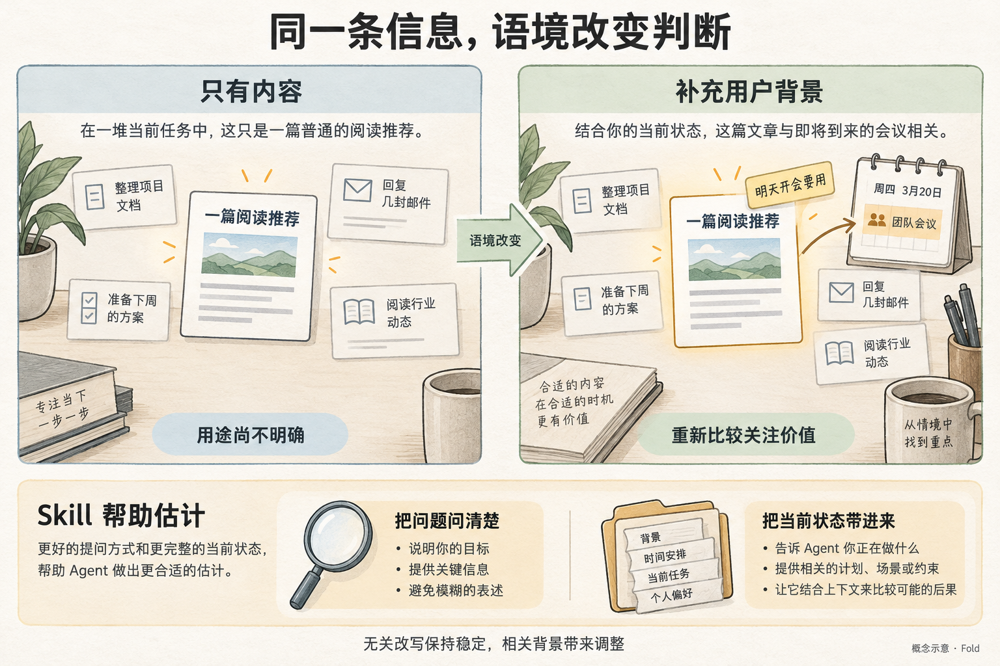
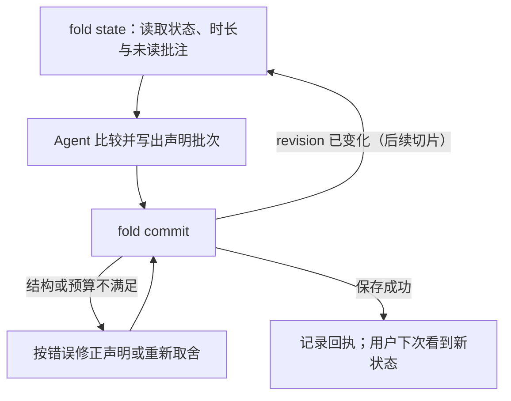
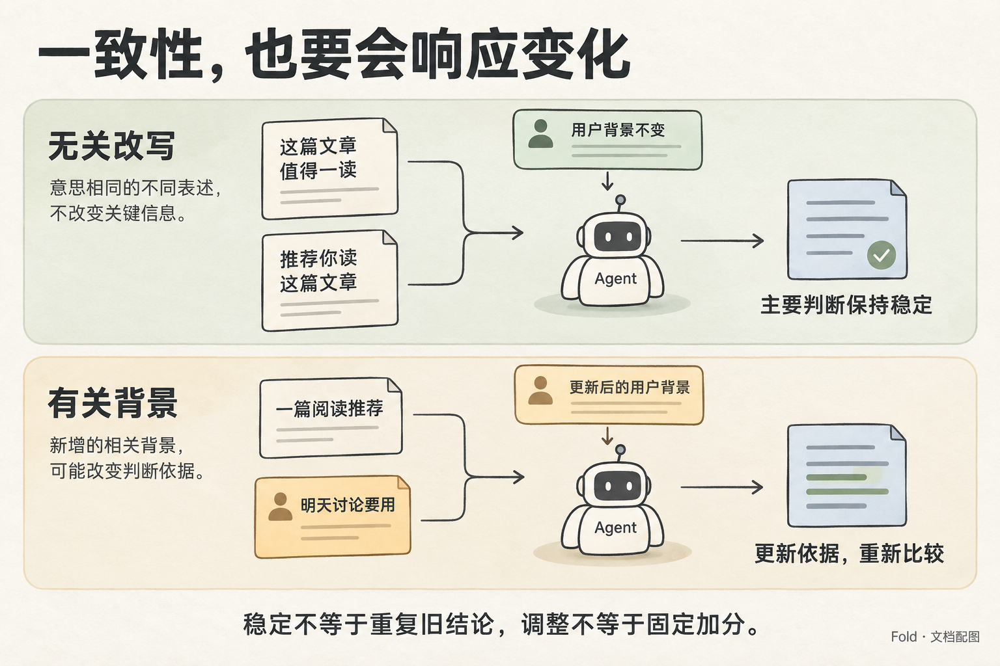

# Fold skill：语义判断与可靠操作

状态：「何时调用」「上下文视图」「动作与命令」「一次整理怎样完成」是首切片要求；对照评估是待执行的验证计划。未决问题见[决策记录](decisions.md)。

本文承接[形式模型](formal-model.md)与[用户故事](user-stories.md)；字段定义见[信息契约](information-contract.md)，实现边界见[架构](architecture.md)。

Skill 把**语义判断指引与成套可执行工具**一起交付。指引帮助 Agent 决定怎样表达与取舍；CLI 负责读取、校验、保存和查询，Agent 不在每一轮重新实现它们。

语义估计指引包含两方面帮助：**把待判断的问题转换成更准确、一致的表达；让 Agent 看见作出判断所需的当前状态与用户上下文。**



*问法更清楚、上下文更完整，估计才有依据；新的背景促使重新比较。*

## 何时调用

Fold 用于 Agent 在替用户持续做事、而用户此刻不在场的情况。一次 Agent 运行里：

1. **开始时**：运行 `fold state`，读取当前层、时长投影和未读批注。批注是方向性提示，不是任务清单。
2. **工作中**：只在产生用户可见变化的里程碑提交，例如一件事完成、同一件事的状态改变、几件事可以合并说、发现需要用户参与的新事项。不要逐步提交过程消息。
3. **结束前**：必须提交一次，哪怕只是确认当前状态无变化并 `acknowledges` 已处理的批注。
4. **不走 Fold 的事**：需要立刻打断用户的紧急事项走即时渠道。

SKILL.md 的 description 应描述场景而非功能，草稿如下：

```
当你在替用户持续做事、而用户此刻不在场时使用。把进度、结果和发现
归约到一个有限的注意力预算里，而不是逐条通知。适用于：后台任务完
成、同一件事状态更新、多件事可以合并汇报、发现需要用户参与的事项。
不适用于：需要立即打断用户的紧急事项。
```

## 估计要回答什么

每次整理的目标统一表达为：

> 用户下次回来时，哪些内容会改变其理解或行动？如果延后表达、缩短表达或省略它，可能造成什么后果？

这使“重要”有了具体对象、时机与后果。它不仅包括需要用户动手的事情，也包括能让用户修正判断、了解结果或放心等待的信息。“PR 已合并”可能无需行动，却能让用户停止等待；“只差银行流水”让用户知道下一步；一篇文章是否值得保留，要看它是否服务于用户明天的讨论。

Agent 用五档 `weight` 表达比较结果，不给数字。它可以提出关注顺序、保留与让位关系、摘要调整；份额由脚本派生。

## 让估计看到足够的上下文

`fold state` 的读取视图包含：

| 上下文 | 为什么影响判断 |
| --- | --- |
| 当前同层的全部条目摘要、预算、份额与 rank | 估计相对关注价值，知道新增内容将与什么竞争；已有份额只是此前判断的结果。 |
| 各条目的时长投影：`age`、`since_update`、`since_seen`、`until_due`、`until_stale` | 判断等待的后果；一条三天没变化、用户看过两次的 fyi，和十分钟前的新事项不该占同样注意力。 |
| 未读批注及其所在条目 | 接住用户更正；区分留言存在、Agent 已读与行动已有结果。 |
| 用户的 `last_seen_at` | 知道用户上次看到的是哪个 revision 的内容。 |
| 已明确的用户目标、偏好与承诺 | 由宿主提供，知道什么后果与用户有关，例如明天的讨论、已约定的办理时间。 |
| 按需的子层、来源附件与变化历史 | 检查摘要是否遗漏关键事实，理解条目为何被缩小、合并或撤下。 |

上下文的选择不能只依赖当前份额。一个长期占很小份额的条目，也可能收到决定性的用户反馈；未读批注和与当前目标相关的历史，应有独立进入上下文的路径。被撤下的内容是否重新纳入，由新背景决定；“不在当前层”不等于“不值得再看”。

## 用一致的语义描述候选

| 容易混淆的表达 | 更适合估计的表达 |
| --- | --- |
| “账单过期了。” | “付款截止已过，仍未支付；尚待处理的是账单。” |
| “这个报价今天过期。” | “此价格今天之后不能购买；出行需求是否仍存在另行判断。” |
| “大项目，写了很多进度。” | “当前哪项结果、阻塞或选择会改变用户的理解；细节量另行说明。” |
| “很紧急，所以最重要。” | “延后到下次查看会有什么后果，该后果与用户目标有何关系。” |
| “用户一直没有点。” | “未观察到展开；可能是摘要已足够，尚无明确不感兴趣的反馈。” |

重要性、紧迫性、任务规模和内容字数可以相关，但不是同一个量。转换也不能擅自补全事实：原始记录只说“已提交付款”，就不能写成“付款成功”。

## 比较方案，给出可核查的说明

让模型比较“保留或增加这项，会让什么让位；被让位的内容是否仍能充分表达”，而非为每个条目孤立打分。沿用 US-03：

- 保留阅读推荐，降低周报档位：适用于阅读与用户近期目标直接相关的情况。
- 撤下阅读推荐，同时保留已完成周报的结论：适用于当前没有阅读用途证据、签证需要用户参与的情况。

选择其中一种时，`reason` 字段写出足以复核的说明：

> 签证代理确认缺银行流水；用户已确定出差安排；周报已有完成稿。提高签证档位，周报保留结果与待核对点，阅读推荐暂离父层。不清楚阅读推荐是否用于近期会议，若用户补充这种用途应重新比较。

未知不必包装成置信度。模型直接指出缺什么、它可能改变哪项判断，以及当前采用了什么暂定假设。

## 用明确动作操作状态

Skill 的可执行部分是一个 CLI，四个子命令：

```
fold state --now <ts>                         # 当前层投影，含时长与未读批注
fold commit <file> --now <ts> --actor <name>  # 整批校验保存；失败返回约束与数值，不写入
fold annotate <id> "<text>" --now <ts>        # 追加批注事件（供渲染器或用户调用）
fold history [id]                             # 事件流
```

`commit` 读取一个 JSON 或 YAML 文件，内容是声明批次（字段见[信息契约](information-contract.md)）。时间由调用方传入，脚本不读时钟。

| 动作 | Agent 决定什么 | 脚本执行什么 |
| --- | --- | --- |
| 新建与覆盖（`new` / `supersedes`） | 新信息属于新事项还是已有事项，当前摘要和依据是什么。 | 以 id 定位目标；supersede 继承批注和未声明的子层，旧内容归档。 |
| 合并（`merges`） | 哪些内容应共同表达，合并后的摘要是什么。 | 释放被合并条目，新条目继承全部批注，历史指向合并后的条目。 |
| 嵌套（`children` / `detail-of`） | 哪些细节属于哪个主题。 | 检查目标存在、不成环；子层按自己的预算检查。 |
| 调整档位（`weight` / `share`） | 哪些条目让位。 | 派生份额，计算各层总量，超额整批拒绝并返回数值；不自行选择让位对象。 |
| 撤下（`withdraw`） | 哪项暂时退出当前关注范围。 | 移出当前层，保留内容、来源、批注和原因；重新纳入是一次新的声明。 |
| 已读批注（`acknowledges`） | 哪些批注已读取并体现在本次整理中。 | 把批注标为已读并绑定本次 revision；没有 acknowledge 的批注保持未读。 |

每个命令的返回至少说明：针对哪个 revision，实际执行了什么，失败时哪条约束、相关数值和未写入的事实。成功返回各项派生份额、rank 和新 revision。

## 一次整理怎样完成



一次整理是一个批次：US-03 中“增加签证、降低周报、PR 和机票档位、撤下阅读推荐”是相互依赖的取舍，整批检查、整批原子写入。

| 结果 | 下一步 |
| --- | --- |
| 字段、对象引用或结构不合法 | 根据具体错误修正声明；脚本不猜测目标或自行删掉关联。 |
| 预算不满足 | Agent 结合上下文重新取舍，再提交；错误里有超额发生的层和每项份额。 |
| revision 过时（接入第二个 Agent 后） | 重新读取当前状态后再判断，不只替换版本号原样提交。 |

本地原子写入不需要幂等键或“结果未知”分支；存储离开本地文件时再设计。

## 两类一致性都需要



*无关措辞变化应保持主要判断稳定，相关背景变化应触发重估。*

**无关变化下保持稳定。** 事实和用户背景相同，仅改写等义句、调整互不依赖条目的顺序或替换序号时，主要取舍应当稳定。某条消息排在提示的最后，不应无故变得更重要。稳定不要求每次生成相同的摘要，检查的是关键事项是否仍可见、相对关系是否无故反转、理由是否仍受相同证据支持。固定的档位映射让“判断相同”可以直接比较为“份额相同”。

**相关变化下能够调整。** 用户说明“这篇文章是明天会议必读材料”，或账单从未支付变成已确认支付时，估计应重新考虑。一直维持原排序也可能是一种失败。

脚本对相同输入总是输出相同结果，只证明执行的确定性；它不能证明模型的估计准确或能合理响应新背景。

## 判断质量与操作可靠性分别验证

### 语义估计的对照（待执行）

| 对照 | 保持什么、改变什么 | 要观察什么 |
| --- | --- | --- |
| 等义改写 | 保持 US-02 的事实与用户背景，改写句子、排列和序号。 | 逾期账单仍被理解为待处理；报价失效没有被误当成出行需求消失。 |
| 相关背景改变 | 保持 US-03 的事项，补充“阅读用于明天会议”。 | 模型重新比较阅读与其他项，说明新依据怎样影响取舍。 |
| 完整与缺失上下文 | 对 US-04 分别提供、隐藏用户“未点击也请保留”的批注。 | 完整条件下能采用偏好；缺失条件下不把未点击当成不关心。 |
| 当前与旧版本上下文 | 对 US-05 分别提供 PR 已合并的当前状态、仍在等 CI 的旧状态。 | 模型能利用可见的新证据；知道输入过时时不声称已确认当前结果。 |

记录每次使用的故事事实、用户背景、revision、说明版本和输出；对等义变体重复少量运行，比较关键事实、主要档位与理由。再让人依据同一背景检查：用户看完是否知道下一步。

### 操作契约的确定性检查

[conformance/cases](../conformance/cases) 中的用例直接验证下面的行为：

| 情境 | 应核对的结果 |
| --- | --- |
| 相同状态、声明与 `now` 重复提交 | 派生份额、rank 与接受或拒绝的判定一致。 |
| 超额、目标不存在或层级成环 | 返回可定位的错误；状态和 revision 不变，事件流不增加。 |
| supersede、merge、withdraw 带有批注与子层的条目 | 批注继承、子层保留、历史可查，不只检查最终条目数量。 |
| acknowledge 批注 | 批注状态变为已读并绑定该 revision；未 acknowledge 的保持未读。 |
| 文字简报 | 按 rank 排序，withdrawn 不出现，时长按 `now` 计算。 |

最后用真实使用路径检查整套 Skill：Agent 能否只依据指引、命令说明和回执完成一次整理，而无需临时重写预算、引用或历史维护逻辑。

## 用户反馈如何改善下一次估计

用户的更正首先是新的上下文：保存其原意与适用范围，在下一次相关整理时读到，并据此重估。必要时检查此前摘要是否误解了用户，而非给某个主题永久加分。这里的“校正”不宣称模型权重被训练，也不假定偏好会自动跨会话保留；跨会话的偏好由宿主提供。
