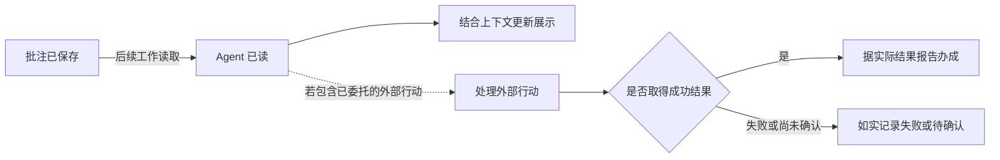
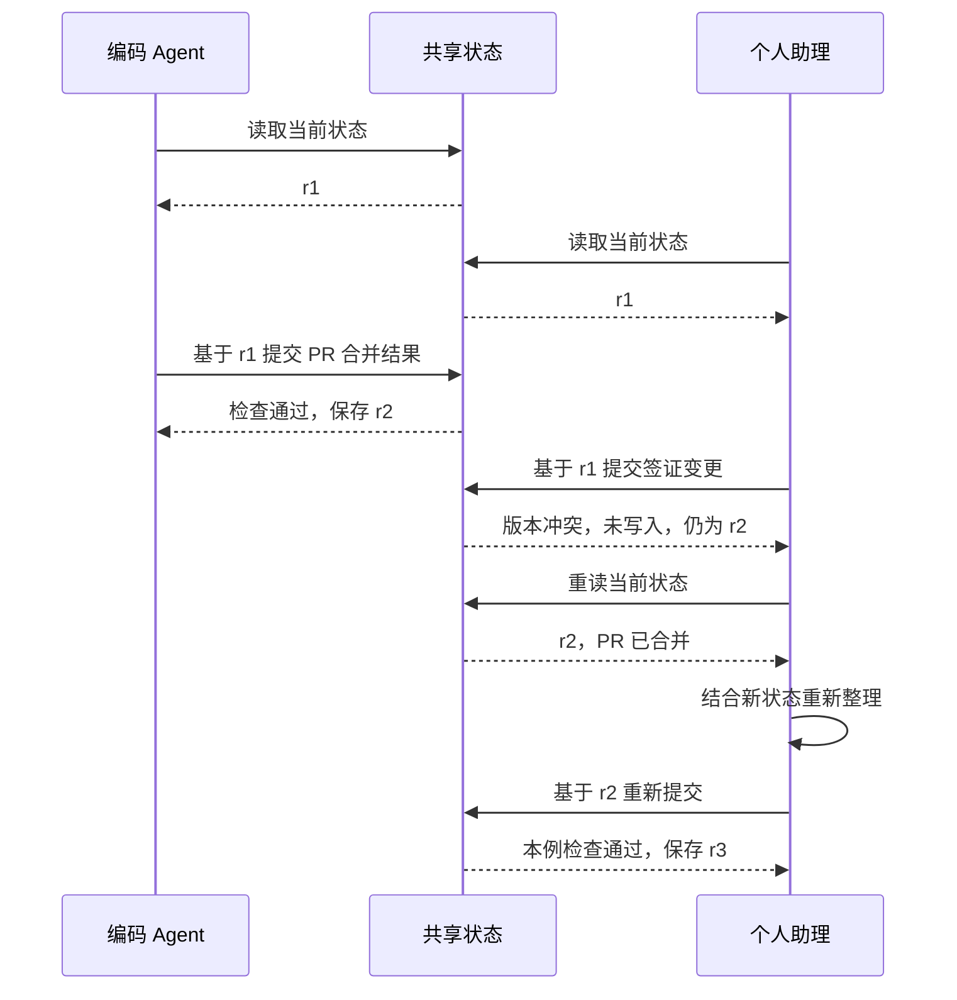

# Fold：从人的一天看设计

状态：用于讨论的具体故事，产品尚未实现。它们把[产品方向](product.md)放进真实工作情境，也为[形式模型](formal-model.md)提供可检查的样例。

下面的人物与数据均为虚构。为便于比较，涉及数字的层统一使用预算 `B = 64`；份额数字、界面文案、反馈状态名称和直接提交 `share` 都是示例，不是固定策略或已确认的接口。相关选择见[决策记录](decisions.md)。

## US-01 · 离开半天，回来就知道下一步

*人离开时继续整理，回来后轻量反馈；读到留言与事情办成是不同事实。*

小林早上把三件事交给 Agent：准备周报、跟进签证材料、查看三个 PR。他已经委托助理在约定的可用时段内代约签证办理，上午则要连续开会，不会盯着聊天窗口。

八点半，Fold 中还是“周报起草中”“PR 等待检查”“签证材料核对中”。之后几个小时里，工作持续变化：周报完成，两项 PR 合并，签证代理指出还缺银行流水。

Agent 判断，周报的旧进度已经被结果替代；三个 PR 现在可以一起说；签证需要小林参与，应当更显眼。它整理之后，父层显示：

> **签证材料 · 需要你** 还缺银行流水；周五办理的预约待确认。展开查看材料要求。
>
> **周报草稿 · 待你过目** 草稿已完成，收入数字有一处需要核对。
>
> **PR 进展 · 推进中** 2 / 3 已合并，剩余一项等待 CI。

中午回来，小林没有读完半天的过程消息，也没有逐个打开 PR。他先知道自己需要补流水、核对一个数字，其他工作还在推进。

点开签证后，子层用自己的预算展示流水要求、预约情况与已经备齐的材料。父层份额表示签证在所有事情中的关注价值；子层份额表示此刻查看签证时各项细节的相对重要性，两者不必按比例相乘。

小林在签证上写：“下午我去打印，周五按之前说的时间约。”保存后，这句话先作为尚待 Agent 读取的反馈留在条目上。小林继续开会，不必等助理在线。

下午 Agent 开始下一轮工作，读取反馈，并在原有委托范围内完成预约。收到预约确认后，才把摘要更新为：

> **签证材料 · 等你补齐** 已约周五 10 点；等你下午打印的银行流水。

用户的反馈已被回应，但银行流水仍未补齐，签证条目不因此显示“全部完成”。预约失败时，摘要应如实显示失败或待确认。

**做对的观察：** 小林只看父层就能复述自己下一步要做什么，打开细节能找到依据；反馈被读取与事情办成，在呈现上不会混成一回事。

**失败对照：** 板上同时留着“周报起草中”和“周报完成”；签证只写“详见子板”；用户刚保存批注，界面就显示“已处理”。这些情况把拼接状态、寻找重点或核实执行结果的工作又交回了人。

## US-02 · 同样是今天 18 点，过了之后却不同

*同一个时刻，不对应同一种自动撤下规则。*

这一天，小林有一张今天 18 点前应支付的账单，也在比较一张有效至今天 18 点的临时机票报价。两项内容恰好带着相同的日期和时间。

下午 Agent 整理时，账单仍待支付，报价仍可用于当前选择。它不能因为两者“快到时间”就认定它们可以提前撤下；剩余时间短，可能反而让小林更需要现在看到它们。

18 点之后，小林仍不在场。Agent 下一次整理时查到，账单状态还是未支付，旧机票报价则已经不能购买。它做出两个不同判断：

> **账单 · 已逾期，仍待支付** 截止时间已过，当前记录仍为未支付。

账单继续保留，因为尚未解决的事情仍然存在。Agent 可以结合后果与其他事项重新判断份额，脚本不因时间已过把它撤下。

旧报价则不再作为“可购买的方案”展示。假设出行仍需安排，当前条目可以变为：

> **机票选择 · 待新报价** 原报价已失效，尚未获得可用的新报价。

旧报价的金额与来源留在可追溯资料中。它失去的是作为当前购买选项的资格，不代表整个出行事项消失。若报价失效本身会影响行程，这个影响仍应在当前状态中说明。

晚上小林回来，看到账单仍需处理，也知道不能再按旧价格决策。他留下“账单我刚付了”，这条反馈先被保存；Agent 后续根据反馈及可获得的支付结果更新状态，不假装自己已经查到外部系统的确认。

本故事采用“Agent 下次整理时更新”的情境，没有假定系统已经具备定时自动撤下能力。若以后引入自动失效声明，仍需明确它针对的是哪条信息及什么后果。

**做对的观察：** 给两项输入相同的时间，不会产生相同的机械撤下结果；用户能区分“事情未完成”和“原有信息已不适用于决策”。

**失败对照：** 午夜一到，所有带日期的条目都消失；或机票价格失效后依然像可购买报价一样展示。一个让人漏事，另一个让人依据旧信息做决定。

## US-03 · 板满了，更重要的事又来了

签证缺材料的消息出现前，小林的父层预算已经用满。Agent 看到完整的当前状态，也知道签证会影响已经计划好的出差，而阅读推荐今天没有必须处理的后果。

*本例由 Agent 让出 24 份关注来容纳签证事项，整理前后均为 64；数字只演示一次取舍。*

在这次判断中，它决定让阅读推荐暂时离开父层，把已经完成的周报缩短表达，并将 PR 与机票进展各压缩一些。假设采用直接申报份额的候选方式，整理前后可以是：

| 条目 | 整理前份额 | 整理后份额 | Agent 对本次变化的解释 |
| --- | ---: | ---: | --- |
| 签证材料 | 0 | 24 | 新发现缺材料，需要小林参与，会影响出差安排。 |
| 周报 | 24 | 12 | 已完成，保留结果与待核对点即可。 |
| PR 进展 | 16 | 12 | 相关进展可以合并说明，仍有一项未完成。 |
| 机票监控 | 12 | 8 | 保留当前结论，详细比较可展开。 |
| 账单 | 8 | 8 | 尚待处理，本次没有足够依据减少关注。 |
| 阅读推荐 | 4 | 0 | 暂离当前层，内容与撤下原因仍可查。 |
| **合计** | **64** | **64** | 两次状态都满足本例预算。 |

新签证增加 `24`，其余调整释放 `12 + 4 + 4 + 4 = 24`。这只证明算术成立，不证明它就是最适合小林的取舍；份额为零在表中表示不在当前层展示，不是决定建立一种零份额条目类型。

如果 Agent 只加入签证而不调整其他项，总量会变成 `88`。脚本可以指出“预算 64，声明总量 88，超出 24”，但不能自行决定阅读推荐先走、周报缩一半。谁让出多少，由 Agent 提出并说明。

小林回来后看见签证最大，周报仍然可辨认，账单没有因为其他事情到来而无声消失。他也能查到阅读推荐为什么撤下，并批注：“那篇文章是明天讨论要用的，请放回来。”

这条新信息改变了 Agent 的判断依据。下一轮需要重新安排份额，而不是套用“阅读永远比签证次要”的固定表。新方案仍要满足预算，哪项进一步缩小须根据当时的完整状态决定。

本故事需要用户看到一致的整理结果；是否通过原子批次实现、失败时怎样返回，仍是待确认机制。

**做对的观察：** 可以核对两次总量与每项变化；每次取舍能归因到 Agent 的明确判断；用户提供新背景后，原来的选择可以被修正。

**失败对照：** 脚本悄悄挤出最低份额项，Agent 却报告全部按原计划展示；或预算检查通过，就被当作“重要性判断正确”的证明。

## US-04 · 没有点击，不代表不重要

小林连续两天没有展开“周五讨论材料”。Agent 可能猜测他不关心，也可能猜测父层摘要已经足够；仅凭没有点击，无法知道哪一种是真的。

第二天小林回来，发现它仍在板上，便留下一句：“这件事我每天扫摘要就够了。周五之前请保持显眼，别因为我不点就撤掉。”随后他离开。

这条反馈让 Agent 获得了比点击行为更直接的偏好。它下一次读取时，应把“保持可见直到周五讨论前”纳入后续整理，而不是等待一个脚本把未点击次数换算成更低份额。

为了让小林知道反馈到了哪一步，故事中可以展示三种不同事实：

| 时刻 | 人能看见的说明示例 | 这句话能证明什么 |
| --- | --- | --- |
| 刚保存 | “你的批注已保存，尚未被 Agent 读取。” | 反馈留存成功，不能证明有人开始处理。 |
| Agent 读取后 | “已读：本周继续保留讨论摘要，正在调整展示。” | Agent 已获取反馈，不能证明状态已经改好。 |
| 新状态保存后 | “已按你的反馈调整：讨论摘要继续保留在父层。” | 这一次展示调整已落实，不代表周五讨论已经完成。 |

*已保存、后来已读与展示已调整是不同事实；外部行动只有取得实际结果后才能另行确认完成。*

这些是待设计的呈现样例，不是已经选定的状态枚举，也不意味着 Fold 自己排程唤醒 Agent。

如果用户的批注同时包含一件外部行动，例如“也请把材料发给参会者”，读到这句话与发出材料仍是两步；只有实际执行结果支持时，才能报告已发出。读取失败、执行失败或尚未有下一轮 Agent 工作，都应保留对应的未完成事实。

配图沿用 US-01 的签证场景：“下午我去打印”表达用户自己的计划，“请帮我预约”则是另一条行动请求。前者可以使摘要改成“等你补齐流水”，但不证明流水已经打印；后者需要在已有委托范围内执行并取得结果，才可报告预约办成。外部行动是一条条件分支，不是“展示已调整”的自动下一状态。

周五过后也不必自动撤下：Agent 需要看讨论是否发生、是否产生了新的待办，再决定当前应留下什么。

**做对的观察：** 用户的明确偏好改变了下一轮整理；阅读事件只作为上下文；用户能够分清“留言已保存”“Agent 已读”和“所说的调整已完成”。

**失败对照：** 两次未点击触发自动降份额；批注被读取后就从记录里消失；或用一个“已完成”标记同时代表反馈已读、条目已改与外部事项已办。

## US-05 · 两个 Agent 更新，仍然是同一个人的板

小林分别请编码 Agent 跟进 PR，请个人助理 Agent 跟进出行。它们面对的是同一个人的父层预算 `64`，不能各拿一整块板后让小林再负责比较。

上午十点，两个 Agent 读到同一份共享状态。编码 Agent 随后得知 PR 已全部合并，准备缩短 PR 汇报；个人助理同时得知缺签证材料，准备增加签证份额。

本故事假设小林已经明确这两个 Agent 的协作与改动范围。能否修改对方条目不能仅由“使用同一个 store”推出；真实接入前需要把范围说清楚。

编码 Agent 先保存了新的 PR 结果。如果个人助理接着用十点读到的旧状态覆盖整块板，刚才的合并结果就会退回“等 CI”。即使份额总量没有超限，用户看到的事实仍然错了。

一个候选做法是随提交带上读取时的版本。存储层发现版本已经变化，返回冲突；个人助理重读新的 PR 结果后，再做自己的取舍。版本检查只防止旧状态静默覆盖新状态，不负责判断签证该多大，也不能赋予跨 Agent 修改权限。

*版本检查是候选机制：两个 Agent 从 r1 出发，先接受的提交形成 r2，旧版提交被拒绝后重读重提。*

在图示方案中，个人助理基于 r1 的旧提交没有写入，共享状态仍保持 r2。它重读后需要结合“PR 已合并”重新整理，而非只替换版本号、原样重试旧内容。r3 表示本例中重提仍基于当前版本且通过其他检查后的结果；重读本身不保证提交成功，版本号也不是已经冻结的协议字段。

无论最终采用哪种并发机制，用户回来时应看见两项最新事实：

> **签证材料 · 需要你** 还缺银行流水，请看材料要求。
>
> **PR 进展 · 已完成** 3 / 3 已合并。

当天晚上，小林想起早上的阅读推荐不见了。历史中的解释应能把这件事说清楚，例如：

> 10:12，个人助理在纳入签证材料时撤下阅读推荐，为当前需要参与的事项腾出关注份额。推荐原文、来源和此前批注仍可查看。

这不是系统根据份额猜出的事后说明，而是整理时留下的 Agent、变化与原因。条目如果只是被合并进别处，历史应指向合并后的内容，不能让“离开当前层”和“被删除”混在一起。

小林发现那篇阅读是明天讨论要用的，于是留下更正。它通过后续正常的 Agent 工作被读取，再进入新一轮判断；此处没有假定 Fold 自带持续运行的调度服务。

**做对的观察：** 共享预算没有变成各 Agent 的独立额度；一次更新不会无声抹去另一次；人能查明“谁、何时、为何、改了什么”，并把遗漏的背景反馈回去。

**失败对照：** 后写入者无条件覆盖；脚本为了合并两次声明自行裁定重要性；或条目撤下后只能看到“已过期”，无法找到真实原因和原有批注。

## 这些故事要帮助我们设计什么

| 故事 | 需要对齐或验证的能力 |
| --- | --- |
| US-01 | 以当前结果覆盖旧进度，合并相关汇报，父层摘要自足，子层独立预算，批注完整往返。 |
| US-02 | 区分时间的意义，保留仍需处理的事项，避免把失效的依据当成可用事实。 |
| US-03 | 明确的 Agent 取舍、可核对的预算与变化、可修正的关注分配。 |
| US-04 | 用户偏好参与判断，反馈保存、读取和落实相互区分。 |
| US-05 | 多 Agent 共享预算，保护并发更新，保留改动归属与可追溯原因。 |

预算与引用等结构约束可以由脚本验证；摘要是否遗漏关键事实、份额是否合乎用户处境，需要结合故事观察 Agent 与人的实际理解。原始细节可追溯不等于摘要或融合在语义上无损，更不等于用户一定不会漏看。

数学描述应帮助区分这些可验证边界与需要判断的部分，而不是把一个故事中的正确选择变成所有场景通用的公式；继续见[形式模型](formal-model.md)。
