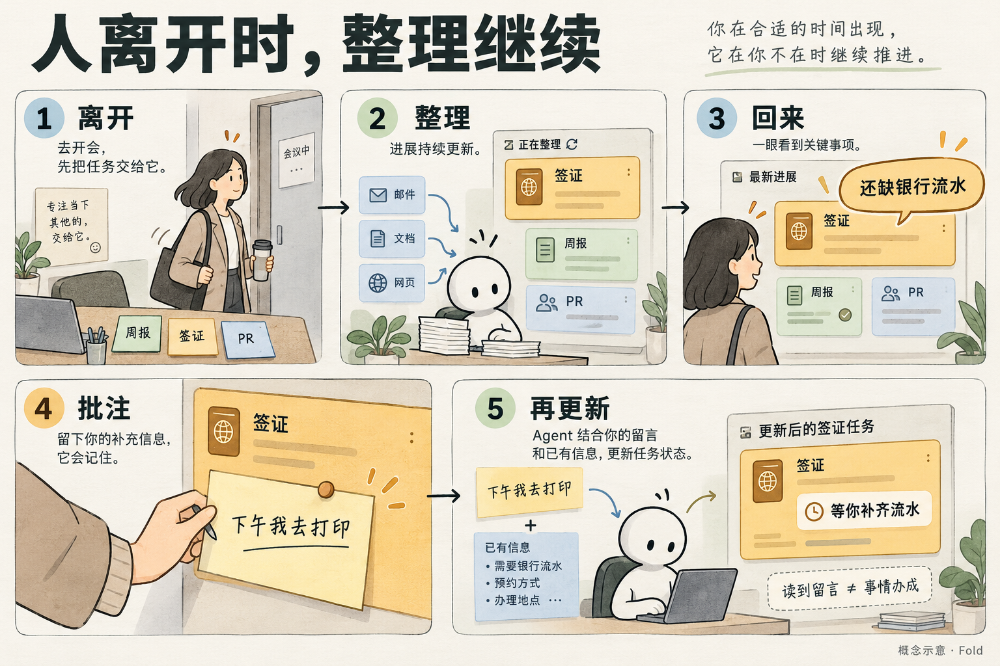
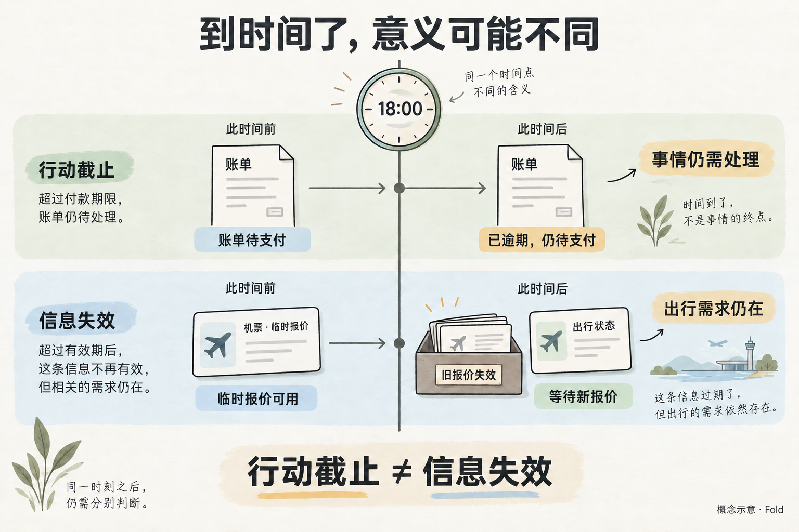
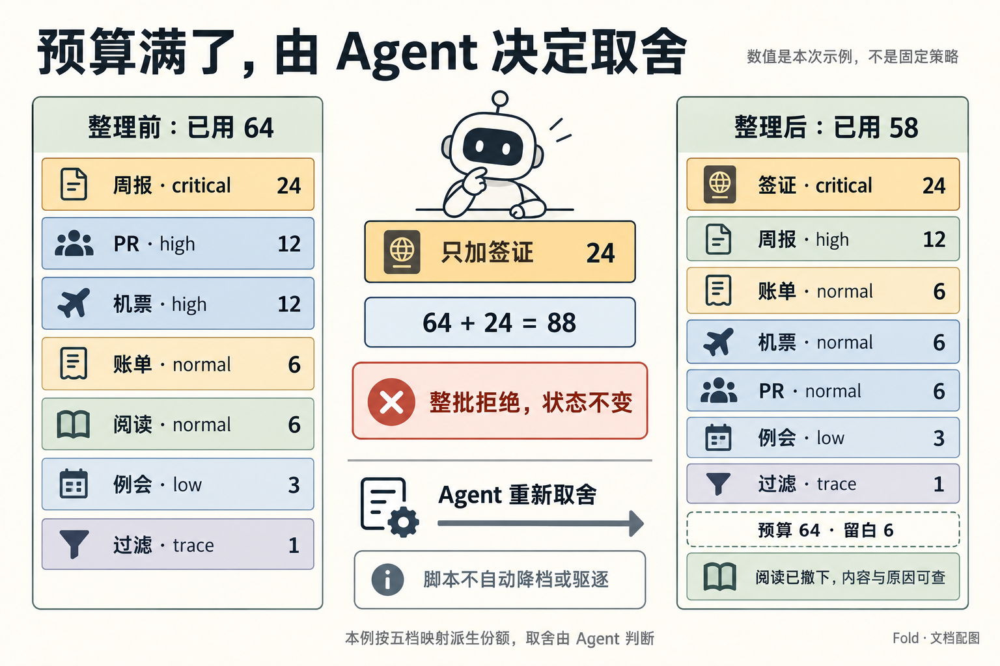
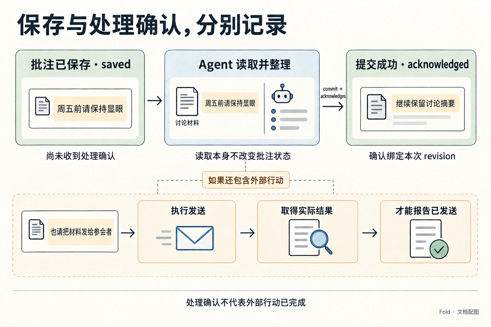
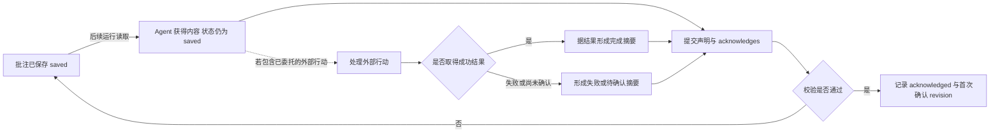
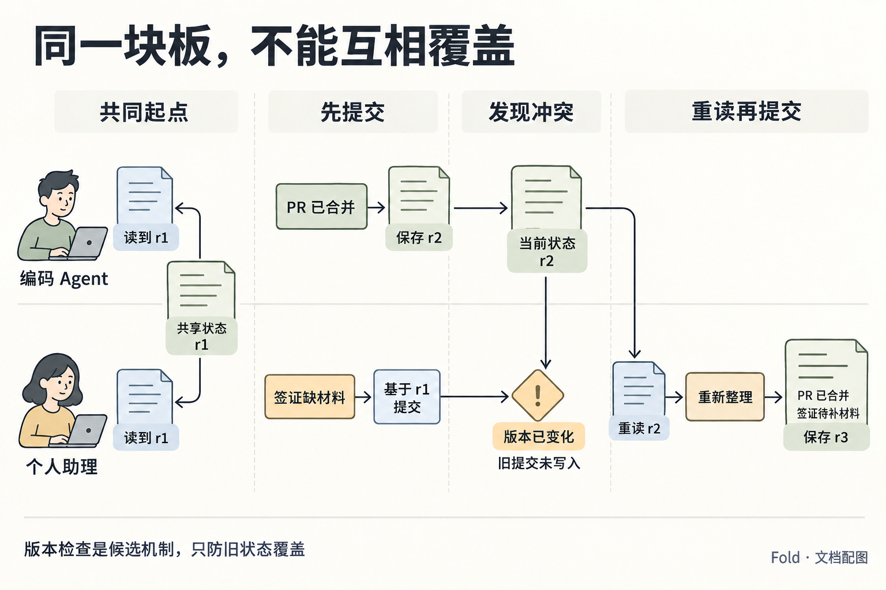
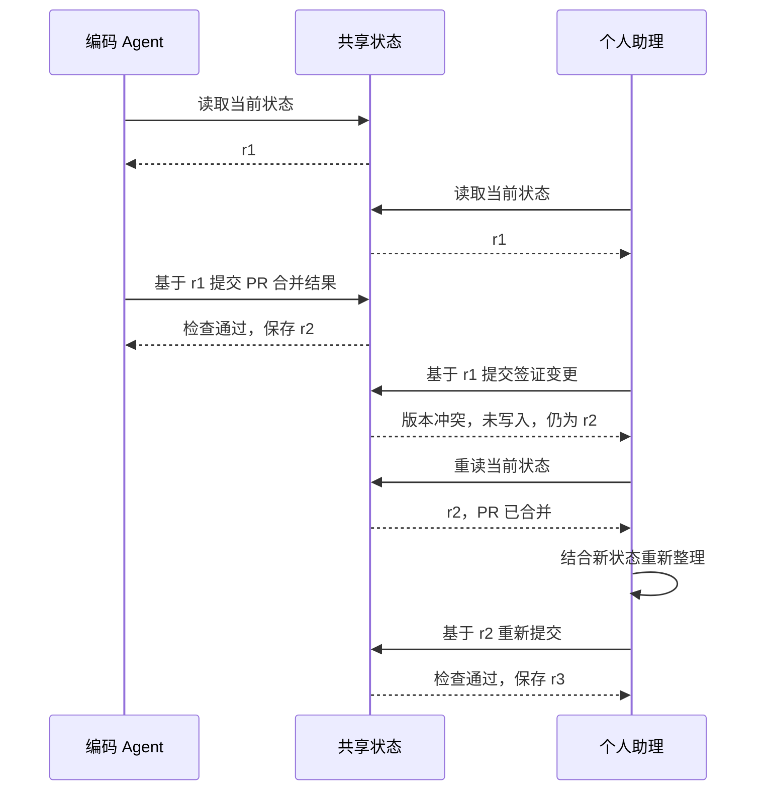

# Fold：从人的一天看设计

状态：首切片设计基线中的体验说明。US-01、US-03，以及 US-02 的时间投影和 US-04 的批注确认属于首切片；US-05 属于后续切片。六组一致性用例见 [conformance/cases](../conformance/cases)，范围与实施顺序见[决策记录](decisions.md)。

人物与数据均为虚构。涉及数字的层统一使用预算 B = 64，默认份额由档位派生：critical 24、high 12、normal 6、low 3、trace 1；需要例外时，声明同时给出 `share` 与 `reason`。

人在场或离开时都能使用 Fold。下面先用“离开半天再回来”验证完整往返；遇到必须立即告知的事情，Agent 先走即时渠道，再把仍值得持续关注的内容纳入状态。

## US-01 · 离开半天，回来就知道下一步

*人离开时继续整理，回来后轻量反馈；读到留言与事情办成是不同事实。*

小林早上把三件事交给 Agent：准备周报、跟进签证材料、查看三个 PR。他已经委托助理在约定的可用时段内代约签证办理，上午则要连续开会，不会盯着聊天窗口。

八点半，Fold 中是“周报起草中”“PR 等待检查”“签证材料核对中”。之后几个小时里，工作持续变化：周报完成，两项 PR 合并，签证代理指出还缺银行流水。

Agent 判断，周报的旧进度已经被结果替代；三个 PR 现在可以一起说；签证需要小林参与，应当更显眼。它整理之后，父层显示：

> **签证材料 · 需要你** 还缺银行流水；周五办理的预约待确认。展开查看材料要求。
>
> **周报草稿 · 待你过目** 草稿已完成，收入数字有一处需要核对。
>
> **PR 进展 · 推进中** 2 / 3 已合并，剩余一项等待 CI。

中午回来，小林没有读完半天的过程消息，也没有逐个打开 PR。他先知道自己需要补流水、核对一个数字，其他工作还在推进。

点开签证后，子层用自己的预算展示流水要求、预约情况与已经备齐的材料。父层份额表示签证在所有事情中的关注价值；子层份额表示此刻查看签证时各项细节的相对重要性，两者不按比例相乘。

小林在签证上写：“下午我去打印，周五按之前说的时间约。”保存后，这句话以 `saved` 留在条目上，表示尚未收到处理确认，不推断 Agent 是否已经读到。小林继续开会，不必等助理在线。

下午 Agent 开始下一轮工作，先读状态和批注，并在原有委托范围内完成预约。收到预约确认后，它提交一次带 `acknowledges` 的整理，把摘要更新为：

> **签证材料 · 等你补齐** 已约周五 10 点；等你下午打印的银行流水。

同一批次把预约子项更新为“已确认周五 10 点”，并保留银行流水待补齐的子项。父层仍是 `needs-you`，预约子项可以是 `done`；父子 `kind` 不必相同，但关于预约是否完成的事实必须相符。预约失败时，相关摘要如实显示失败或待确认。

批注在这次接受的整理中变为 `acknowledged`，绑定首次确认的 revision；银行流水仍未补齐，签证条目不显示“全部完成”。

首切片不采集人的查看动作，`last_seen_at` 与 `since_seen` 均为 `null`，表示未采集；不能从 Agent 读 `state` 或用户留下批注推断阅读时间。用户确实回来查看是故事事实，但当前工具尚不记录这种行为。

如果下午提交后没有收到回执，Agent 先核对此次整理是否已经保存，不重新制造一遍进展。具体批次身份、查询与重试行为见[信息契约](information-contract.md)。

**做对的观察：** 小林只看父层就能复述自己下一步要做什么，打开细节能找到相符的事实；批注确认与事情办成保持区分，重试不会重复执行。

**失败对照：** 板上同时留着“周报起草中”和“周报完成”；签证只写“详见子板”；用户刚保存批注，界面就显示“已处理”。

## US-02 · 同样是今天 18 点，过了之后却不同

*同一个时刻，不对应同一种撤下规则。*

这一天，小林有一张今天 18 点前应支付的账单，也在比较一张有效至今天 18 点的临时机票报价。前者的 18 点是 `due_at`，后者的 18 点是 `stale_after`。

下午 Agent 整理时，账单仍待支付，报价仍可用于当前选择。读取视图里两项都显示“还剩 3 小时”，剩余时间短可能反而让小林更需要现在看到它们。

18 点之后，小林仍不在场。Agent 下一次整理时，读取视图显示账单“已逾期 2 小时”、报价“依据已过期 2 小时”，两项的 `status` 都还是 `active`。它做出两个不同判断：

> **账单 · 已逾期，仍待支付** 截止时间已过，当前记录仍为未支付。

账单继续保留，因为尚未解决的事情仍然存在。Agent 结合后果与其他事项重新判断档位，脚本不因时间已过撤下它。

旧报价不再作为“可购买的方案”展示。出行仍需安排，当前条目变为：

> **机票选择 · 待新报价** 原报价已失效，尚未获得可用的新报价。

旧报价的金额与来源留在历史里。它失去的是作为当前购买选项的资格，不是整个出行事项。

晚上小林回来，看到账单仍需处理，也知道不能再按旧价格决策。他留下“账单我刚付了”，这条批注先被保存；Agent 后续根据批注及可获得的支付结果更新状态，不假装自己已经查到外部系统的确认。

**做对的观察：** 两项输入相同的时间，不会产生相同的机械撤下结果；用户能区分“事情未完成”和“原有信息已不适用于决策”。

**失败对照：** 午夜一到，所有带日期的条目都消失；或机票价格失效后依然像可购买报价一样展示。

## US-03 · 板满了，更重要的事又来了

签证缺材料的消息出现前，小林的父层预算已经用满。Agent 看到完整的当前状态，也知道签证会影响已经计划好的出差，而阅读推荐今天没有必须处理的后果。

*Agent 决定让位，脚本按档位计算并校验；整理后占用 58，留下 6 份空白。*

如果 Agent 只加入签证而不调整其他项，脚本返回“预算 64，声明 88，超出 24”和每项份额，状态不变。它不会自行决定阅读推荐先走、周报降一档；谁让出多少，由 Agent 在第二次提交里说明：

| 条目 | 整理前档位（份额） | 整理后档位（份额） | Agent 对本次变化的解释 |
| --- | --- | --- | --- |
| 签证材料 | 无 | critical（24） | 新发现缺材料，需要小林参与，会影响出差安排。 |
| 周报 | critical（24） | high（12） | 进度可缩短表达，为签证让位。 |
| PR 进展 | high（12） | normal（6） | 相关进展可以合并说明。 |
| 机票监控 | high（12） | normal（6） | 保留当前结论，详细比较可展开。 |
| 账单 | normal（6） | normal（6） | 尚待处理，本次没有足够依据减少关注。 |
| 阅读推荐 | normal（6） | 撤下 | 暂离当前层，内容与撤下原因仍可查。 |
| 明早例会 | low（3） | low（3） | 不变。 |
| 邮件过滤 | trace（1） | trace（1） | 不变。 |
| **合计** | **64** | **58** | 第二次提交通过，留白 6。 |

小林回来后看见签证最大，周报仍然可辨认，账单没有因为其他事情到来而无声消失。他也能在历史里查到阅读推荐为什么撤下，并批注：“那篇文章是明天讨论要用的，请放回来。”

这条新信息改变了 Agent 的判断依据。下一轮重新纳入阅读条目并安排档位，延续原有内容与历史，而不是套用“阅读永远比签证次要”的固定表。新方案仍要满足预算，哪项进一步缩小根据当时的完整状态决定。

如果被撤下的条目带有细节，用户仍应能找回资料与尚未确认的批注；重新展示哪些内容，由 Agent 明确选择。操作规则见[信息契约](information-contract.md)，撤下不能成为忽略用户反馈的方式。

**做对的观察：** 可以核对两次总量与每项变化；每次取舍能归因到 Agent 的明确判断和 `reason`；用户提供新背景后，原来的选择可以被修正。

**失败对照：** 脚本悄悄挤出最低份额项，Agent 却报告全部按原计划展示；或预算检查通过，就被当作“重要性判断正确”的证明。

## US-04 · 没有点击，不代表不重要

小林连续两天没有展开“周五讨论材料”。Agent 可能猜测他不关心，也可能猜测父层摘要已经足够，但首切片根本没有采集这项阅读行为；`since_seen: null` 不能被解释成“从未看过”或“不感兴趣”。

第二天小林回来，发现它仍在板上，便留下一句：“这件事我每天扫摘要就够了。周五之前请保持显眼，别因为我不点就撤掉。”随后他离开。

这条批注让 Agent 获得了比点击行为更直接的偏好。它下一次读取时，把“保持可见直到周五讨论前”纳入后续整理，而不是等待一个脚本把未点击次数换算成更低份额。

小林能看到反馈到了哪一步：

| 时刻 | 人能看见的说明 | 这句话能证明什么 |
| --- | --- | --- |
| 刚保存，状态 `saved` | “你的批注已保存，尚未收到处理确认。” | 批注已留存，不能据此判断 Agent 是否读到或正在处理。 |
| 带新 `acknowledges` 的提交接受后，状态 `acknowledged` | “已在本次整理中确认：讨论摘要继续保留在父层。” | 处理确认绑定首次确认的 revision；不代表周五讨论已经完成。 |

*saved 表示尚未收到处理确认，acknowledged 表示已在整理中确认；外部行动完成需要实际结果。*

`state` 读取不改变批注状态。Agent 可能已经读到或开始处理，但在带确认的提交被接受前，状态仍为 `saved`；这个名称只描述系统已记录的事实。

如果现有摘要已经符合小林的要求，Agent 只需确认这条反馈，不必重写相同的内容。之后再次检查，没有变化就记录“检查过，仍维持当前状态”，用户不会误以为事情刚有了新进展。确认、复核与版本的精确规则见[信息契约](information-contract.md)。

如果用户的批注同时包含一件外部行动，例如“也请把材料发给参会者”，读到这句话与发出材料仍是两步；只有实际执行结果支持时，才能在 `summary` 和 `kind` 里报告已发出。

周五过后也不自动撤下：Agent 需要看讨论是否发生、是否产生了新的待办，再决定当前应留下什么。

**做对的观察：** 用户的明确偏好进入下一轮整理；用户能区分“留言已保存”“处理已确认”和“外部行动已完成”；无变化复核与重复确认不会伪造新进展。

**失败对照：** 把未采集的阅读时间当作未点击并自动降份额；批注被读取后就从记录里消失；或用一个“已完成”标记同时代表处理确认、条目已改与外部事项已办。

## US-05 · 两个 Agent 更新，仍然是同一个人的板

本故事属于后续切片，规则已在[决策记录](decisions.md)中写明，首切片不实现。

小林分别请编码 Agent 跟进 PR，请个人助理 Agent 跟进出行。它们面对的是同一个人的父层预算 64，不能各拿一整块板后让小林再负责比较。

上午十点，两个 Agent 读到同一份共享状态 r1。编码 Agent 随后得知 PR 已全部合并，准备缩短 PR 汇报；个人助理同时得知缺签证材料，准备提高签证档位。

编码 Agent 先保存了新的 PR 结果，形成 r2。如果个人助理接着用十点读到的 r1 覆盖整块板，刚才的合并结果就会退回“等 CI”。即使份额总量没有超限，用户看到的事实仍然错了。

提交随附读取时的 revision。存储层发现版本已经变化，拒绝并返回当前 revision；个人助理重读 r2 后，再做自己的取舍。

`revision` 用于判断提交基于哪份状态，`batch_id` 用于判断一次写入是否已经执行；这两个标识解决不同问题，不能相互替代。

*两个 Agent 从 r1 出发，先接受的提交形成 r2，旧版提交被拒绝后重读重提。*

版本检查只防止旧状态静默覆盖新状态。它不防止另一种失败：编码 Agent 认为签证该降档，个人助理认为该升档，每轮互相改写。因此这个后续场景还需要明确改动范围与请求他人让位的方式，方向见[决策记录](decisions.md)；共享预算不自动赋予改写彼此条目的权利。

无论哪个 Agent 先后提交，用户回来时应看见两项最新事实：

> **签证材料 · 需要你** 还缺银行流水，请看材料要求。
>
> **PR 进展 · 已完成** 3 / 3 已合并。

当天晚上，小林想起早上的阅读推荐不见了。历史中的撤下记录说明了谁、何时、为何作出这次调整：

> 10:12，个人助理在纳入签证材料时撤下阅读推荐，为当前需要参与的事项腾出关注份额。推荐原文、来源和此前批注仍可查看。

条目如果只是被合并进别处，历史指向合并后的内容，“离开当前层”和“被删除”不混在一起。

**做对的观察：** 共享预算没有变成各 Agent 的独立额度；一次更新不会无声抹去另一次；两个 Agent 不会互相拉锯；人能查明“谁、何时、为何、改了什么”。

**失败对照：** 后写入者无条件覆盖；脚本为了合并两次声明自行裁定重要性；或条目撤下后只能看到“已过期”，无法找到真实原因和原有批注。

## 这些故事要帮助我们设计什么

| 故事 | 切片 | 需要对齐或验证的能力 |
| --- | --- | --- |
| US-01 | 首切片 | 覆盖旧进度，合并相关汇报，父子事实一致，子层独立预算，批注确认与重试。 |
| US-02 | 首切片的时长投影，撤下判断属于 Agent | 区分 `due_at` 与 `stale_after`，保留仍需处理的事项，避免把失效的依据当成可用事实。 |
| US-03 | 首切片 | 超额整批拒绝，Agent 自行让位，可核对的预算与变化，`reason` 可追溯。 |
| US-04 | 首切片的 acknowledge 与 checked 机制 | 用户偏好参与判断，批注保存与处理确认分开，无变化复核不伪造进展。 |
| US-05 | 后续切片 | 多 Agent 共享预算，revision 检查，条目改写权，改动归属与原因。 |

预算与引用等结构约束由脚本验证；摘要是否遗漏关键事实、档位是否合乎用户处境，需要结合故事观察 Agent 与人的实际理解。原始细节可追溯不等于摘要在语义上无损。继续见[形式模型](formal-model.md)。
