<!-- 状态：给第一次了解 Fold 的人从头读到尾的说明，不是规范出处。十四段沿用原 16 页小册子的故事线，每段至少一张图，
     只看图和图注也能顺下来。版式在 site/.vitepress/theme/why.css；标题与引句用 Fold Serif SC 子集，改了字要重跑
     node scripts/landing-fonts.mjs。图在 docs/assets/why/：d-*.webp 是按演示数据画的示意，其余是原型截图，
     例子取自 composite 演示数据的 f22（8 月 14 日零点）；重画与重拍用 node scripts/why-figures.mjs，见 docs/development.md「为什么要做 Fold」。 -->

<article class="fw">

<header class="fw-head">

从头读起

# 为什么要做 Fold

Fold 替一个人整理 Agent 看到的一切，只给他此刻最值得看、也看得过来的那部分。下面用一个人的两周，分十四段讲它为什么要做、怎么做、做到了哪。读完约十分钟。

<figure class="fw-fig is-cover" style="--max: 360px">

<figcaption>8 月 14 日零点。Jonas 离开了半天，这期间进来 172 条。他掏出手机，第一屏只说：5 件事等你回应，最急的是猫。</figcaption>
</figure>

<nav class="fw-toc" aria-label="本篇十四段">

1. [有尽头的通知](#notifications)
2. [一百多条里的两件](#two-of-many)
3. [头版只有那么大](#front-page)
4. [Jonas 的两周](#two-weeks)
5. [大体判得对](#mostly-right)
6. [错在轻重](#where-it-errs)
7. [同一场比赛](#same-game)
8. [抬腕一眼](#glance)
9. [坐到桌前](#desk)
10. [什么时候到期](#when)
11. [回头看两周](#review)
12. [按下之后](#after-answer)
13. [亲手试一下](#try)
14. [做到了哪](#where-we-are)

</nav>

</header>

<section class="fw-sec">
<header class="fw-rail">

01 · 问题从哪来

## 有尽头的通知 {#notifications}

</header>

你手机上有几个 App 会给你发通知？

每一个都有尽头。幼儿园的 App 一周发几条，银行只在扣款时响一声，工作群热闹一阵也会安静下来。每个 App 只管自己的事，事情有多少，消息就有多少。

排先后的一直是你。孩子发烧比论坛新帖要紧，家里漏水比订阅的周刊要紧。没有哪个 App 替你排，因为没有哪个 App 看得见别的 App。

Agent 不一样。你让它替你看着工作、家里的群、孩子的学校、银行和订阅，它就全看着。它不累，也不漏，来源只会越加越多。

<figure class="fw-fig">

<figcaption>以前每个 App 只管自己的事，两周也就十来条。现在 Agent 同时看着全部，三千多条；你抬腕看一眼，只看得过来一小块。</figcaption>
</figure>

> 它看见的没有上限，你看得过来的有。

你看得过来多少，还要看你在做什么。骑车时只能瞄一眼手表，坐在电脑前能多看一些，周末停下来复盘，才有工夫从头看到尾。

所以排先后这件事，第一次可以交给别人做，也只能交给别人做。总有一刻，Agent 得替你决定，哪些先不给你看。

它该给你看哪些？

</section>

<section class="fw-sec">
<header class="fw-rail">

02 · 为什么难

## 一百多条里的两件 {#two-of-many}

</header>

演示里有一个化名的人，叫 Jonas。他维护一个开源软件，家里有伴侣、两个孩子、一只猫，房子正在修。

8 月 13 日中午到半夜，他离开了半天，进来 172 条。急着要他拿主意的只有两件：猫可能多吃了药，要不要一早打给诊所；母亲楼里要换水管，那六周住哪。

<figure class="fw-fig">

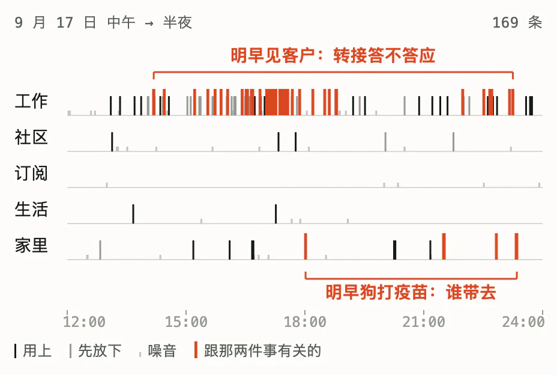

<figcaption>那半天的 172 条，一条一道竖线，按来源分行。灰的没用上，黑的用上了；跟那两件急事有关的，只有朱红的几条。</figcaption>
</figure>

难在把这两件挑出来。看其中几条，和 Agent 怎么处理：

| 进来的 | Agent 的处理 |
| --- | --- |
| 自然论坛里有人聊相机防抖 | **噪音。** 他只是关注了这个版块 |
| 订阅的技术周刊 | **噪音。** |
| 幼儿园提醒：热浪里早上给孩子涂防晒 | **先放下。** 儿子病着在家，暂时用不上 |
| 问答站上一个陌生人的留言：这种药，猫一天超过 5 毫克每公斤就不该再吃 | **用上。** 这正是他两天前在那里问的事 |
| 伴侣：明早 8 点整打给诊所 | **用上。** |

写得认真的被放下，一个陌生人的留言却最要紧。同一条幼儿园通知，换一个下午就该用上。

规则做不了这件事。它认得出机器人和“谢谢”，认不出“写得认真，但和你无关”。

> 要不要紧，不在消息本身，在这个人、这一刻。

还有两处让它更难。**放下的不能凭空消失。** 没给你看的，你得信得过，所以每一条都要有去处，说得出为什么。**你看得过来的量在变。** 同一张清单，放在手表上太长，放在桌前又太短。

谁来判断？判断写在哪里？

</section>

<section class="fw-sec">
<header class="fw-rail">

03 · 第一个判断

## 头版只有那么大 {#front-page}

</header>

报纸的头版只有那么大。

每天的稿子远多于版面。编辑的活儿就是取舍：哪条上头版，占多大，哪条放进内页，哪条不登。版面不会变大，变的只是取舍。

Fold 让 Agent 当这个编辑。每半天，它读完新进来的全部，重排一份头版：眼下有哪几件事，每件占多大，哪几件在等你拿主意。每一条消息都记下去处，用上、先放下、噪音或重复，再附一句理由。

<figure class="fw-fig">

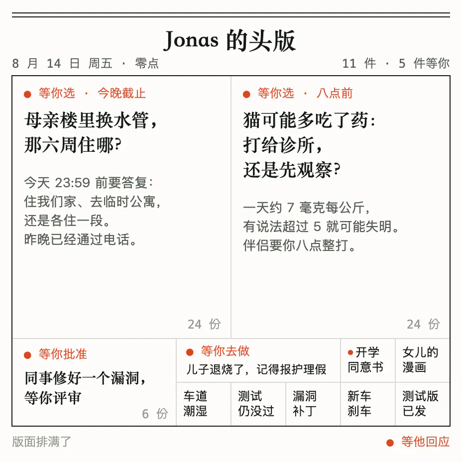

<figcaption>8 月 14 日零点的头版。母亲住哪、猫的药量各占一大块，评审和报护理假小一些，七件小事各占一小格。朱红的是在等他回应的。</figcaption>
</figure>

**判断交给模型。** 只有读懂了，才分得出猫的药量和论坛的照片谁轻谁重。这一步，以前只有人做得了。

**边界交给规则。** 版面多大是固定的。放不下，整份退回，写明超了多少；先撤哪件，由它自己定。规则只换算、检查、记账，不替它拿掉任何一件。

<figure class="fw-fig">

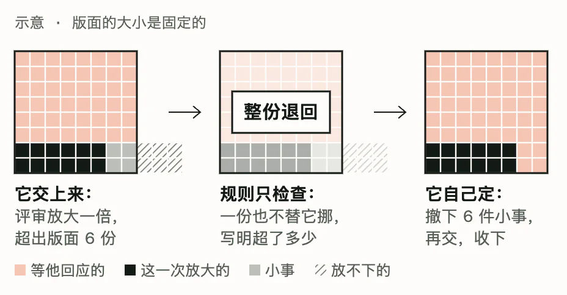

<figcaption>示意。它想把评审放大一倍，版面超了 6 份。规则整份退回，一份也不替它挪；它自己撤下 6 件小事，再交，才收下。</figcaption>
</figure>

版面固定，取舍才是真的：多放一件，就有一件要变小。不固定，这份头版很快会变成另一个收件箱。

原型里，版面切成 64 份，一件事占几份，就画多大。64 只是演示选的数，可以改。

这份头版，在 Fold 里叫“状态”。它排得准吗？要回答，先得有一份像真的两周。

</section>

<section class="fw-sec">
<header class="fw-rail">

04 · 用什么数据

## Jonas 的两周 {#two-weeks}

</header>

手写的例子太干净。真实的收件箱里，大多数消息写得认真，却和你无关。

所以 Jonas 的两周是拼起来的，取自真实的公开文本。工作那一路，是一位开源软件维护者两周的公开往来；社区那一路是一个自然观察论坛；生活那一路是问答站上的真实提问；订阅是周刊和天气提醒。人名、账号、项目都换成了化名。

家里那一路不能用真人的私信。伴侣、孩子、母亲和邻居的消息，由作者照真实的语气写成。

<figure class="fw-fig">

<figcaption>两周，每半天一列，五路来源。家里的消息只占八分之一，要他回答的问题却有一半来自家里。</figcaption>
</figure>

拼接也有接缝：有人住公寓，又有人有车道。这些不一致来自拼接，不是 Agent 读错了。

数据有了。让真实的模型跑一遍，会怎样？

</section>

<section class="fw-sec">
<header class="fw-rail">

05 · 判得怎么样

## 大体判得对 {#mostly-right}

</header>

我们让真实的模型从一张白纸开始，每半天整理一次，连跑两周。条件略有不同，跑了三遍。

三遍都没有跑乱。每一轮都交上了一份合规的头版；偶尔第一次超了字数，看到退回的说明，下一次就改对了。

哪些是噪音，它大体判得对。拿 Jonas 后来做了什么去对照：它判成噪音的，十条里有九条，他确实没再理会。

<figure class="fw-fig">

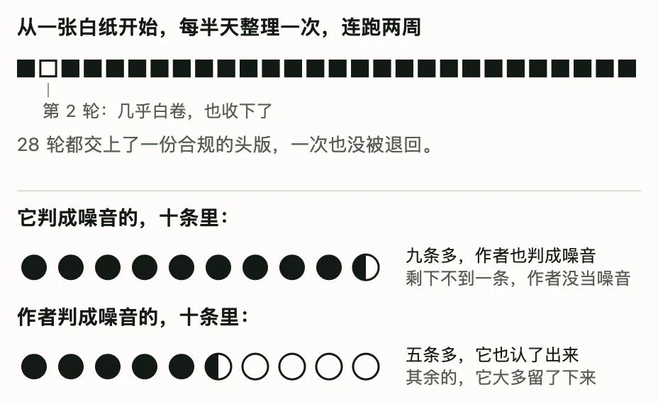

<figcaption>三遍，每遍 28 轮，每一轮都交上了一份头版。它判成噪音的十条里，九条他后来确实没理。</figcaption>
</figure>

在另一组手写的例子上，逐条对照作者自己的答案，结论也一样：该不该用，大多判得一样；轻重，常常差一档。

格式守得住，噪音分得清。那它错在哪？

</section>

<section class="fw-sec">
<header class="fw-rail">

06 · 错在哪里

## 错在轻重 {#where-it-errs}

</header>

儿子发烧，伴侣在手术室走不开。它只给了最低一档，手机首页会把这件收进“其余”里。

朋友把“明早九点骑不骑车”发错了群。它却把这件排到了第一。

<figure class="fw-fig">

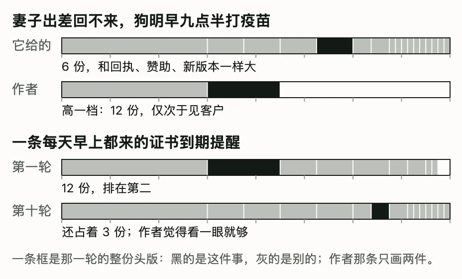

<figcaption>两处判错。儿子发烧只给了 1 份，排在最后，改成 3 份；发错群的骑车给了 12 份、排第一，改成 3 份。</figcaption>
</figure>

> 错的不是格式，是轻重。

第一遍里，工作上的事更容易排在前面；加上家里那一路之后又反过来，家里的事普遍高一档。注意力往哪边偏，换个条件就会变。

这正是难的地方，也是接着要做的地方。演示用的是其中一遍的结果；少数会误导人的判断我们手改过，上面两处都在其中，每一处改动都有[记录](../prototype/data/composite/POLISH.md)。

头版排好了。可人不会总坐在桌前读它。

</section>

<section class="fw-sec">
<header class="fw-rail">

07 · 第二个判断

## 同一场比赛 {#same-game}

</header>

同一场球赛，开车时听广播，在家看直播，第二天看集锦。

比赛是同一场，讲法不同。广播只说比分和谁进了球；直播什么都给；集锦只留下改变比分的那几分钟。讲法跟着你能分出多少注意力走。

这份注意力，我们叫它带宽：这一刻一眼读得下多少，能看多久，手上能做什么。

Fold 的第二个判断：同一刻的头版，按此刻的带宽重新编排。不是把一张大图缩小。挑哪些，按什么顺序，画成什么样，都要重来。

<figure class="fw-fig">

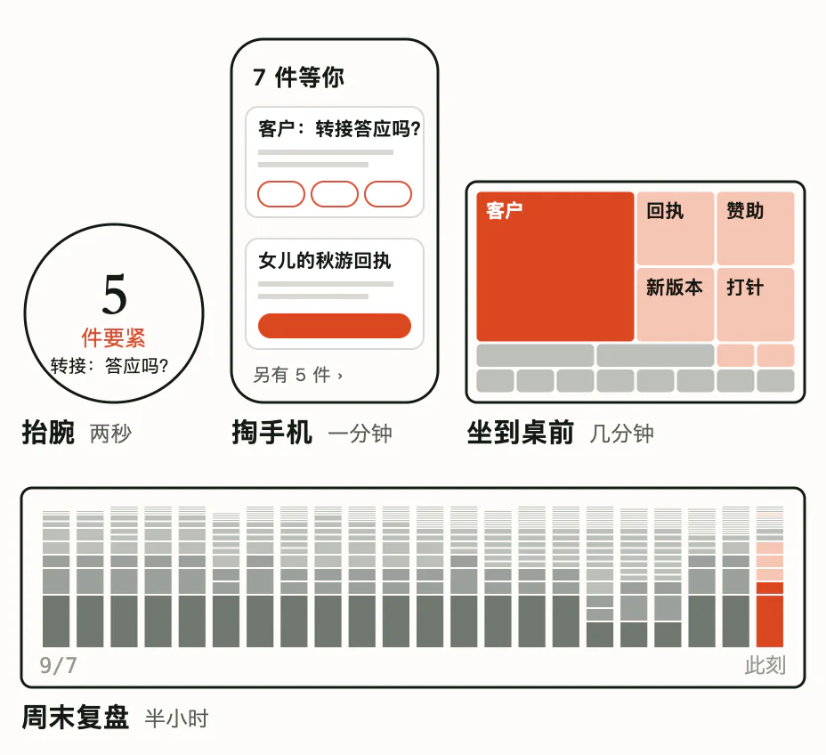

<figcaption>同一刻，四扇窗。抬腕两秒，只数要紧的；掏出手机一分钟，等你回应的排成卡片；坐到桌前几分钟，整份头版铺开；周末复盘半小时，只看两周的走向。</figcaption>
</figure>

原型一共试了二十多种读法，都是表现层上的尝试，读的是同一份回放。下面挨个看其中几种。

抬腕那两秒，该看到什么？

</section>

<section class="fw-sec">
<header class="fw-rail">

08 · 回来一眼

## 抬腕一眼 {#glance}

</header>

手表只回答一个问题：要不要现在掏手机。

表圈上的刻度是整份头版，中间的数只数要紧的事：一天之内到期，或者特别重。8 月 14 日零点是 2 件，最急的是猫，八点前要打电话。

能在表上答的，一次给全：问题、两个大按钮，再加一个“1 小时后再提醒”。母亲住哪是三选一，表上答不了，留给手机。

<figure class="fw-fig" style="--a: 0.8255">
<a class="fw-shot" href="../prototype/forms/watch.html?frame=22" target="_self" data-vp-ignore>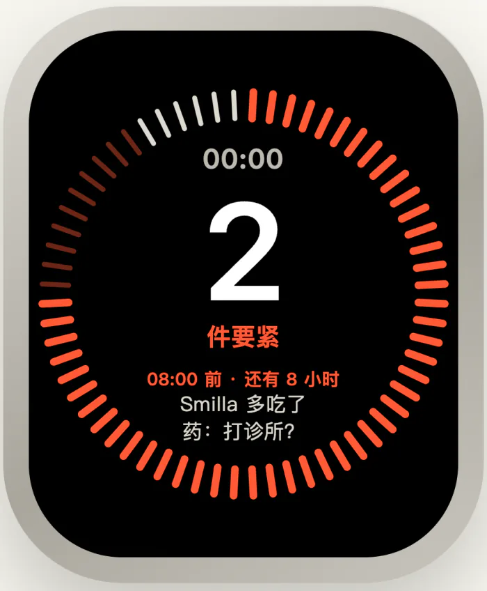</a>
<figcaption>抬腕：2 件要紧，最急的一件写成一句话。</figcaption>
</figure>
<figure class="fw-fig" style="--a: 0.8255">
<a class="fw-shot" href="../prototype/forms/watch.html?frame=22" target="_self" data-vp-ignore>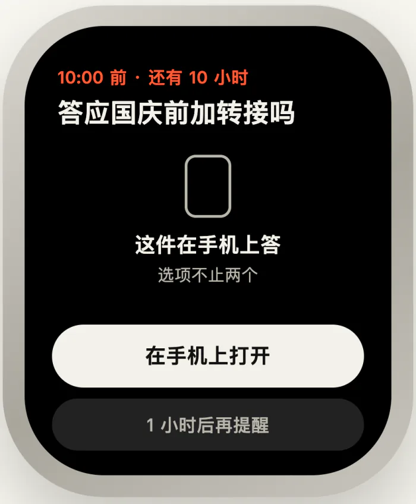</a>
<figcaption>点开：能当场答的，就给大按钮。</figcaption>
</figure>

掏出手机，就是开头那一屏：顶上一句先说几件在等你，最急的几件排成大卡，按钮上写明怎么答。

坐到桌前，有几分钟呢？

</section>

<section class="fw-sec">
<header class="fw-rail">

09 · 在电脑前

## 坐到桌前 {#desk}

</header>

坐到桌前，可以把整份头版铺开。

格子的面积就是分量。母亲住哪、猫的药量各占一大块，评审和报护理假小一些。不需要他做什么的小事，合成一格“另有 6 件小事”，点开再看。

<figure class="fw-fig" style="--max: 434px">

<figcaption>桌前的版面。面积就是分量，红点是在等他回应的，六件小事合成一格。</figcaption>
</figure>

等他批准的评审，在旁边点一下“批准”就行。

这块版面只说此刻。哪件事什么时候到期？

</section>

<section class="fw-sec">
<header class="fw-rail">

10 · 什么时候

## 什么时候到期 {#when}

</header>

有些事，要看的不是多重，是什么时候。

一种读法把期限画在“此刻”这条线的右边。猫的电话还有 8 小时，母亲那边的答复还有 24 小时，谁先到一眼就看得出；过了期限的，写明过了多久。

另一种把每件事画成一滴水，越重越大。你把一件事推到傍晚六点，它就沉到水面以下，到点再浮上来。

<figure class="fw-fig" style="--a: 0.6761">
<a class="fw-shot" href="../prototype/index.html?variant=b&amp;frame=22" target="_self" data-vp-ignore>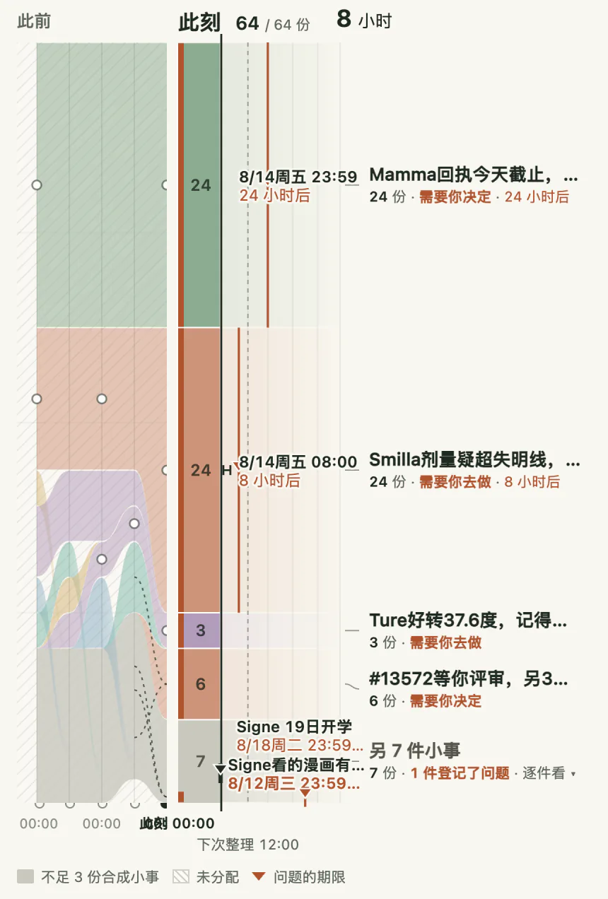</a>
<figcaption>零点：期限画在此刻之后。猫的电话 8 小时后到期，最近。</figcaption>
</figure>
<figure class="fw-fig" style="--a: 0.6232">
<a class="fw-shot" href="../prototype/index.html?variant=c&amp;frame=22" target="_self" data-vp-ignore>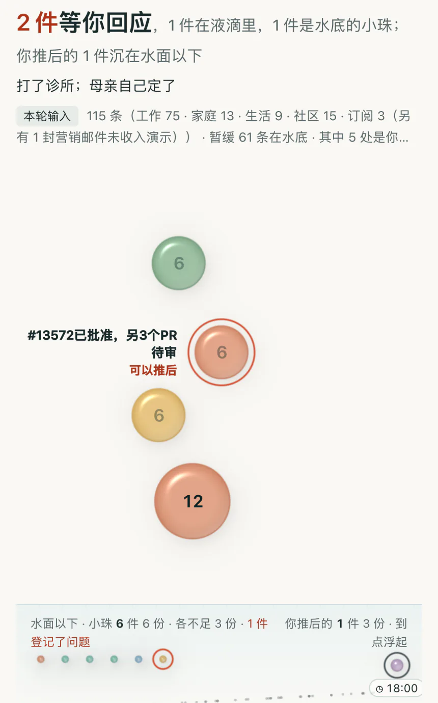</a>
<figcaption>中午：推后的那件沉在水下，标着 18:00；猫已经打过电话，那一滴缩小了一半。</figcaption>
</figure>

一刻一刻地看，看不出两周里发生了什么。复盘时看什么？

</section>

<section class="fw-sec">
<header class="fw-rail">

11 · 复盘

## 回头看两周 {#review}

</header>

复盘不收作答，只回答一件事：这两周是怎么过的。

每半天一张小方阵，按日排开。哪件事什么时候变大、什么时候消失，一眼就看得出：第二周的中间几天，母亲住哪（蓝）和猫的药量（橙）占了大半；到了周末，换成车道下的水管（黄）。

旁边记着每件事的起落，也记着每个问题怎样关上：有的是他答了，有的是事情变了，问题跟着撤下。

<figure class="fw-fig" style="--a: 0.5635">
<a class="fw-shot" href="../prototype/forms/multiples.html?frame=22" target="_self" data-vp-ignore>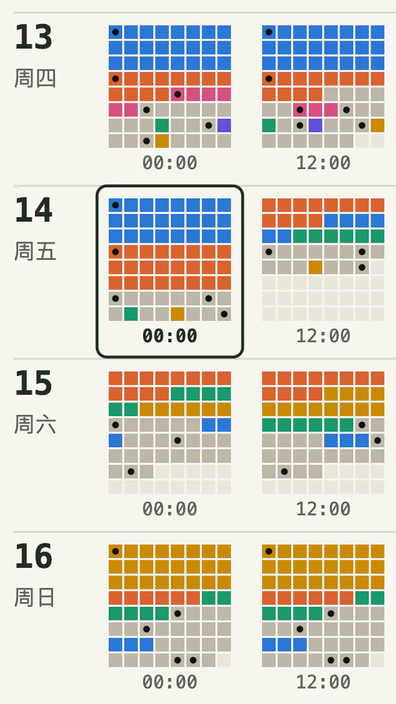</a>
<figcaption>8 月 13 日到 16 日，每半天一张方阵；框出的是 14 日零点。</figcaption>
</figure>
<figure class="fw-fig" style="--a: 0.6061">
<a class="fw-shot" href="../prototype/forms/multiples.html?frame=22" target="_self" data-vp-ignore>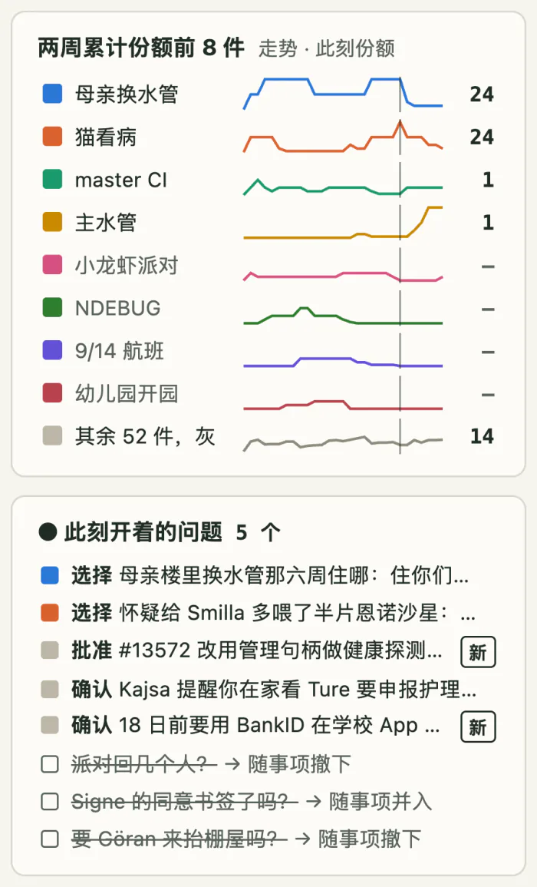</a>
<figcaption>两周分量最多的几件事怎样起落，和此刻开着、刚关上的问题。</figcaption>
</figure>

问题关上，多半靠他的回答。可按下一个按钮，事情就办了吗？

</section>

<section class="fw-sec">
<header class="fw-rail">

12 · 回答之后

## 按下之后 {#after-answer}

</header>

在手机上按下“打给诊所”，事情办了吗？

没有。按下，只是记下了你的回答。Agent 下一轮整理读到它，才算收到。诊所到底打没打，要从之后的消息里看出来。

> 保存、收到、办成，是三件事。

<figure class="fw-fig">

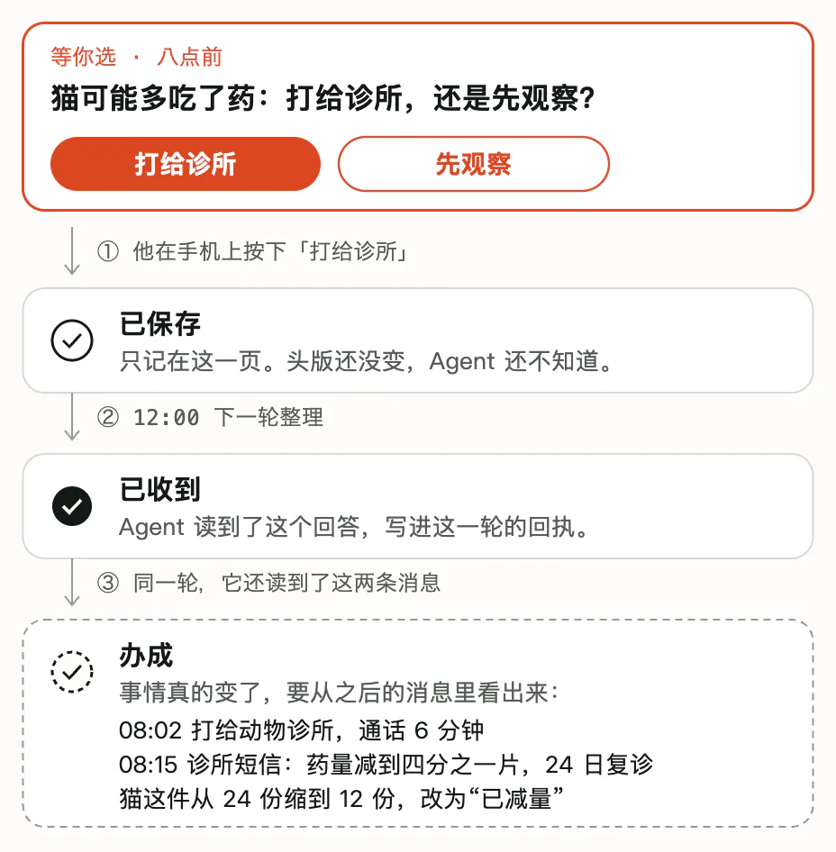

<figcaption>同一个回答的三步。按下时只是保存；下一轮整理读到，才算收到；通话记录和诊所的短信进来，才算办成。</figcaption>
</figure>

所以 Fold 留着的是头版，不是一条条通知。一件事开着，就一直在头版上占着地方，直到之后的消息说明它变了。

而人多半不会回到 Fold 里来答。演示里的回答都来自真实数据，全都发生在原处：在网站上点批准，在消息里回一句，直接打电话。8 月 14 日早上八点，Jonas 直接打给了诊所；下一轮，Agent 读到这条通话记录，猫这件事才缩小一半，改成“已减量，24 日复诊”。

Fold 得认得出这样的回答。

光看不如试一下。

</section>

<section class="fw-sec">
<header class="fw-rail">

13 · 试一下

## 亲手试一下 {#try}

</header>

原型就是这份回放本身：两周，28 轮，可以一轮一轮往前走。

<figure class="fw-fig" style="--max: 329px">
<a class="fw-shot" href="../prototype/index.html?variant=d&amp;frame=22" target="_self" data-vp-ignore>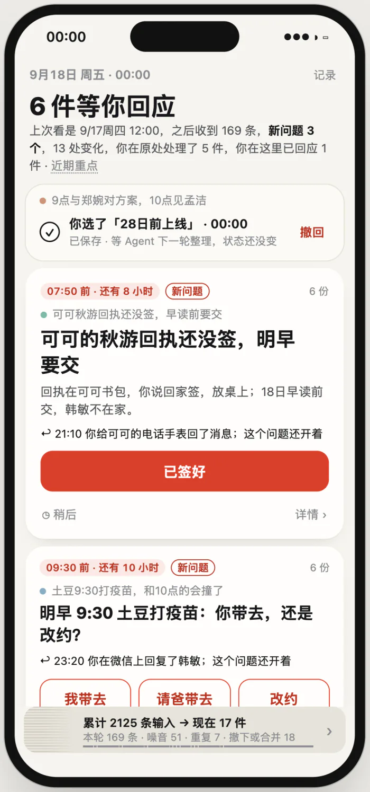</a>
<figcaption>按下“打给诊所”，那张卡收成一行回执：已保存，等 Agent 下一轮整理。</figcaption>
</figure>

<a class="fw-btn" href="../prototype/index.html?variant=d&amp;frame=22" target="_self" data-vp-ignore>亲手试一下 ↗</a>回到 8 月 14 日零点。按下一个答案，再往前走一轮，看回执从“已保存”变成“已收到”。作答只记在你的浏览器里。

看完这些，Fold 走到了哪一步？

</section>

<section class="fw-sec">
<header class="fw-rail">

14 · 现在在哪

## 做到了哪 {#where-we-are}

</header>

**已经有的。**

- 一套设计：Agent 交什么，规则怎么守，状态怎么存。写在[信息契约](information-contract.md)和[架构](architecture.md)里。
- 规则那一半的第一段：在内存里跑通，用[一致性用例](../conformance/cases)逐条检查“超了就整份退回”这类规则。
- 给 Agent 的[判断指引](../skill/SKILL.md)，第二版，在真实数据上跑过，结果见[评测报告](evaluations/README.md)。
- 二十多种读法的[原型](../prototype/README.md)，读的是同一份回放。

**还没有的。** 能装上就用的产品：命令行和接进 Agent 的 skill 都还没做。原型不连真实账户，按下的回答只记在你的浏览器里。

**还缺的。** 头版里还缺几样东西：一件事改了名，怎样认出还是同一件；一个问题什么时候算关上；一件事变大了，是谁给它腾出的地方。这些都记在[未决问题](decisions.md#未决问题)里。

**怎样算有用。** 最后只问一件事：一个人离开半天回来，能不能很快认出要自己处理的事，少漏，也少被打扰。

<figure class="fw-fig">

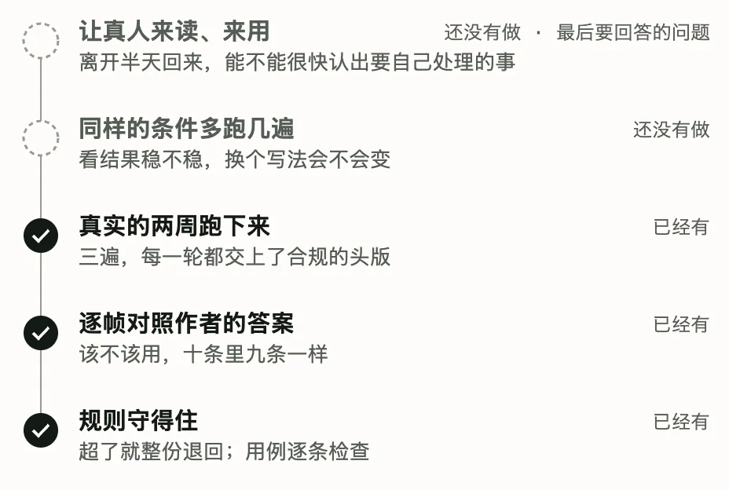

<figcaption>证据从下往上。规则守得住、逐帧大体判得对、两周跑得下来，已经有了；多跑几遍看稳不稳、让真人来读来用，还没有做。</figcaption>
</figure>

现在的证据，是拿作者的答案、拿 Jonas 后来做了什么去对照。让真人来读、来用，是下一步。

<nav class="fw-more" aria-label="接着读">

- [全部原型](../prototype/all.html)：所有读法排在一页里
- [产品方向](product.md)、[用户故事](user-stories.md)：人怎样用它
- [信息契约](information-contract.md)：精确的规则
- [真实语料](../corpus/README.md)：这两周的数据从哪来

</nav>

</section>

<footer class="fw-foot">

Jonas 是化名人物。他的两周取自化名改写的真实公开文本，家里那一路由作者参照真实语气编写；来源与许可见[真实语料](../corpus/README.md)和[演示数据的来源](../prototype/data/composite/SOURCES.md#公开与许可)。

这一篇讲为什么，不是规范出处：精确规则以[信息契约](information-contract.md)为准，范围与次序以[决策记录](decisions.md)为准。

</footer>

</article>
