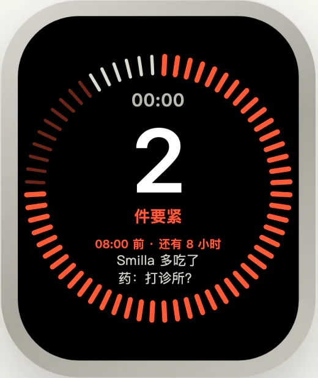

<!-- 状态：给第一次了解 Fold 的人从头读到尾的说明，不是规范出处。版式在 site/.vitepress/theme/why.css；
     标题与引句用 Fold Serif SC 子集，改了字要重跑 node scripts/landing-fonts.mjs；截图与例子取自 composite 演示数据的
     f22（8 月 14 日零点），重拍方法见 docs/development.md「为什么要做 Fold」。 -->

<article class="fw">

<header class="fw-head">

从头读起

# 为什么要做 Fold

从一个日常的问题讲起，到 Fold 的两个判断，再到现在做到了哪。读完约十分钟。

</header>

<nav class="fw-toc" aria-label="本篇七节">

1. [有尽头的通知](#notifications)问题从哪来，为什么以前没有
2. [一百多条里的两件](#two-of-many)为什么难
3. [头版只有那么大](#front-page)第一个判断：让 Agent 当编辑
4. [同一场比赛](#same-game)第二个判断：按处境重新编码
5. [回答之后](#after-answer)按下，不等于办成
6. [模型会错在哪](#where-it-errs)这些判断做得到多少
7. [做到了哪](#where-we-are)有什么，缺什么，怎样算有用

</nav>

<section class="fw-sec">
<header class="fw-rail">

01 · 问题从哪来

## 有尽头的通知 {#notifications}

</header>

你手机上有几个 App 会给你发通知？

每一个都有尽头。幼儿园的 App 一周发几条，银行只在扣款时响一声，工作群吵一阵也会停。它们各管一摊，摊子多大，消息就有多少。

排先后的一直是你。孩子发烧比论坛新帖要紧，家里漏水比订阅的周刊要紧。没有哪个 App 替你排，因为没有哪个 App 看得见别的 App。

Agent 不一样。

你让它替你看着工作、家里的群、孩子的学校、银行和订阅，它就全看着。它不累，也不漏，来源只会越加越多。它是第一个同时看得见你所有事情的东西。

> 看见的没有上限，你接得住的有。

于是排先后这件事，第一次可以交出去，也必须交出去。看见的一定超出你接得住的，总有一刻，Agent 得替你舍掉一些。

舍掉哪些？

</section>

<section class="fw-sec">
<header class="fw-rail">

02 · 为什么难

## 一百多条里的两件 {#two-of-many}

</header>

演示里有一个化名的人，叫 Jonas。他维护一个开源软件，家里有伴侣、两个孩子、一只猫，房子正在修。他的两周取自真实的公开文本：工作上的往来、一个自然论坛、生活问答站、订阅邮件；家里那一路照真实的语气写成。

8 月 13 日中午到半夜，他离开了半天，进来一百七十多条。

急着要他拿主意的，只有两件：猫可能多吃了药，要不要一早打给诊所；妈妈楼里要换水管，那六周住哪。

难在把这两件挑出来。看其中几条，和 Agent 的处理：

| 进来的 | Agent 的处理 |
| --- | --- |
| 自然论坛里一帖“本周最佳照片” | **噪音。** 他只是关注了这个版块 |
| 订阅的技术周刊 | **噪音。** |
| 机器人提醒：他的代码没通过自动测试 | **暂缓。** 后来已经修好 |
| 幼儿园提醒：热浪里早上给孩子涂防晒 | **暂缓。** 儿子病着在家，这条暂时用不上 |
| 问答站上一个陌生人的留言：这种药猫吃多了，可能突然失明 | **用上。** 这正是他前几天在那里问的事 |
| 伴侣：明早 8 点整打给诊所 | **用上。** |

写得认真的被放下，一个陌生人的留言却最要紧。同一条幼儿园通知，换一个下午就该用上。

规则做不了这件事。它认得出机器人和“谢谢”，认不出“写得认真，但和你无关”。

> 要不要紧，不在消息本身，在这个人、这一刻。

还有两处让它更难。

**舍掉的不能凭空消失。** 没交到你眼前的，你得信得过。所以每一条都要有去处，说得出为什么。

**你接得住的量在变。** 抬腕看表只有两秒，坐到桌前有几分钟，周末复盘有半小时。同一张清单，放在哪儿都不对。

谁来判断？判断写在哪里？又怎样按处境交出去？

</section>

<section class="fw-sec">
<header class="fw-rail">

03 · 第一个判断

## 头版只有那么大 {#front-page}

</header>

报纸的头版只有那么大。

每天的稿子远多于版面。编辑的活儿就是取舍：哪条上头版，占多大，哪条进内页，哪条不登。版面不会变大，变的只是取舍。

Fold 让 Agent 当这个编辑。

每一轮整理（演示里半天一轮），它读完新进来的全部，改写一份状态：眼下有哪几件事，每件对你多重要，哪几件在等你拿主意。每一条输入都记下去处，用上、暂缓、噪音或重复，再附一句理由。

**判断交给模型。** 只有读懂了，才分得出猫的药量和论坛的照片谁轻谁重。这一步，以前只有人做得了。

**边界交给规则。** 一份状态能放多少是固定的，像头版的大小。放不下，整批退回，告诉它超在哪里；谁让位，由它自己定。规则只换算、检查、记账，不替它挤掉任何一件。

版面固定，取舍才是真的：多放一件，就有一件要让出来。不固定，状态很快会变成另一个收件箱。

原型里，这份容量切成 64 份，一件事占几份，就画多大。64 只是演示选的数，可以配。

状态写好了。可人不会总坐在桌前读它。

</section>

<section class="fw-sec">
<header class="fw-rail">

04 · 第二个判断

## 同一场比赛 {#same-game}

</header>

同一场球赛，开车时听广播，在家看直播，第二天看集锦。

比赛是同一场，讲法不同。广播只说比分和谁进了球；直播什么都给；集锦只留下改变比分的那几分钟。讲法跟着你能分出多少注意力走。

这份注意力，我们叫它带宽：这一刻一眼读得下多少，能看多久，手上能做什么。

Fold 的第二个判断：同一刻的状态，按此刻的带宽重新编码。

不是把一张大图缩小。挑哪些，按什么顺序，画成什么样，都要重来。

<figure class="fw-quad">

<a class="fw-pane is-watch" href="../prototype/forms/watch.html?frame=22" target="_self" data-vp-ignore><b>抬腕 · 两秒</b>只数要紧的，最急那件给一句话</a>
<a class="fw-pane is-phone" href="../prototype/index.html?variant=d&amp;frame=22" target="_self" data-vp-ignore><b>掏手机 · 一分钟</b>等你回应的排在前，按钮写明怎么答</a>

<a class="fw-pane is-desk" href="../prototype/index.html?frame=22" target="_self" data-vp-ignore><b>坐到桌前 · 几分钟</b>整份状态铺成一块版面，面积就是轻重</a>
<a class="fw-pane is-review" href="../prototype/forms/multiples.html?frame=22" target="_self" data-vp-ignore><b>周末复盘 · 半小时</b>两周每一轮一张小方阵，只看走向</a>

<figcaption>8 月 14 日零点，同一刻的四种读法。每一张都能点开，是原型本身。</figcaption>
</figure>

图里四种都是原型。原型一共试了二十多种读法，都是表现层上的尝试；它们要证明的是同一件事：带宽不同，交出去的东西就该不同。

交出去之后呢？你答了一件，它就算办了吗？

</section>

<section class="fw-sec">
<header class="fw-rail">

05 · 答了就算办了吗

## 回答之后 {#after-answer}

</header>

在手机上按下“打给诊所”，事情办了吗？

没有。按下，只是记下了你的回答。Agent 下一轮整理读到它，才算收到。诊所到底打没打，要从之后的消息里看出来。

> 保存、收到、办成，是三件事。

所以 Fold 留着的是状态，不是通知。一件事开着，就一直在状态里占着位置，直到之后的消息说明它变了。

而人多半不会回到 Fold 里来答。演示里的回应都来自真实数据，全都发生在原处：在网站上点批准，在消息里回一句，直接打电话。8 月 14 日早上八点，Jonas 直接打给了诊所；下一轮，Agent 读到这条通话记录，猫这件事才让出位置。

Fold 得认得出这样的回答。

<a class="fw-btn" href="../prototype/index.html?variant=d&amp;frame=22" target="_self" data-vp-ignore>亲手试一下 ↗</a>打开手机首页的原型，回到 8 月 14 日零点。按下一个答案，再往前走一轮，看回执从“已保存”变成“已收到”。

这些判断，模型真的做得到吗？

</section>

<section class="fw-sec">
<header class="fw-rail">

06 · 做得到多少

## 模型会错在哪 {#where-it-errs}

</header>

我们拿 Jonas 这两周，让真实的模型从一张白纸开始，每半天整理一次，连跑两周，跑了几遍。

格式和容量，它都守得住；哪些是噪音，大体判得对。几遍下来，没有一次跑乱。

错在取舍。

儿子发烧，伴侣在手术室走不开。它只给了最低一档，手机首页会把这件折进“其余”。

朋友把“明早九点骑不骑车”发错了群。它却把这件排到了第一。

> 错的不是格式，是轻重。

这正是难的地方，也是接着要做的地方。演示用的就是其中一次的结果；少数会误导人的判断我们手改过，上面两处都在其中，每一处改动都有[记录](../prototype/data/composite/POLISH.md)。

那么，现在走到了哪一步？怎样才算有用？

</section>

<section class="fw-sec">
<header class="fw-rail">

07 · 现在在哪

## 做到了哪 {#where-we-are}

</header>

**已经有的。**

- 一套设计：Agent 交什么，规则怎么守，状态怎么存。写在[信息契约](information-contract.md)和[架构](architecture.md)里。
- 规则那一半的第一段：在内存里跑通，用[一致性用例](../conformance/cases)逐条检查“超了就整批退回”这类规则。
- 给 Agent 的[判断指引](../skill/SKILL.md)，第二版，在真实数据上跑过，结果见[评测报告](evaluations/README.md)。
- 二十多种读法的[原型](../prototype/README.md)，读的是同一份回放。

**还没有的。** 能装上就用的产品：命令行和接进 Agent 的 skill 都还没做。原型不连真实账户，按下的回答只记在你的浏览器里。

**怎样算有用。** 最后只问一件事：一个人离开半天回来，能不能很快认出要自己处理的事，少漏，也少被打扰。现在的证据只到“守得住规则、大体判得对”，是拿作者的标注、拿他后来做了什么去对照。让真人来读、来用，还没有做。

**还缺的。** 状态里还缺几样东西，比如一个问题什么时候算关上，一件事改了名怎样认出是同一件。它们记在[未决问题](decisions.md#未决问题)里。

<nav class="fw-more" aria-label="接着读">

- [全部原型](../prototype/all.html)：所有读法排在一页里
- [产品方向](product.md)、[用户故事](user-stories.md)：人怎样用它
- [信息契约](information-contract.md)：精确的规则
- [真实语料](../corpus/README.md)：这两周的数据从哪来

</nav>

</section>

<footer class="fw-foot">

Jonas 是化名人物。他的两周取自化名改写的真实公开文本，家里那一路由作者参照真实语气编写；来源与许可见[真实语料](../corpus/README.md)和[演示数据的来源](../prototype/data/composite/SOURCES.md#公开与许可)。

这一篇讲为什么，不是规范出处：精确规则以[信息契约](information-contract.md)为准，范围与次序以[决策记录](decisions.md)为准。

</footer>

</article>
